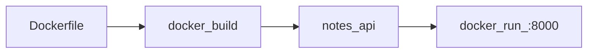
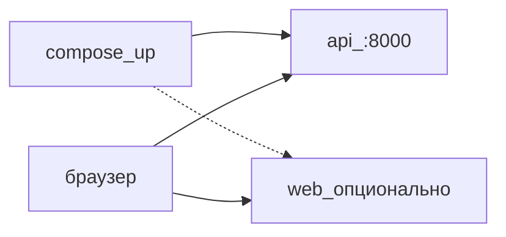
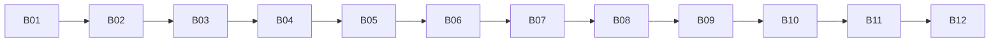

## Введение

B10 · Docker · образ FastAPI Тема выпуска: Docker: образ API.

**Compose: поднять приложение.** B11 · Compose · API (+ UI) Тема выпуска: Compose: поднять приложение одной командой.

**Склейка.** B12 · Склейка · чеклист первого приложения

## Раздел: Как отвечать одним блоком

Этот выпуск собрал соседние короткие темы трека: «Docker: образ API», «Compose: поднять приложение», «Склейка». Раньше каждая занимала отдельную карточку на несколько минут, а на собеседовании их спрашивают одним блоком. Ниже у каждой темы свой раздел, затем общие лабы, один тест и одна колода карточек. В ответе сначала назовите, какую тему спросили, потом определение и один пример. Не проговаривайте все разделы, если спросили один. Лабы можно пройти по порядку исходного трека. Если времени мало, сделайте первую и последнюю: первая ставит язык, последняя проверяет, что соседние темы вы не перепутали.

## Раздел: Docker: образ API: Основная часть

Друг без вашего venv должен поднять тот же API из [B07](/game/learn/b05-api-check). Для этого — образ.

`api/requirements.txt`:

```
fastapi[standard]==0.115.6
```

`api/Dockerfile` (пример):

```dockerfile
FROM python:3.12-slim
WORKDIR /app
COPY requirements.txt .
RUN pip install --no-cache-dir -r requirements.txt
COPY . .
CMD ["uvicorn", "main:app", "--host", "0.0.0.0", "--port", "8000"]
```

Если код в `api/main.py` и контекст сборки — папка `api/`:

```bash
cd api
docker build -t notes-api .
docker run --rm -p 8000:8000 notes-api
```

Проверка как в [B05](/game/learn/b05-api-check): `curl localhost:8000/health`.

Граница. UI в образ пока не кладём — в [B11](/game/learn/b10-docker) решим через Compose (API + dev UI или статика).

Следующий: [B11 · Compose](/game/learn/b10-docker).

## Раздел: Docker: образ API: Частые вопросы с собеседования

Короткие ответы на вопросы, которые чаще всего звучат по теме выпуска. Развёрнутая проверка — в тесте ниже.

**Зачем Dockerfile для API?** Зависимости внутри образа.

**Что копируют в образ обычно?** Не venv с хоста.

**Какая команда собрать образ?** Тег удобен для compose.

**Зачем EXPOSE/порты?** Публикация — в run/compose.

**Почему .dockerignore нужен?** Не тащить node_modules/.git.

## Раздел: Docker: образ API: Шпаргалка

```bash
docker build -t notes-api .
docker run --rm -p 8000:8000 notes-api
```

Не коммитить секреты. Compose: [B11](/game/learn/b10-docker).

## Раздел: Compose: поднять приложение: Основная часть

`docker-compose.yml` в корне `notes`:

```yaml
services:
  api:
    build: ./api
    ports:
      - "8000:8000"
```

Запуск:

```bash
docker compose up --build
```

Опционально добавьте сервис `web` (nginx со статикой после `npm run build`) или оставьте UI на `npm run dev` против `localhost:8000` — для учёбы оба варианта ок. Главное: **API поднимается одной командой**, как обещали в [B01](/game/learn/b01-karta).

Проверка: [B05](/game/learn/b05-api-check) + форма из [B09](/game/learn/b05-api-check).

Следующий: [B12 · склейка](/game/learn/b10-docker) — чеклист и README для портфолио / взаимного продвижения на 9to18.

## Раздел: Compose: поднять приложение: Частые вопросы с собеседования

Короткие ответы на вопросы, которые чаще всего звучат по теме выпуска. Развёрнутая проверка — в тесте ниже.

**Что даёт docker compose up?** Сервисы из yaml вместе.

**Где описаны сервисы?** build/ports/environment.

**Зачем сервис api отдельным блоком?** UI может жить отдельно или рядом.

**Как пересобрать после правки кода?** Иначе старый образ.

**Что проверить после подъёма?** Сценарии B05/B09.

## Раздел: Compose: поднять приложение: Шпаргалка

```bash
docker compose up --build
```

Связи: [B10](/game/learn/b10-docker), финал: [B12](/game/learn/b10-docker).

## Раздел: Склейка: Основная часть

Вы прошли круг сезона B:

1. Карта — [B01](/game/learn/b01-karta)
2. Git — [B02](/game/learn/b01-karta), [B06](/game/learn/b05-api-check)
3. Python / FastAPI — [B03](/game/learn/b01-karta)–[B07](/game/learn/b05-api-check)
4. Проверка без UI — [B05](/game/learn/b05-api-check)
5. React — [B08](/game/learn/b05-api-check), [B09](/game/learn/b05-api-check)
6. Docker / Compose — [B10](/game/learn/b10-docker), [B11](/game/learn/b10-docker)

### Чеклист «готово»

- [ ] Репозиторий на GitHub, README с командами
- [ ] `GET /health` и `GET/POST /notes`
- [ ] React: список + форма
- [ ] `docker compose up --build` поднимает API
- [ ] В git нет `.venv`, `node_modules`, `.env` с секретами

### Что писать в README для продвижения

На 9to18 взаимное продвижение начинается с понятного «как запустить за 5 минут». Три команды в README важнее длинного манифеста.

### Куда дальше

Когда будете готовы к БД, JWT и Minikube — смотрите сезон S01 на Learn (Postgres, Docker «взрослее», k8s). Сезон B сознательно короче.

Следующий шаг вне серии: покажите `notes` другу или вынесите ссылку на репо в спотлайт сообщества.

## Раздел: Склейка: Частые вопросы с собеседования

Короткие ответы на вопросы, которые чаще всего звучат по теме выпуска. Развёрнутая проверка — в тесте ниже.

**Что должно быть в README финала?** Три команды важнее манифеста.

**Какой чеклист «готово» минимум?** Плюс git без секретов.

**Зачем взаимное продвижение с понятным README?** Иначе репо не проверят.

**Что не должно оказаться в git?** Секреты и зависимости.

**Куда идти после сезона B?** Сезон S01/карта — следующий уровень.

## Раздел: Склейка: Шпаргалка

### Маршрут сезона B

[B01](/game/learn/b01-karta) → [B02](/game/learn/b01-karta) → [B03](/game/learn/b01-karta) → [B04](/game/learn/b01-karta) → [B05](/game/learn/b05-api-check) → [B06](/game/learn/b05-api-check) → [B07](/game/learn/b05-api-check) → [B08](/game/learn/b05-api-check) → [B09](/game/learn/b05-api-check) → [B10](/game/learn/b10-docker) → [B11](/game/learn/b10-docker) → **B12**

### Готово, если…

- API + React + Compose
- README на 5 минут запуска
- Без секретов в git

## Раздел: Формулировки из исходных выпусков

Docker: образ API. Вопрос «Зачем Dockerfile для API?»: одинаковый рантайм. Зависимости внутри образа.

Docker: образ API. Вопрос «Что копируют в образ обычно?»: код и requirements. Не venv с хоста.

Docker: образ API. Вопрос «Какая команда собрать образ?»: docker build. Тег удобен для compose.

Docker: образ API. Вопрос «Зачем EXPOSE/порты?»: документировать вход. Публикация — в run/compose.

Docker: образ API. Вопрос «Почему .dockerignore нужен?»: меньше контекст. Не тащить node_modules/.git.

Docker: образ API. Карточка «О чём выпуск «Docker»?» — B10 · Docker · образ FastAPI.

Docker: образ API. Карточка «Ключевая идея: Docker» — Друг без вашего venv должен поднять тот же API из [B07](/game/learn/b05-api-check). Для этого — образ..

Docker: образ API. Карточка «Зачем тема «Docker» на практике?» — Следующий: [B11 · Compose](/game/learn/b10-docker)..

Docker: образ API. Карточка «Кратко: Docker: образ API» — ```bash
docker build -t notes-api .
docker run --rm -p 8000:8000 notes-api
```

Не коммитить секреты. Compose: [B11](/game/learn/b10-docker)..

Compose: поднять приложение. Вопрос «Что даёт docker compose up?»: стек одной командой. Сервисы из yaml вместе.

Compose: поднять приложение. Вопрос «Где описаны сервисы?»: docker-compose.yml. build/ports/environment.

Compose: поднять приложение. Вопрос «Зачем сервис api отдельным блоком?»: граница процесса. UI может жить отдельно или рядом.

Compose: поднять приложение. Вопрос «Как пересобрать после правки кода?»: up --build. Иначе старый образ.

Compose: поднять приложение. Вопрос «Что проверить после подъёма?»: health и notes. Сценарии B05/B09.

Compose: поднять приложение. Карточка «О чём выпуск «Compose»?» — B11 · Compose · API (+ UI).

Compose: поднять приложение. Карточка «Ключевая идея: Compose» — `docker-compose.yml` в корне `notes`:.

Compose: поднять приложение. Карточка «Зачем тема «Compose» на практике?» — Следующий: [B12 · склейка](/game/learn/b10-docker) — чеклист и README для портфолио / взаимного продвижения на 9to18..

Compose: поднять приложение. Карточка «Кратко: Compose: поднять приложение одной командой» — ```bash
docker compose up --build
```

Связи: [B10](/game/learn/b10-docker), финал: [B12](/game/learn/b10-docker)..

Склейка. Вопрос «Что должно быть в README финала?»: запуск за 5 минут. Три команды важнее манифеста.

Склейка. Вопрос «Какой чеклист «готово» минимум?»: API React Compose. Плюс git без секретов.

Склейка. Вопрос «Зачем взаимное продвижение с понятным README?»: другие поднимут. Иначе репо не проверят.

Склейка. Вопрос «Что не должно оказаться в git?»: venv node_modules .env. Секреты и зависимости.

Склейка. Вопрос «Куда идти после сезона B?»: БД JWT k8s. Сезон S01/карта — следующий уровень.

Склейка. Карточка «О чём выпуск «Склейка»?» — B12 · Склейка · чеклист первого приложения.

Склейка. Карточка «Ключевая идея: Склейка» — Вы прошли круг сезона B:.

Склейка. Карточка «Запомните (Склейка) #1» — API + React + Compose.

Склейка. Карточка «Запомните (Склейка) #2» — README на 5 минут запуска.

Склейка. Карточка «Запомните (Склейка) #3» — Без секретов в git.

Склейка. Карточка «Зачем тема «Склейка» на практике?» — Следующий шаг вне серии: покажите `notes` другу или вынесите ссылку на репо в спотлайт сообщества..

## Лаба

**Docker: образ API.**

**40 минут.**

1. `requirements.txt` + `Dockerfile` для API.
2. `docker build` и `docker run -p 8000:8000`.
3. curl `/health` и `/notes`.
4. Commit.

**Проверка:** API отвечает из контейнера без локального venv.

**Дальше:** [B11](/game/learn/b10-docker). Назад: [B07](/game/learn/b05-api-check), [B04](/game/learn/b01-karta).

**Compose: поднять приложение.**

**40 минут.**

1. `docker-compose.yml` с сервисом `api`.
2. `docker compose up --build`, curl `/health`.
3. Обновите README секцией Compose.
4. Commit.

**Проверка:** на чистой машине с Docker (без ручного venv) API отвечает.

**Дальше:** [B12](/game/learn/b10-docker). Назад: [B10](/game/learn/b10-docker).

**Склейка.**

**30 минут.** Пройдите чеклист из теории по своему репо. Допишите README, если чего-то нет.

**Проверка:** человек с Docker Desktop поднимает API по README без голосовых подсказок.

**Назад по серии:** [B01](/game/learn/b01-karta) … [B11](/game/learn/b10-docker). Оглавление: [/game/learn](/game/learn).

## Схема: Docker: образ API: Схема



## Схема: Compose: поднять приложение: Схема



## Схема: Склейка: Схема



## Тест

### Зачем Dockerfile для API?

**Ответ:** одинаковый рантайм

**Пояснение:** Зависимости внутри образа.

### Что даёт docker compose up?

**Ответ:** стек одной командой

**Пояснение:** Сервисы из yaml вместе.

### Что должно быть в README финала?

**Ответ:** запуск за 5 минут

**Пояснение:** Три команды важнее манифеста.

### Что копируют в образ обычно?

**Ответ:** код и requirements

**Пояснение:** Не venv с хоста.

### Где описаны сервисы?

**Ответ:** docker-compose.yml

**Пояснение:** build/ports/environment.

## Шпаргалка

<ul><li>```bash docker build -t notes-api . docker run --rm -p 8000:8000 notes-api ``` Не коммитить секреты. Compose: [B11](/game/learn/b10-docker).</li><li>```bash docker compose up --build ``` Связи: [B10](/game/learn/b10-docker), финал: [B12](/game/learn/b10-docker).</li><li>### Маршрут сезона B [B01](/game/learn/b01-karta) → [B02](/game/learn/b01-karta) → [B03](/game/learn/b01-karta) → [B04](/game/learn/b01-karta) → [B05](/game/learn/b05-api-check) → [B06](/game/learn/b05-api-check) → [B07](/game/lear</li></ul>

## Anki

### Front: О чём выпуск «Docker»?

Back: B10 · Docker · образ FastAPI

### Front: О чём выпуск «Compose»?

Back: B11 · Compose · API (+ UI)

### Front: О чём выпуск «Склейка»?

Back: B12 · Склейка · чеклист первого приложения

### Front: Ключевая идея: Docker

Back: Друг без вашего venv должен поднять тот же API из [B07](/game/learn/b05-api-check). Для этого — образ.

### Front: Ключевая идея: Compose

Back: `docker-compose.yml` в корне `notes`:

### Front: Ключевая идея: Склейка

Back: Вы прошли круг сезона B:

## Мнемоника

### link: Образ и стенд

**Задание:** Чем образ отличается от запущенного набора.

**Элементы:**
- Dockerfile
- образ
- контейнер
- compose

**Подсказка:** Compose поднимает несколько контейнеров и сеть между ними.

**Ответ:** file → image → container → compose

## Итоги

- Изучите выпуск B10: Docker
- Изучите выпуск B11: Compose
- API + React + Compose
- README на 5 минут запуска
- Без секретов в git

## Ссылки

- [← B09 · React форма](/game/learn/b05-api-check)
- [B05 · Проверка API](/game/learn/b05-api-check)
- [Docker Get Started](https://docs.docker.com/get-started/)
- [B01 · Карта](/game/learn/b01-karta)
- [Compose spec](https://docs.docker.com/compose/)
- [Оглавление Learn](/game/learn)
- [Сезон S01 · слои (продолжение)](/game/learn/s01e01-sloi)
