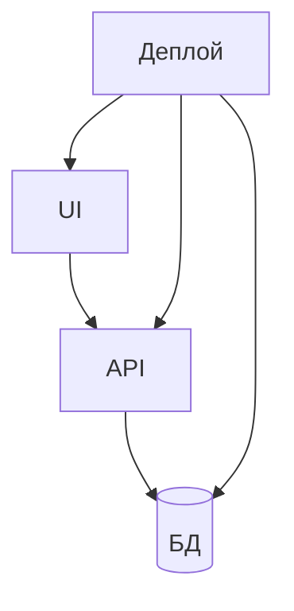
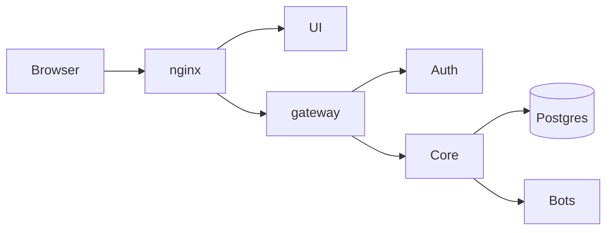

## Введение

S01E01 · Слои · UI / API / БД / деплой Тема выпуска: Зачем собирать сервис слоями.

**Карта.** S01E02 · Карта · кто кому звонит Тема выпуска: Карта CopyParse за 10 минут.

## Раздел: Как отвечать одним блоком

Этот выпуск собрал соседние короткие темы трека: «Слои», «Карта». Раньше каждая занимала отдельную карточку на несколько минут, а на собеседовании их спрашивают одним блоком. Ниже у каждой темы свой раздел, затем общие лабы, один тест и одна колода карточек. В ответе сначала назовите, какую тему спросили, потом определение и один пример. Не проговаривайте все разделы, если спросили один. Лабы можно пройти по порядку исходного трека. Если времени мало, сделайте первую и последнюю: первая ставит язык, последняя проверяет, что соседние темы вы не перепутали.

## Раздел: Слои: Основная часть

Сервис — это не «один файл Python, который рисует HTML». Как только появляются второй пользователь, обновление кода и падение базы, слои начинают окупаться.

Четыре слоя, которые вы соберёте за сезон:

1. UI — то, что видит человек (у нас позже React).
2. API — контракт: HTTP, JSON, ошибки. Без экранов.
3. БД — факты, которые переживают перезапуск процесса (PostgreSQL).
4. Деплой — как это запускают одинаково у вас и на стенде (сначала Compose, потом Minikube).

Зачем это в живом сервисе. У CopyParse браузер не ходит в базу: он говорит с UI и с `/api`, дальше шлюз, сервисы, Postgres. Если смешать всё в одном процессе, нельзя заменить только бота или только фронт.

Граница. Слой «оркестратор / Kafka / микросервисы на каждый чих» в первую неделю — лишняя фича. Сначала четыре коробки и понятные стрелки.

Следующий выпуск: карта CopyParse — кто кому звонит, без клонирования всего монорепо.

## Раздел: Слои: Частые вопросы с собеседования

Короткие ответы на вопросы, которые чаще всего звучат по теме выпуска. Развёрнутая проверка — в тесте ниже.

**Какие четыре слоя сервиса разбираем в выпуске?** UI видит пользователь; API — контракт; БД — факты; деплой — одинаковый запуск.

**Почему UI не должен писать в БД в обход API?** Иначе нельзя заменить фронт или бота отдельно, ломается безопасность и контракт.

**Что даёт слой API без экранов?** HTTP/JSON/ошибки можно тестировать и переиспользовать из UI, ботов и скриптов.

**Чем деплой отличается от «у меня на ноутбуке завелось»?** Compose/образ фиксируют окружение; локальный хаос не равен стенду.

**Когда слои ещё рано дробить на микросервисы?** Сначала четыре коробки и стрелки; оркестратор на каждый чих — лишняя сложность.

## Раздел: Слои: Шпаргалка

### Слои (запомнить)

| Слой | Отвечает за | Не делает |
|------|-------------|-----------|
| UI | Экраны, формы | Прямой доступ к БД |
| API | HTTP, JSON, коды ошибок | Вёрстку |
| БД | Факты после рестарта | Бизнес-логику UI |
| Деплой | Одинаковый запуск | «У меня локально ок» |

### Стрелка «создать заявку»

`Человек → UI → API → БД`

### Не делать

- Браузер → Postgres
- Один файл «и HTML, и SQL, и деплой»
- Kafka / оркестратор в первую неделю

### Готово, если…

- [ ] На схеме 4 коробки
- [ ] Одна подписанная стрелка вызова
- [ ] БД не торчит в браузер

## Раздел: Карта: Основная часть

Сегодня не поднимаем стенд. Учимся читать чужую систему по коробкам, а не по файлам.

Упрощённо CopyParse:

- Край: nginx принимает HTTPS и режет по Host.
- UI — React. Браузер ходит на UI и на `/api`.
- Шлюз (gateway) — JWT, CORS, прокси во внутренние сервисы.
- Платформа: auth, core, scheduler, collector, processor.
- Боты площадок: Telegram, VK и остальные.
- Данные: PostgreSQL и объектное хранилище S3 (MinIO).

Путь «опубликовать пост»: UI или бот → данные в Postgres → collector/processor гоняют статусы → бот площадки публикует. Это конвейер со статусами, не один скрипт `send()`.

Зачем это вам. Ваш сервис заявок в миниатюре повторит ту же идею: UI не пишет в БД в обход API, деплой не равен «у меня на ноутбуке завелось».

Граница. Не клонируйте весь монорепо на первой неделе и не пытайтесь понять каждый бот. Пять коробок достаточно.

Следующий выпуск: Git и GitHub — чтобы лабы жили в ветке, а не в архиве на Рабочем столе.

## Раздел: Карта: Частые вопросы с собеседования

Короткие ответы на вопросы, которые чаще всего звучат по теме выпуска. Развёрнутая проверка — в тесте ниже.

**Кто принимает HTTPS на краю CopyParse?** Edge режет по Host и TLS до UI/gateway.

**Через что браузер ходит во внутренние сервисы?** Шлюз: JWT, CORS, прокси; клиент не бьёт в auth/core напрямую.

**Где живут факты, переживающие рестарт?** Плюс объектное хранилище (MinIO/S3) для файлов.

**Как устроен путь «опубликовать пост» упрощённо?** Не один скрипт send(); конвейер collector/processor/боты.

**Зачем читать систему по коробкам, а не по файлам?** Иначе тонете в деталях до понимания границ.

## Раздел: Карта: Шпаргалка

### Коробки CopyParse

1. **nginx** — HTTPS, Host
2. **UI** — React
3. **gateway** — JWT, CORS, прокси
4. **Сервисы** — auth, core, боты…
5. **Данные** — Postgres + S3/MinIO

### Путь «Опубликовать»

`UI → gateway → core/боты → Postgres → статусы → публикация`

Не: `UI → send() в бот напрямую`.

### Не делать

- Клонировать весь монорепо в первую неделю
- Рисовать 20 микросервисов «как в проде»
- UI → Postgres

### Готово, если…

- [ ] 5–7 блоков своими словами
- [ ] Красный путь «Опубликовать»
- [ ] На пути есть API/шлюз

## Раздел: Формулировки из исходных выпусков

Слои. Вопрос «Какие четыре слоя сервиса разбираем в выпуске?»: UI API БД деплой. UI видит пользователь; API — контракт; БД — факты; деплой — одинаковый запуск.

Слои. Вопрос «Почему UI не должен писать в БД в обход API?»: теряется граница слоёв. Иначе нельзя заменить фронт или бота отдельно, ломается безопасность и контракт.

Слои. Вопрос «Что даёт слой API без экранов?»: стабильный контракт. HTTP/JSON/ошибки можно тестировать и переиспользовать из UI, ботов и скриптов.

Слои. Вопрос «Чем деплой отличается от «у меня на ноутбуке завелось»?»: воспроизводимый запуск. Compose/образ фиксируют окружение; локальный хаос не равен стенду.

Слои. Вопрос «Когда слои ещё рано дробить на микросервисы?»: пока нет границ. Сначала четыре коробки и стрелки; оркестратор на каждый чих — лишняя сложность.

Слои. Карточка «Что такое «UI»?» — Экраны, формы.

Слои. Карточка «Что такое «API»?» — HTTP, JSON, коды ошибок.

Слои. Карточка «Что такое «БД»?» — Факты после рестарта.

Слои. Карточка «Что такое «Деплой»?» — Одинаковый запуск.

Слои. Карточка «UI?» — Экраны, формы.

Слои. Карточка «API?» — HTTP, JSON, коды ошибок.

Слои. Карточка «БД?» — Факты после рестарта.

Слои. Карточка «Деплой?» — Одинаковый запуск.

Карта. Вопрос «Кто принимает HTTPS на краю CopyParse?»: nginx. Edge режет по Host и TLS до UI/gateway.

Карта. Вопрос «Через что браузер ходит во внутренние сервисы?»: gateway. Шлюз: JWT, CORS, прокси; клиент не бьёт в auth/core напрямую.

Карта. Вопрос «Где живут факты, переживающие рестарт?»: PostgreSQL. Плюс объектное хранилище (MinIO/S3) для файлов.

Карта. Вопрос «Как устроен путь «опубликовать пост» упрощённо?»: статусы в Postgres. Не один скрипт send(); конвейер collector/processor/боты.

Карта. Вопрос «Зачем читать систему по коробкам, а не по файлам?»: карта связей. Иначе тонете в деталях до понимания границ.

Карта. Карточка «О чём выпуск «Карта»?» — S01E02 · Карта · кто кому звонит.

Карта. Карточка «Ключевая идея: Карта» — Сегодня не поднимаем стенд. Учимся читать чужую систему по коробкам, а не по файлам..

Карта. Карточка «Запомните (Карта) #1» — Клонировать весь монорепо в первую неделю.

Карта. Карточка «Запомните (Карта) #2» — Рисовать 20 микросервисов «как в проде».

Карта. Карточка «Запомните (Карта) #3» — UI → Postgres.

Карта. Карточка «Запомните (Карта) #4» — 5–7 блоков своими словами.

Карта. Карточка «Запомните (Карта) #5» — Красный путь «Опубликовать».

Карта. Карточка «Запомните (Карта) #6» — На пути есть API/шлюз.

## Лаба

**Слои.**

**20 минут.** На бумаге или в любом редакторе нарисуйте свой учебный сервис «Заявки» четырьмя прямоугольниками: UI, API, БД, деплой. Подпишите одну стрелку: кто кого вызывает при «создать заявку».

**В группу:** фото схемы. Не код.

**Проверка:** на схеме база не торчит в браузер напрямую.

**Карта.**

**20 минут.** Перерисуйте схему своими словами (можно 6–7 блоков, не 20). Подпишите красным путь одного действия: «пользователь нажал Опубликовать».

**В группу:** фото/скрин схемы.

**Проверка:** на пути есть API или шлюз; UI не подключён к Postgres напрямую.

## Схема: Слои: Слои сервиса

## Схема: Карта: Карта CopyParse

## Тест

### Какие четыре слоя сервиса разбираем в выпуске?

**Ответ:** UI API БД деплой

**Пояснение:** UI видит пользователь; API — контракт; БД — факты; деплой — одинаковый запуск.

### Кто принимает HTTPS на краю CopyParse?

**Ответ:** nginx

**Пояснение:** Edge режет по Host и TLS до UI/gateway.

### Почему UI не должен писать в БД в обход API?

**Ответ:** теряется граница слоёв

**Пояснение:** Иначе нельзя заменить фронт или бота отдельно, ломается безопасность и контракт.

### Через что браузер ходит во внутренние сервисы?

**Ответ:** gateway

**Пояснение:** Шлюз: JWT, CORS, прокси; клиент не бьёт в auth/core напрямую.

### Что даёт слой API без экранов?

**Ответ:** стабильный контракт

**Пояснение:** HTTP/JSON/ошибки можно тестировать и переиспользовать из UI, ботов и скриптов.

## Шпаргалка

<ul><li>### Слои (запомнить) | Слой | Отвечает за | Не делает | |------|-------------|-----------| | UI | Экраны, формы | Прямой доступ к БД | | API | HTTP, JSON, коды ошибок | Вёрстку | | БД | Факты после рестарта | Бизнес-логику UI | | Деплой | О</li><li>### Коробки CopyParse 1. **nginx** — HTTPS, Host 2. **UI** — React 3. **gateway** — JWT, CORS, прокси 4. **Сервисы** — auth, core, боты… 5. **Данные** — Postgres + S3/MinIO ### Путь «Опубликовать» `UI → gateway → core/боты → Postgres → стат</li></ul>

## Anki

### Front: Что такое «UI»?

Back: Экраны, формы

### Front: О чём выпуск «Карта»?

Back: S01E02 · Карта · кто кому звонит

### Front: Что такое «API»?

Back: HTTP, JSON, коды ошибок

### Front: Ключевая идея: Карта

Back: Сегодня не поднимаем стенд. Учимся читать чужую систему по коробкам, а не по файлам.

### Front: Что такое «БД»?

Back: Факты после рестарта

### Front: Запомните (Карта) #1

Back: Клонировать весь монорепо в первую неделю

## Итоги

- UI — Экраны, формы
- API — HTTP, JSON, коды ошибок
- БД — Факты после рестарта
- Деплой — Одинаковый запуск
- Браузер → Postgres
- Один файл «и HTML, и SQL, и деплой»
- Kafka / оркестратор в первую неделю
- На схеме 4 коробки

## Ссылки

- [Двенадцать факторов: процессы, конфиг, подключённые сервисы](https://12factor.net/ru/)
- [HTTP как транспорт API (методы, статус-коды)](https://developer.mozilla.org/ru/docs/Web/HTTP/Overview)
- [Как устроен стенд курса: docs/ARCHITECTURE.md в репозитории CopyParse](#)
- [Паттерн BFF / gateway (Microsoft)](https://learn.microsoft.com/ru-ru/azure/architecture/microservices/design/gateway)
