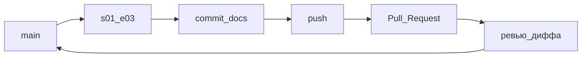
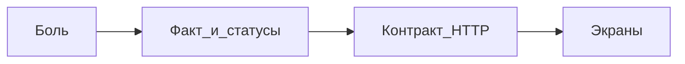

## Введение

S01E03 · Git · commit, ветка, PR — на примерах

**SA / контракт.** S01E04 · SA · контракт до экранов Тема выпуска: SA: от боли к контракту API.

## Раздел: Как отвечать одним блоком

Этот выпуск собрал соседние короткие темы трека: «Git», «SA / контракт». Раньше каждая занимала отдельную карточку на несколько минут, а на собеседовании их спрашивают одним блоком. Ниже у каждой темы свой раздел, затем общие лабы, один тест и одна колода карточек. В ответе сначала назовите, какую тему спросили, потом определение и один пример. Не проговаривайте все разделы, если спросили один. Лабы можно пройти по порядку исходного трека. Если времени мало, сделайте первую и последнюю: первая ставит язык, последняя проверяет, что соседние темы вы не перепутали.

## Раздел: Git: Основная часть

Код без истории — черновик на Рабочем столе. Git фиксирует *что* изменилось. GitHub — *где это обсудить*, не кидая zip в мессенджер.

Сквозной пример сезона: репозиторий учебного сервиса **«Заявки»** (`tickets`).

### 1. Репозиторий

Один учебный проект — один repo. На GitHub: New repository → имя `tickets` (private нормально) → **без** README, если будете `git init` локально.

```bash
mkdir tickets
cd tickets
git init
git branch -M main
```

### 2. .gitignore сразу, до первого commit

Иначе `.env` и `venv/` уедут в историю навсегда.

```
.env
venv/
.venv/
__pycache__/
*.pyc
node_modules/
.idea/
.vscode/
*.pem
```

Плохо: закоммитить `.env` с `DATABASE_URL=...` и потом «удалить файл» — секрет уже в истории.

### 3. Commit — снимок с понятным сообщением

```bash
git add .gitignore README.md
git status
git commit -m "init: учебный сервис заявок, gitignore"
```

| Плохо | Хорошо |
|-------|--------|
| `fix` | `init: учебный сервис заявок, gitignore` |
| `asdf` | `docs: схема слоёв UI/API/БД` |
| `update` | `feat: черновик статусов заявки` |

### 4. Ветка: `main` бережём

```bash
git switch -c s01-e03
# правите docs/layers.md (схема из E01 текстом)
git add docs/layers.md
git commit -m "docs: схема слоёв для сервиса заявок"
```

Имена веток: `s01-e03`, `feature/tickets-api` — коротко и по делу.

### 5. Push и Pull Request

```bash
git remote add origin https://github.com/<you>/tickets.git
git push -u origin main
git push -u origin s01-e03
```

На GitHub: Compare & pull request → `s01-e03` → `main`. В PR смотрите **Files changed** (дифф), не кнопку Merge.

Зачем это в живом сервисе. В CopyParse секреты не кладут в git (`secret.yaml` собирают из example). Один пароль БД в истории = ротация у всех.

Граница. Теги, rebase «как в банке» и монорепо-тулинг подождут. В сезон 1: ветка + понятный commit + PR.

Следующий выпуск: системный анализ — контракт API до первой строчки FastAPI.

## Раздел: Git: Частые вопросы с собеседования

Короткие ответы на вопросы, которые чаще всего звучат по теме выпуска. Развёрнутая проверка — в тесте ниже.

**Что фиксирует git commit?** История *что* изменилось, с понятным сообщением.

**Зачем .gitignore до первого commit?** .env и venv в истории остаются даже после удаления файла.

**Чем ветка отличается от копирования папки?** Ветка — указатель на коммиты, merge/PR обсуждают diff.

**Зачем GitHub в учебном проекте?** Не zip в мессенджер — PR и Issues.

**Что сделать с веткой main перед первым push?** Часто git branch -M main для единого имени.

## Раздел: Git: Шпаргалка

### Команды подряд (happy path)

```bash
git init
git branch -M main
git status
git add .gitignore README.md
git commit -m "init: учебный сервис заявок, gitignore"
git remote add origin https://github.com/<you>/tickets.git
git push -u origin main

git switch -c s01-e03
git add docs/layers.md
git commit -m "docs: схема слоёв для сервиса заявок"
git push -u origin s01-e03
# дальше PR на GitHub: s01-e03 → main
```

### Смотреть, что происходит

```bash
git status          # что изменено / в индексе
git log --oneline   # короткая история
git diff            # незакоммиченный дифф
git diff --staged   # то, что уже в add
```

### .gitignore (минимум)

```
.env
venv/
.venv/
__pycache__/
*.pyc
node_modules/
*.pem
```

### Не делать

- Commit `fix` / `asdf` / `update`
- Класть `.env` и `venv/` в репозиторий
- Писать лабу прямо в `main` без ветки и PR
- «Починить» секрет удалением файла без ротации — история помнит

### Готово, если…

- [ ] Есть PR со ссылкой
- [ ] В Files changed нет секретов и venv
- [ ] Два осмысленных commit message
- [ ] Ветка лабы ≠ `main`

## Раздел: SA / контракт: Основная часть

Системный анализ — не «нарисовать макет». Это ответить: какая боль, какой факт в системе меняется, какой HTTP-контракт это фиксирует.

Порядок, который экономит переписывание React:

1. Боль. «Куратор не видит, какие заявки зависли».
2. Факт. Заявка имеет статус: `new` → `in_progress` → `done` (отказ — отдельный статус, не удаление строки «чтобы не потерять историю»).
3. Контракт. `POST /tickets`, `GET /tickets`, `PATCH /tickets/{id}` — поля, коды 400/404/409.
4. Экран. Список и форма появляются после пунктов 1–3.

Так устроен CopyParse: пост живёт статусами (`collected` → `review`/`ready` → `published`), а не кнопкой «отправить во все сети сразу».

Граница. Не пишите ТЗ на 40 страниц и не тащите Kafka «на вырост». Одна страница: цель, 3–5 операций, статусы, что *не* делаем в MVP.

Следующий выпуск: FastAPI — первый роутер под этот контракт.

## Раздел: SA / контракт: Частые вопросы с собеседования

Короткие ответы на вопросы, которые чаще всего звучат по теме выпуска. Развёрнутая проверка — в тесте ниже.

**Чем FR отличается от NFR?** FR — функция; NFR — perf, security, доступность.

**Зачем actor в use case?** Без актёра сценарий повисает в воздухе.

**Что такое acceptance criteria?** Проверяемые факты, а не «сделать удобно».

**Когда user story лучше длинной спецификации?** Ценность + критерии; детали API — в постановке.

**Чего нельзя путать с приоритетом ценности?** Severity бага и product priority — разные шкалы.

## Раздел: SA / контракт: Шпаргалка

### Порядок SA

`Боль → Факт/статусы → Контракт HTTP → Экраны`

### Таблица операций (шаблон)

| Метод | Путь | Тело | OK | Ошибка |
|-------|------|------|-----|--------|
| POST | /tickets | title | 201 | 400 |
| GET | /tickets | — | 200 | — |
| PATCH | /tickets/{id} | status | 200 | 404 / 409 |

### Статусы заявки (пример)

`new → in_progress → done` (+ `rejected`, не DELETE)

### Не делать

- ТЗ на 40 страниц
- Kafka «на вырост»
- Начинать с макета React

### Готово, если…

- [ ] Есть 409 или 404 в таблице
- [ ] Есть убитая фича
- [ ] Нет пункта «красивый UI»

## Раздел: Формулировки из исходных выпусков

Git. Вопрос «Что фиксирует git commit?»: снимок изменений. История *что* изменилось, с понятным сообщением.

Git. Вопрос «Зачем .gitignore до первого commit?»: не утекут секреты. .env и venv в истории остаются даже после удаления файла.

Git. Вопрос «Чем ветка отличается от копирования папки?»: история общая. Ветка — указатель на коммиты, merge/PR обсуждают diff.

Git. Вопрос «Зачем GitHub в учебном проекте?»: обсуждение и бэкап. Не zip в мессенджер — PR и Issues.

Git. Вопрос «Что сделать с веткой main перед первым push?»: переименовать если нужно. Часто git branch -M main для единого имени.

Git. Карточка ««Починить» секрет удалением файла без ротации?» — история помнит.

Git. Карточка «О чём выпуск «Git»?» — S01E03 · Git · commit, ветка, PR — на примерах.

Git. Карточка «Ключевая идея: Git» — Код без истории — черновик на Рабочем столе. Git фиксирует *что* изменилось. GitHub — *где это обсудить*, не кидая zip в мессенджер..

Git. Карточка «Запомните (Git) #1» — Commit `fix` / `asdf` / `update`.

Git. Карточка «Запомните (Git) #2» — Класть `.env` и `venv/` в репозиторий.

Git. Карточка «Запомните (Git) #3» — Писать лабу прямо в `main` без ветки и PR.

Git. Карточка «Запомните (Git) #4» — «Починить» секрет удалением файла без ротации — история помнит.

Git. Карточка «Запомните (Git) #5» — Есть PR со ссылкой.

SA / контракт. Вопрос «Чем FR отличается от NFR?»: что vs как. FR — функция; NFR — perf, security, доступность.

SA / контракт. Вопрос «Зачем actor в use case?»: кто инициирует. Без актёра сценарий повисает в воздухе.

SA / контракт. Вопрос «Что такое acceptance criteria?»: условия готово. Проверяемые факты, а не «сделать удобно».

SA / контракт. Вопрос «Когда user story лучше длинной спецификации?»: короткий инкремент. Ценность + критерии; детали API — в постановке.

SA / контракт. Вопрос «Чего нельзя путать с приоритетом ценности?»: срочность бага. Severity бага и product priority — разные шкалы.

SA / контракт. Карточка «Что такое «POST»?» — /tickets.

SA / контракт. Карточка «Что такое «GET»?» — /tickets.

SA / контракт. Карточка «Что такое «PATCH»?» — /tickets/{id}.

SA / контракт. Карточка «PATCH?» — /tickets/{id}.

## Лаба

**Git.**

**30–40 минут.** Цель: один PR без секретов.

1. Создайте пустой репозиторий `tickets` на GitHub (private ок). **Не** ставьте галку «Add a README», если идёте путём ниже.
2. Локально:

```bash
mkdir tickets && cd tickets
git init
git branch -M main
```

Создайте `.gitignore` (блок из теории) и `README.md` на 3 строки: что за сервис, для кого, стек позже.

3. Первый commit в `main`, push:

```bash
git add .gitignore README.md
git commit -m "init: учебный сервис заявок, gitignore"
git remote add origin https://github.com/<you>/tickets.git
git push -u origin main
```

4. Ветка и второй commit:

```bash
git switch -c s01-e03
# файл docs/layers.md — четыре слоя + стрелка «создать заявку» (из E01)
git add docs/layers.md
git commit -m "docs: схема слоёв для сервиса заявок"
git push -u origin s01-e03
```

5. Откройте Pull Request `s01-e03` → `main`. Просмотрите Files changed.

**В группу:** ссылка на PR.

**Проверка:**
- в диффе нет `.env`, `venv/`, `__pycache__/`
- у обоих commit сообщения читаются (не `fix`)
- PR идёт не из `main` в `main`, а из ветки лабы

**Тренажёр:** [/game/git](/game/git) · [GIT01](/game/learn/git-commit-anatomy).

**SA / контракт.**

**40 минут.** Одна страница (Google Doc, Markdown в репо — как удобно).

Заголовок: «Заявки, MVP». Блоки:

- Кто пользователь и какая боль (2–3 предложения).
- Статусы заявки (3–4 значения, переходы).
- Таблица операций: метод, путь, тело, успешный код, ошибка.
- Одна убитая фича: что сознательно не делаем (комментарии, файлы, роли админа — выберите одно и напишите почему).

**В группу:** ссылка или файл `docs/tz-mvp.md` в PR.

**Проверка:** в таблице есть хотя бы один 409/404; нет пункта «красивый UI».

## Схема: Git: Схема



## Схема: SA / контракт: Схема



## Тест

### Что фиксирует git commit?

**Ответ:** снимок изменений

**Пояснение:** История *что* изменилось, с понятным сообщением.

### Чем FR отличается от NFR?

**Ответ:** что vs как

**Пояснение:** FR — функция; NFR — perf, security, доступность.

### Зачем .gitignore до первого commit?

**Ответ:** не утекут секреты

**Пояснение:** .env и venv в истории остаются даже после удаления файла.

### Зачем actor в use case?

**Ответ:** кто инициирует

**Пояснение:** Без актёра сценарий повисает в воздухе.

### Чем ветка отличается от копирования папки?

**Ответ:** история общая

**Пояснение:** Ветка — указатель на коммиты, merge/PR обсуждают diff.

## Шпаргалка

<ul><li>### Команды подряд (happy path) ```bash git init git branch -M main git status git add .gitignore README.md git commit -m "init: учебный сервис заявок, gitignore" git remote add origin https://github.com/ /tickets.git git push -u origin mai</li><li>### Порядок SA `Боль → Факт/статусы → Контракт HTTP → Экраны` ### Таблица операций (шаблон) | Метод | Путь | Тело | OK | Ошибка | |-------|------|------|-----|--------| | POST | /tickets | title | 201 | 400 | | GET | /tickets | — | 200 | — </li></ul>

## Anki

### Front: «Починить» секрет удалением файла без ротации?

Back: история помнит

### Front: Что такое «POST»?

Back: /tickets

### Front: О чём выпуск «Git»?

Back: S01E03 · Git · commit, ветка, PR — на примерах

### Front: Что такое «GET»?

Back: /tickets

### Front: Ключевая идея: Git

Back: Код без истории — черновик на Рабочем столе. Git фиксирует *что* изменилось. GitHub — *где это обсудить*, не кидая zip в мессенджер.

### Front: Что такое «PATCH»?

Back: /tickets/{id}

## Мнемоника

### link: Ветка и договор

**Задание:** Сначала снимок, потом договорённость аналитика.

**Элементы:**
- коммит
- ветка
- запрос на слияние
- контракт

**Подсказка:** Контракт API без примера ошибки — половина договорённости.

**Ответ:** commit → branch → PR → contract

## Итоги

- Commit `fix` / `asdf` / `update`
- Класть `.env` и `venv/` в репозиторий
- Писать лабу прямо в `main` без ветки и PR
- «Починить» секрет удалением файла без ротации — история помнит
- Есть PR со ссылкой
- В Files changed нет секретов и venv
- Два осмысленных commit message
- Ветка лабы ≠ `main`

## Ссылки

- [Pro Git, главы 2–3](https://git-scm.com/book/ru/v2)
- [GitHub Flow](https://docs.github.com/ru/get-started/using-github/github-flow)
- [Шаблоны .gitignore](https://github.com/github/gitignore)
- [Тренажёр Git](/game/git)
- [Методы HTTP](https://developer.mozilla.org/ru/docs/Web/HTTP/Reference/Methods)
- [Семантика статус-кодов](https://developer.mozilla.org/ru/docs/Web/HTTP/Reference/Status)
- [Ресурсная модель REST (Microsoft)](https://learn.microsoft.com/ru-ru/azure/architecture/best-practices/api-design)
