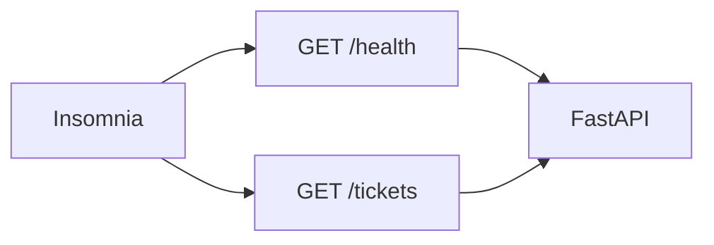

## Введение

S01E05 · FastAPI · роутер и Pydantic Тема выпуска: FastAPI: первый роутер и Pydantic.

**Insomnia: коллекция до UI.** S01E06 · Insomnia · API проверяем до React

## Раздел: Как отвечать одним блоком

Этот выпуск собрал соседние короткие темы трека: «FastAPI: первый роутер и», «Insomnia: коллекция до UI». Раньше каждая занимала отдельную карточку на несколько минут, а на собеседовании их спрашивают одним блоком. Ниже у каждой темы свой раздел, затем общие лабы, один тест и одна колода карточек. В ответе сначала назовите, какую тему спросили, потом определение и один пример. Не проговаривайте все разделы, если спросили один. Лабы можно пройти по порядку исходного трека. Если времени мало, сделайте первую и последнюю: первая ставит язык, последняя проверяет, что соседние темы вы не перепутали.

## Раздел: FastAPI: первый роутер и: Основная часть

API начинается не с базы, а с контракта: путь, вход, выход, ошибка. FastAPI как раз заставляет это написать типами.

Три понятия:

- Роутер — набор путей (`GET /health`, `GET /tickets`). Позже разрежете по модулям, сейчас хватит одного файла.
- Pydantic-модель — JSON, который вы обещаете. Лишнее поле клиента не должно молча ломать сервер; недостающее — 422, не 500.
- Обработчик — функция. Пока можно вернуть список из памяти. База будет в E07.

Зачем это в живом сервисе. В CopyParse сервисы на FastAPI: шлюз и core говорят JSON-контрактами, а не «как получилось в print».

Граница. Не подключайте ORM, JWT и Docker в этом выпуске. Один процесс, `uvicorn`, две ручки. Swagger сам появится на `/docs` — это нормально, не отдельный микросервис.

Следующий выпуск: Insomnia — те же ручки без браузера и без React.

## Раздел: FastAPI: первый роутер и: Частые вопросы с собеседования

Короткие ответы на вопросы, которые чаще всего звучат по теме выпуска. Развёрнутая проверка — в тесте ниже.

**Зачем Pydantic-модель во входном теле?** Невалидный JSON отсекается до бизнес-логики.

**Что возвращает роутер обычно?** FastAPI сериализует в JSON по response_model.

**Где объявляют путь и метод?** @app.get / @router.post задают контракт.

**Зачем отделять схемы от SQLAlchemy-моделей?** Не светить внутренние поля и связи наружу.

**Что проверить первым после hello-роута?** Контракт виден без фронта.

## Раздел: FastAPI: первый роутер и: Шпаргалка

### Скелет

```python
from fastapi import FastAPI
from pydantic import BaseModel

app = FastAPI()

class Ticket(BaseModel):
    id: int
    title: str
    status: str

@app.get("/health")
def health():
    return {"status": "ok"}

@app.get("/tickets", response_model=list[Ticket])
def list_tickets():
    return [...]
```

### Запуск

```bash
uvicorn main:app --reload
# docs → http://127.0.0.1:8000/docs
```

### Коды

| Ситуация | Код |
|----------|-----|
| OK | 200 |
| Создано | 201 |
| Плохое тело / валидация | 422 |
| Не найдено | 404 |
| Сервер упал | 500 — чинить, не маскировать |

### Не делать

- ORM + JWT + Docker в этом выпуске
- Ответ «как print» без модели

### Готово, если…

- [ ] `/health` и `/tickets` в `/docs`
- [ ] Совпадает с ТЗ хотя бы по GET /tickets

## Раздел: Insomnia: коллекция до UI: Основная часть

UI ещё нет — и это хорошо. Если ручка жива только «когда открыта страница», вы не отличите баг фронта от бага сервера.

Insomnia (или аналог) нужна как **клиент контракта**:

- Коллекция — набор запросов, который живёт рядом с кодом, а не в голове.
- Environment — `base_url` для local (`http://127.0.0.1:8000`). Позже добавите minikube, не плодя копии запросов.
- Заголовки. Пока без JWT; привыкайте видеть `Content-Type: application/json`. Authorization появится позже.

Зачем это в живом сервисе. Шлюз CopyParse отдаёт JSON; отладка «пост не ушёл» начинается с запроса к API, не с кликов в UI.

Граница. Не превращайте Insomnia в CI. Сначала руками, коллекцию — в git. Прогоны в Jenkins — сезон 2.

Следующий выпуск: PostgreSQL — факты заявок переживут перезапуск uvicorn.

## Раздел: Insomnia: коллекция до UI: Частые вопросы с собеседования

Короткие ответы на вопросы, которые чаще всего звучат по теме выпуска. Развёрнутая проверка — в тесте ниже.

**Зачем дергать API без UI?** Отделить баг фронта от бага бэка.

**Что сохранить в коллекции запросов?** Повторяемые сценарии для регрессии.

**Какой заголовок часто нужен для JSON?** application/json для тела POST/PUT.

**Что смотреть кроме статуса 200?** Ошибка может быть в схеме ответа.

**Чем коллекция лучше разовых curl из чата?** Можно шарить и гонять одним кликом.

## Раздел: Insomnia: коллекция до UI: Шпаргалка

### Environment

```
base_url = http://127.0.0.1:8000
```

Запросы: `{{ base_url }}/health`, `{{ base_url }}/tickets`

### Чеклист запроса

- Method + URL
- `Content-Type: application/json` (для тела)
- Сохранённый успешный ответ в коллекции
- JSON коллекции в git

### Не делать

- Копии одних и тех же запросов под каждый стенд (используйте env)
- «Проверил только в браузере на UI»
- Jenkins вместо ручной коллекции в сезон 1

### Готово, если…

- [ ] Два зелёных запроса
- [ ] `insomnia/*.json` в PR
- [ ] Меняется только `base_url`

## Раздел: Формулировки из исходных выпусков

FastAPI: первый роутер и. Вопрос «Зачем Pydantic-модель во входном теле?»: валидация и типы. Невалидный JSON отсекается до бизнес-логики.

FastAPI: первый роутер и. Вопрос «Что возвращает роутер обычно?»: модель или dict. FastAPI сериализует в JSON по response_model.

FastAPI: первый роутер и. Вопрос «Где объявляют путь и метод?»: декоратор роутера. @app.get / @router.post задают контракт.

FastAPI: первый роутер и. Вопрос «Зачем отделять схемы от SQLAlchemy-моделей?»: граница API и БД. Не светить внутренние поля и связи наружу.

FastAPI: первый роутер и. Вопрос «Что проверить первым после hello-роута?»: OpenAPI /docs. Контракт виден без фронта.

FastAPI: первый роутер и. Карточка «Что такое «Сервер упал»?» — 500 — чинить, не маскировать.

FastAPI: первый роутер и. Карточка «Сервер упал?» — 500 — чинить, не маскировать.

FastAPI: первый роутер и. Карточка «О чём выпуск «FastAPI»?» — S01E05 · FastAPI · роутер и Pydantic.

FastAPI: первый роутер и. Карточка «Ключевая идея: FastAPI» — API начинается не с базы, а с контракта: путь, вход, выход, ошибка. FastAPI как раз заставляет это написать типами..

FastAPI: первый роутер и. Карточка «Запомните (FastAPI) #1» — Ситуация — Код.

FastAPI: первый роутер и. Карточка «Запомните (FastAPI) #2» — OK — 200.

FastAPI: первый роутер и. Карточка «Запомните (FastAPI) #3» — Создано — 201.

FastAPI: первый роутер и. Карточка «Запомните (FastAPI) #4» — Плохое тело / валидация — 422.

Insomnia: коллекция до UI. Вопрос «Зачем дергать API без UI?»: проверить контракт. Отделить баг фронта от бага бэка.

Insomnia: коллекция до UI. Вопрос «Что сохранить в коллекции запросов?»: метод URL тело. Повторяемые сценарии для регрессии.

Insomnia: коллекция до UI. Вопрос «Какой заголовок часто нужен для JSON?»: Content-Type. application/json для тела POST/PUT.

Insomnia: коллекция до UI. Вопрос «Что смотреть кроме статуса 200?»: тело и заголовки. Ошибка может быть в схеме ответа.

Insomnia: коллекция до UI. Вопрос «Чем коллекция лучше разовых curl из чата?»: версионируется. Можно шарить и гонять одним кликом.

Insomnia: коллекция до UI. Карточка «`Content-Type?» — application/json` (для тела).

Insomnia: коллекция до UI. Карточка «О чём выпуск «Insomnia»?» — S01E06 · Insomnia · API проверяем до React.

Insomnia: коллекция до UI. Карточка «Ключевая идея: Insomnia» — UI ещё нет — и это хорошо. Если ручка жива только «когда открыта страница», вы не отличите баг фронта от бага сервера..

Insomnia: коллекция до UI. Карточка «Запомните (Insomnia) #1» — Method + URL.

Insomnia: коллекция до UI. Карточка «Запомните (Insomnia) #2» — `Content-Type: application/json` (для тела).

Insomnia: коллекция до UI. Карточка «Запомните (Insomnia) #3» — Сохранённый успешный ответ в коллекции.

Insomnia: коллекция до UI. Карточка «Запомните (Insomnia) #4» — JSON коллекции в git.

Insomnia: коллекция до UI. Карточка «Запомните (Insomnia) #5» — Копии одних и тех же запросов под каждый стенд (используйте env).

## Лаба

**FastAPI: первый роутер и.**

**40 минут.** В ветке репозитория заявок:

1. Минимальный FastAPI: `GET /health` → `{"status": "ok"}`.
2. Модель `Ticket` (id, title, status) и `GET /tickets` — верните 2–3 объекта из списка в коде.
3. Запуск: `uvicorn`. Откройте `/docs`.

**В группу:** скрин `/docs` и URL локально (localhost достаточно).

**Проверка:** OpenAPI в `/docs` совпадает с таблицей из вашего ТЗ хотя бы по `GET /tickets`. Если нет — поправьте либо код, либо ТЗ, не оба «на потом».

**Insomnia: коллекция до UI.**

**30 минут.**

1. Установите Insomnia: https://insomnia.rest/download
2. Создайте коллекцию «Заявки», env `local` с `base_url`.
3. Запросы: `GET {{ base_url }}/health` и `GET {{ base_url }}/tickets`. Сохраните успешные ответы.
4. Экспорт коллекции (JSON) в репозиторий, например `insomnia/tickets.json`. Commit в ветке.

**В группу:** скрин двух зелёных запросов + путь к файлу коллекции в PR.

**Проверка:** одногруппник может импортировать JSON и попасть в ваши ручки, сменив только `base_url`.

## Схема: FastAPI: первый роутер и: Схема


## Схема: Insomnia: коллекция до UI: Схема



## Тест

### Зачем Pydantic-модель во входном теле?

**Ответ:** валидация и типы

**Пояснение:** Невалидный JSON отсекается до бизнес-логики.

### Зачем дергать API без UI?

**Ответ:** проверить контракт

**Пояснение:** Отделить баг фронта от бага бэка.

### Что возвращает роутер обычно?

**Ответ:** модель или dict

**Пояснение:** FastAPI сериализует в JSON по response_model.

### Что сохранить в коллекции запросов?

**Ответ:** метод URL тело

**Пояснение:** Повторяемые сценарии для регрессии.

### Где объявляют путь и метод?

**Ответ:** декоратор роутера

**Пояснение:** @app.get / @router.post задают контракт.

## Шпаргалка

<ul><li>### Скелет ```python from fastapi import FastAPI from pydantic import BaseModel app = FastAPI() class Ticket(BaseModel): id: int title: str status: str @app.get("/health") def health(): return {"status": "ok"} @app.get("/tickets", response_</li><li>### Environment ``` base_url = http://127.0.0.1:8000 ``` Запросы: `{{ base_url }}/health`, `{{ base_url }}/tickets` ### Чеклист запроса - Method + URL - `Content-Type: application/json` (для тела) - Сохранённый успешный ответ в коллекции - </li></ul>

## Anki

### Front: Что такое «Сервер упал»?

Back: 500 — чинить, не маскировать

### Front: `Content-Type?

Back: application/json` (для тела)

### Front: Сервер упал?

Back: 500 — чинить, не маскировать

### Front: О чём выпуск «Insomnia»?

Back: S01E06 · Insomnia · API проверяем до React

### Front: О чём выпуск «FastAPI»?

Back: S01E05 · FastAPI · роутер и Pydantic

### Front: Ключевая идея: Insomnia

Back: UI ещё нет — и это хорошо. Если ручка жива только «когда открыта страница», вы не отличите баг фронта от бага сервера.

## Мнемоника

### link: Ручка

**Задание:** Порядок первой проверки сервиса.

**Элементы:**
- схема
- health
- ошибка валидации
- клиент

**Подсказка:** 200 на health не значит, что заказ создаётся.

**Ответ:** schema → health → 422 → client

## Итоги

- Ситуация — Код
- OK — 200
- Создано — 201
- Плохое тело / валидация — 422
- Не найдено — 404
- Сервер упал — 500 — чинить, не маскировать
- ORM + JWT + Docker в этом выпуске
- Ответ «как print» без модели

## Ссылки

- [First Steps](https://fastapi.tiangolo.com/tutorial/first-steps/)
- [Pydantic-модели в FastAPI](https://fastapi.tiangolo.com/tutorial/body/)
- [Автодокументация OpenAPI](https://fastapi.tiangolo.com/tutorial/metadata/)
- [Скачать Insomnia](https://insomnia.rest/download)
- [Коллекции и окружения](https://docs.insomnia.rest/insomnia/environments)
- [Импорт / экспорт](https://docs.insomnia.rest/insomnia/import-export-data)
