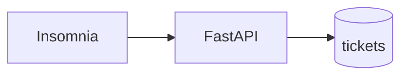
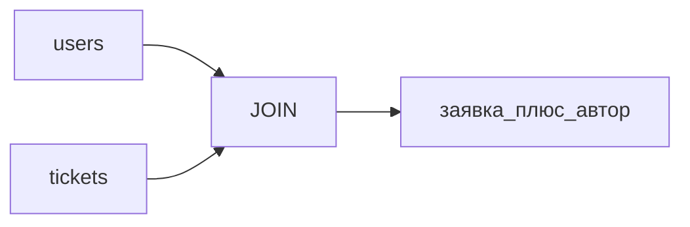

## Введение

S01E07 · PostgreSQL · таблица, PK, SELECT

**SQL: JOIN и индекс.** S01E08 · SQL · JOIN и зачем индекс Тема выпуска: SQL: JOIN и индекс.

## Раздел: Как отвечать одним блоком

Этот выпуск собрал соседние короткие темы трека: «PostgreSQL: таблица и SELECT», «SQL: JOIN и индекс». Раньше каждая занимала отдельную карточку на несколько минут, а на собеседовании их спрашивают одним блоком. Ниже у каждой темы свой раздел, затем общие лабы, один тест и одна колода карточек. В ответе сначала назовите, какую тему спросили, потом определение и один пример. Не проговаривайте все разделы, если спросили один. Лабы можно пройти по порядку исходного трека. Если времени мало, сделайте первую и последнюю: первая ставит язык, последняя проверяет, что соседние темы вы не перепутали.

## Раздел: PostgreSQL: таблица и SELECT: Основная часть

Пока заявки живут в списке Python, перезапуск сервера стирает учебный стенд. База — это факты: строка либо есть, либо её нет.

Минимум:

- Таблица `tickets`: столбцы с типами, не «одна JSON-простыня на всё».
- Первичный ключ (`id`). Без него вы не скажете PATCH/DELETE «вот эта заявка».
- `SELECT` — чтение. Сначала без JOIN.
- Подключение с API. Один пул / одно соединение на запрос в учебном коде допустимо; соединение в глобальном цикле без закрытия — нет.

Зачем это в живом сервисе. CopyParse хранит посты и статусы в PostgreSQL: конвейер переживает рестарт бота.

Граница. Не настраивайте репликацию, партиции и Kafka «чтобы было как в банке». Одна база, одна таблица, три строки.

Следующий выпуск: JOIN и индекс — когда таблиц станет две.

## Раздел: PostgreSQL: таблица и SELECT: Частые вопросы с собеседования

Короткие ответы на вопросы, которые чаще всего звучат по теме выпуска. Развёрнутая проверка — в тесте ниже.

**Чем Postgres отличается от файла JSON на диске?** ACID, индексы, конкурентный доступ.

**Что такое connection string?** host/port/user/db; не коммитить пароли.

**Зачем миграции вместо ручного SQL в проде?** Одинаковая схема на стендах.

**Что хранить в БД учебного сервиса заявок?** Пользователи, заявки, статусы — не секреты в plaintext без нужды.

**Почему «БД на ноутбуке» ≠ стенд?** Нужен явный DATABASE_URL и бэкапы.

## Раздел: PostgreSQL: таблица и SELECT: Шпаргалка

### DDL

```sql
CREATE TABLE tickets (
  id         bigint GENERATED ALWAYS AS IDENTITY PRIMARY KEY,
  title      text NOT NULL,
  status     text NOT NULL,
  created_at timestamptz NOT NULL DEFAULT now()
);

INSERT INTO tickets (title, status) VALUES
  ('Первая', 'new'),
  ('Вторая', 'in_progress'),
  ('Третья', 'done');

SELECT id, title, status FROM tickets;
```

### Правило

Список в Python → **пропадает** после рестарта.  
Строки в Postgres → **остаются**.

### Не делать

- Одна JSON-простыня «на всё»
- Соединение без закрытия в бесконечном цикле
- Репликация / партиции в этот выпуск

### Готово, если…

- [ ] SELECT в клиенте БД
- [ ] GET /tickets после рестарта uvicorn тот же

## Раздел: SQL: JOIN и индекс: Основная часть

Одна таблица врёт, как только появляется «чей это». Автор заявки — не строка, повторённая в каждом title, а другая сущность.

JOIN склеивает факты по ключу: `tickets.author_id = users.id`. Это не «цикл в Python по двум спискам», это работа СУБД.

Индекс — структура, которая ускоряет поиск по условию (`WHERE status = ...`, `WHERE author_id = ...`). Цена: INSERT/UPDATE становятся чуть дороже, место на диске тоже. Индекс «на всякий случай по всем колонкам» — лишняя фича.

`EXPLAIN` (и `EXPLAIN ANALYZE`) показывает, пошла ли база seq scan по всей таблице или index scan. На трёх строках разницы не видно — и это нормально. Смотрите план, привыкайте к словам.

Зачем это в живом сервисе. В аналитике и в ядре CopyParse без JOIN и индексов под реальные выборки вы не отладите «почему тормозит список».

Граница. Не учите оконные функции и CTE в этом выпуске, если JOIN ещё не уверенный. Партиции и шардинг — не сюда.

Следующий выпуск: регулярные выражения — валидация на входе, не парсинг всего HTML.

## Раздел: SQL: JOIN и индекс: Частые вопросы с собеседования

Короткие ответы на вопросы, которые чаще всего звучат по теме выпуска. Развёрнутая проверка — в тесте ниже.

**Чем SELECT отличается от INSERT?** DQL vs DML; права тоже разные.

**Зачем WHERE в UPDATE/DELETE?** Без фильтра затронете все строки.

**Что делает JOIN?** По ключу/условию ON.

**Зачем параметризованные запросы?** Не склеивать строки пользователя в SQL.

**Чем NULL отличается от пустой строки?** Сравнения с NULL через IS NULL.

## Раздел: SQL: JOIN и индекс: Шпаргалка

### JOIN

```sql
SELECT t.id, t.title, u.name AS author
FROM tickets t
INNER JOIN users u ON u.id = t.author_id
WHERE t.author_id = 1;
```

### Индекс

```sql
CREATE INDEX tickets_author_id_idx ON tickets (author_id);
EXPLAIN SELECT ... WHERE tickets.author_id = 1;
```

### Когда индекс

- Часто фильтруете / джойните по колонке
- Не «на все колонки сразу»

### Не делать

- JOIN в цикле Python по двум спискам
- Оконные функции, пока JOIN не уверенный
- Индекс «на всякий случай»

### Готово, если…

- [ ] Имя автора из SQL, не из Python
- [ ] Есть скрин EXPLAIN

## Раздел: Формулировки из исходных выпусков

PostgreSQL: таблица и SELECT. Вопрос «Чем Postgres отличается от файла JSON на диске?»: транзакции и запросы. ACID, индексы, конкурентный доступ.

PostgreSQL: таблица и SELECT. Вопрос «Что такое connection string?»: URL к БД. host/port/user/db; не коммитить пароли.

PostgreSQL: таблица и SELECT. Вопрос «Зачем миграции вместо ручного SQL в проде?»: воспроизводимость. Одинаковая схема на стендах.

PostgreSQL: таблица и SELECT. Вопрос «Что хранить в БД учебного сервиса заявок?»: факты сущностей. Пользователи, заявки, статусы — не секреты в plaintext без нужды.

PostgreSQL: таблица и SELECT. Вопрос «Почему «БД на ноутбуке» ≠ стенд?»: другие данные и доступ. Нужен явный DATABASE_URL и бэкапы.

PostgreSQL: таблица и SELECT. Карточка «О чём выпуск «PostgreSQL»?» — S01E07 · PostgreSQL · таблица, PK, SELECT.

PostgreSQL: таблица и SELECT. Карточка «Ключевая идея: PostgreSQL» — Пока заявки живут в списке Python, перезапуск сервера стирает учебный стенд. База — это факты: строка либо есть, либо её нет..

PostgreSQL: таблица и SELECT. Карточка «Запомните (PostgreSQL) #1» — Одна JSON-простыня «на всё».

PostgreSQL: таблица и SELECT. Карточка «Запомните (PostgreSQL) #2» — Соединение без закрытия в бесконечном цикле.

PostgreSQL: таблица и SELECT. Карточка «Запомните (PostgreSQL) #3» — Репликация / партиции в этот выпуск.

PostgreSQL: таблица и SELECT. Карточка «Запомните (PostgreSQL) #4» — SELECT в клиенте БД.

PostgreSQL: таблица и SELECT. Карточка «Запомните (PostgreSQL) #5» — GET /tickets после рестарта uvicorn тот же.

PostgreSQL: таблица и SELECT. Карточка «Зачем тема «PostgreSQL» на практике?» — Следующий выпуск: JOIN и индекс — когда таблиц станет две..

SQL: JOIN и индекс. Вопрос «Чем SELECT отличается от INSERT?»: чтение vs запись. DQL vs DML; права тоже разные.

SQL: JOIN и индекс. Вопрос «Зачем WHERE в UPDATE/DELETE?»: не снести таблицу. Без фильтра затронете все строки.

SQL: JOIN и индекс. Вопрос «Что делает JOIN?»: связывает таблицы. По ключу/условию ON.

SQL: JOIN и индекс. Вопрос «Зачем параметризованные запросы?»: защита от SQL injection. Не склеивать строки пользователя в SQL.

SQL: JOIN и индекс. Вопрос «Чем NULL отличается от пустой строки?»: неизвестность. Сравнения с NULL через IS NULL.

SQL: JOIN и индекс. Карточка «О чём выпуск «SQL JOIN»?» — S01E08 · SQL · JOIN и зачем индекс.

SQL: JOIN и индекс. Карточка «Ключевая идея: SQL JOIN» — Одна таблица врёт, как только появляется «чей это». Автор заявки — не строка, повторённая в каждом title, а другая сущность..

SQL: JOIN и индекс. Карточка «Запомните (SQL JOIN) #1» — Часто фильтруете / джойните по колонке.

SQL: JOIN и индекс. Карточка «Запомните (SQL JOIN) #2» — Не «на все колонки сразу».

SQL: JOIN и индекс. Карточка «Запомните (SQL JOIN) #3» — JOIN в цикле Python по двум спискам.

SQL: JOIN и индекс. Карточка «Запомните (SQL JOIN) #4» — Оконные функции, пока JOIN не уверенный.

SQL: JOIN и индекс. Карточка «Запомните (SQL JOIN) #5» — Индекс «на всякий случай».

SQL: JOIN и индекс. Карточка «Запомните (SQL JOIN) #6» — Имя автора из SQL, не из Python.

## Лаба

**PostgreSQL: таблица и SELECT.**

**40 минут.**

1. Поднимите Postgres (локально или контейнер). Создайте БД `tickets`.
2. SQL:

```sql
CREATE TABLE tickets (
  id         bigint GENERATED ALWAYS AS IDENTITY PRIMARY KEY,
  title      text NOT NULL,
  status     text NOT NULL,
  created_at timestamptz NOT NULL DEFAULT now()
);
```

3. Вставьте 3 заявки. `SELECT id, title, status FROM tickets;`
4. Подключите FastAPI к БД: `GET /tickets` читает таблицу, не список в памяти.

**В группу:** скрин SELECT из клиента (psql, DBeaver, DataGrip) и зелёный `GET /tickets` в Insomnia после рестарта uvicorn.

**Проверка:** после рестарта API список тот же.

**SQL: JOIN и индекс.**

**40 минут.**

1. Таблица `users (id, name)`. 2–3 пользователя. В `tickets` добавьте `author_id` (FK).
2. Запрос: все заявки с именем автора — `INNER JOIN`.
3. Индекс: `CREATE INDEX tickets_author_id_idx ON tickets (author_id);`
4. `EXPLAIN SELECT ... JOIN ... WHERE tickets.author_id = 1;`

**В группу:** текст JOIN-запроса и скрин `EXPLAIN` (не обязательно ANALYZE).

**Проверка:** без JOIN в Python. Имена авторов приходят из SQL.

## Схема: PostgreSQL: таблица и SELECT: Схема



## Схема: SQL: JOIN и индекс: Схема



## Тест

### Чем Postgres отличается от файла JSON на диске?

**Ответ:** транзакции и запросы

**Пояснение:** ACID, индексы, конкурентный доступ.

### Чем SELECT отличается от INSERT?

**Ответ:** чтение vs запись

**Пояснение:** DQL vs DML; права тоже разные.

### Что такое connection string?

**Ответ:** URL к БД

**Пояснение:** host/port/user/db; не коммитить пароли.

### Зачем WHERE в UPDATE/DELETE?

**Ответ:** не снести таблицу

**Пояснение:** Без фильтра затронете все строки.

### Зачем миграции вместо ручного SQL в проде?

**Ответ:** воспроизводимость

**Пояснение:** Одинаковая схема на стендах.

## Шпаргалка

<ul><li>### DDL ```sql CREATE TABLE tickets ( id bigint GENERATED ALWAYS AS IDENTITY PRIMARY KEY, title text NOT NULL, status text NOT NULL, created_at timestamptz NOT NULL DEFAULT now() ); INSERT INTO tickets (title, status) VALUES ('Первая', 'new</li><li>### JOIN ```sql SELECT t.id, t.title, u.name AS author FROM tickets t INNER JOIN users u ON u.id = t.author_id WHERE t.author_id = 1; ``` ### Индекс ```sql CREATE INDEX tickets_author_id_idx ON tickets (author_id); EXPLAIN SELECT ... WHERE </li></ul>

## Anki

### Front: О чём выпуск «PostgreSQL»?

Back: S01E07 · PostgreSQL · таблица, PK, SELECT

### Front: О чём выпуск «SQL JOIN»?

Back: S01E08 · SQL · JOIN и зачем индекс

### Front: Ключевая идея: PostgreSQL

Back: Пока заявки живут в списке Python, перезапуск сервера стирает учебный стенд. База — это факты: строка либо есть, либо её нет.

### Front: Ключевая идея: SQL JOIN

Back: Одна таблица врёт, как только появляется «чей это». Автор заявки — не строка, повторённая в каждом title, а другая сущность.

### Front: Запомните (PostgreSQL) #1

Back: Одна JSON-простыня «на всё»

### Front: Запомните (SQL JOIN) #1

Back: Часто фильтруете / джойните по колонке

## Итоги

- Одна JSON-простыня «на всё»
- Соединение без закрытия в бесконечном цикле
- Репликация / партиции в этот выпуск
- SELECT в клиенте БД
- GET /tickets после рестарта uvicorn тот же
- Часто фильтруете / джойните по колонке
- Не «на все колонки сразу»
- JOIN в цикле Python по двум спискам

## Ссылки

- [Учебник PostgreSQL: старт](https://www.postgresql.org/docs/current/tutorial-start.html)
- [Создание таблиц (Postgres Pro)](https://postgrespro.ru/docs/postgresql/current/ddl-basics)
- [Docker image postgres](https://hub.docker.com/_/postgres)
- [JOIN в учебнике Postgres Pro](https://postgrespro.ru/docs/postgresql/current/tutorial-join)
- [Индексы](https://postgrespro.ru/docs/postgresql/current/indexes-intro)
- [Как читать EXPLAIN](https://postgrespro.ru/docs/postgresql/current/using-explain)
