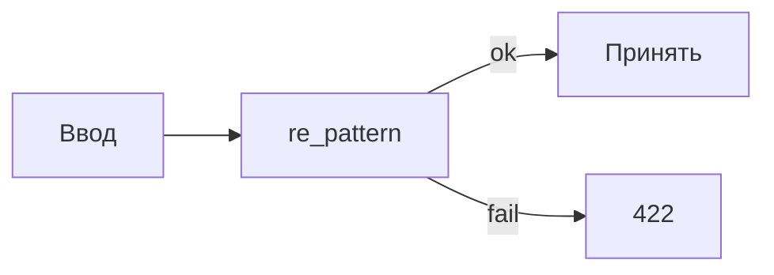
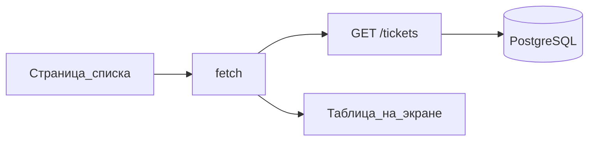

## Введение

S01E09 · Regex · валидация и где уже вредно

**React: страница списка и.** S01E10 · React · список и fetch Тема выпуска: React: страница списка и вызов API.

## Раздел: Как отвечать одним блоком

Этот выпуск собрал соседние короткие темы трека: «Регулярные выражения», «React: страница списка и». Раньше каждая занимала отдельную карточку на несколько минут, а на собеседовании их спрашивают одним блоком. Ниже у каждой темы свой раздел, затем общие лабы, один тест и одна колода карточек. В ответе сначала назовите, какую тему спросили, потом определение и один пример. Не проговаривайте все разделы, если спросили один. Лабы можно пройти по порядку исходного трека. Если времени мало, сделайте первую и последнюю: первая ставит язык, последняя проверяет, что соседние темы вы не перепутали.

## Раздел: Регулярные выражения: Основная часть

Регулярное выражение — это формальный язык для поиска по строке, не «искусственный интеллект» и не парсер HTML.

Где уместно в сервисе заявок:

- Грубый формат: код заявки `TCK-\d+`, e-mail «есть @ и точка», slug из латиницы.
- Вырезать кусок из лога: номер запроса, статус.
- Серверная проверка плюс та же идея на клиенте — но источником правды остаётся API.

Где вредно:

- Разбор HTML/XML regex’ом («достать все ссылки из страницы») — ломается на вложенности. Для этого парсер.
- «Умная» валидация ФИО, адресов, телефона всех стран одним выражением — ложные отказы.
- Секреты и SQL: regex не заменяет параметризованные запросы.

В Python — модуль `re`. Отлаживать удобно на regex101: видны группы и расхождения Python vs JS.

Зачем это в живом сервисе. В пайплайне контента (чистка текста, URL, лимиты) без дисциплины regex легко сломать валидные данные.

Граница. Не пишите комбайн на 80 групп. Если выражение нельзя прочитать вслух — упростите или откажитесь.

Следующий выпуск: React — список заявок из того API, которое вы уже проверили Insomnia.

## Раздел: Регулярные выражения: Частые вопросы с собеседования

Короткие ответы на вопросы, которые чаще всего звучат по теме выпуска. Развёрнутая проверка — в тесте ниже.

**Для чего regex в сервисе?** Валидация, парсинг логов, извлечение полей.

**Чем ^ и $ полезны?** Иначе паттерн найдёт подстроку в середине.

**Почему «сложный» regex опасен?** Иногда проще парсер или библиотека.

**Что проверить на тестах к regex?** Позитивные и негативные примеры.

**Где хранить паттерн лучше?** Не размазывать магические строки по коду.

## Раздел: Регулярные выражения: Шпаргалка

### Пример

```
^TCK-\d+$
```

- Flavor на regex101: **Python**
- В Pydantic: `pattern=...` → невалидное → **422**

### Уместно / вредно

| Уместно | Вредно |
|---------|--------|
| Код `TCK-123` | Парсинг HTML |
| Грубый e-mail | «Телефон всех стран» |
| Кусок из лога | Замена параметризованного SQL |

### Не делать

- Комбайн на 80 групп
- Источник правды только на клиенте

### Готово, если…

- [ ] 5+ / 3− примера на regex101
- [ ] Скрин 422 из Insomnia
- [ ] HTML не парсите regex’ом

## Раздел: React: страница списка и: Основная часть

UI — последний слой в этой десятке, не первый. Вы уже знаете контракт (`GET /tickets`) и видели JSON в Insomnia. Страница только рисует то, что API уже умеет.

Минимум Vite + React:

- Страница «Список заявок»: запрос к API при загрузке, вывод `title` и `status`.
- Один `baseURL` (лучше переменная `VITE_API_URL`), не размазанные по компонентам localhost.
- Ошибка сети — текст на странице, не пустой экран.
- Пока без дизайн-системы, без Redux, без авторизации (JWT — позже).

CORS. Если UI на `:5173`, а API на `:8000`, браузер заблокирует запрос, пока FastAPI не отдаст CORS. Это не баг React. Либо прокси Vite на `/api`, либо настройки CORS на бэке — выберите одно и зафиксируйте в README.

Зачем это в живом сервисе. UI CopyParse ходит в `/api` так же: один клиент, не «каждый экран сам знает хост core».

Граница. Не верстайте админку и не тащите компонентную библиотеку «как на проде». Список из API важнее кнопок.

Следующий выпуск: JWT — логин без самодельной криптографии.

## Раздел: React: страница списка и: Частые вопросы с собеседования

Короткие ответы на вопросы, которые чаще всего звучат по теме выпуска. Развёрнутая проверка — в тесте ниже.

**Что такое компонент в React?** Принимает props, возвращает разметку.

**Зачем state?** Перерисовка при setState/useState.

**Куда класть запрос к API?** Не в рендер-тело без контроля.

**Чем props отличаются от state?** Props даёт родитель; state — сам компонент.

**Зачем ключи в списках?** Иначе лишние ремоунты и баги фокуса.

## Раздел: React: страница списка и: Шпаргалка

### Минимум страницы

```ts
const base = import.meta.env.VITE_API_URL

useEffect(() => {
  fetch(`${base}/tickets`)
    .then((r) => {
      if (!r.ok) throw new Error(String(r.status))
      return r.json()
    })
    .then(setTickets)
    .catch(setError)
}, [])
```

### CORS

UI `:5173` + API `:8000` → нужен CORS на FastAPI **или** proxy Vite. Зафиксируйте в README.

### Не делать

- Хардкод списка «пока без API»
- Redux / UI-kit / JWT в этом выпуске
- Пустой экран при ошибке сети

### Готово, если…

- [ ] Список = то же, что Insomnia
- [ ] Стоп API → ошибка на экране
- [ ] Один `VITE_API_URL`

## Раздел: Формулировки из исходных выпусков

Регулярные выражения. Вопрос «Для чего regex в сервисе?»: разбор текста. Валидация, парсинг логов, извлечение полей.

Регулярные выражения. Вопрос «Чем ^ и $ полезны?»: якоря границ. Иначе паттерн найдёт подстроку в середине.

Регулярные выражения. Вопрос «Почему «сложный» regex опасен?»: читаемость и ReDoS. Иногда проще парсер или библиотека.

Регулярные выражения. Вопрос «Что проверить на тестах к regex?»: ложные срабатывания. Позитивные и негативные примеры.

Регулярные выражения. Вопрос «Где хранить паттерн лучше?»: константа/конфиг. Не размазывать магические строки по коду.

Регулярные выражения. Карточка «Что такое «Код `TCK-123`»?» — Парсинг HTML.

Регулярные выражения. Карточка «Что такое «Грубый e-mail»?» — «Телефон всех стран».

Регулярные выражения. Карточка «Что такое «Кусок из лога»?» — Замена параметризованного SQL.

Регулярные выражения. Карточка «В Pydantic?» — `pattern=...` → невалидное → **422**.

Регулярные выражения. Карточка «Код `TCK-123`?» — Парсинг HTML.

Регулярные выражения. Карточка «Грубый e-mail?» — «Телефон всех стран».

Регулярные выражения. Карточка «Кусок из лога?» — Замена параметризованного SQL.

React: страница списка и. Вопрос «Что такое компонент в React?»: функция UI. Принимает props, возвращает разметку.

React: страница списка и. Вопрос «Зачем state?»: локальные изменения. Перерисовка при setState/useState.

React: страница списка и. Вопрос «Куда класть запрос к API?»: эффект или обработчик. Не в рендер-тело без контроля.

React: страница списка и. Вопрос «Чем props отличаются от state?»: снаружи vs внутри. Props даёт родитель; state — сам компонент.

React: страница списка и. Вопрос «Зачем ключи в списках?»: стабильная идентичность. Иначе лишние ремоунты и баги фокуса.

React: страница списка и. Карточка «О чём выпуск «React»?» — S01E10 · React · список и fetch.

React: страница списка и. Карточка «Ключевая идея: React» — UI — последний слой в этой десятке, не первый. Вы уже знаете контракт (`GET /tickets`) и видели JSON в Insomnia. Страница только рисует то, что API уже умеет..

React: страница списка и. Карточка «Запомните (React) #1» — Хардкод списка «пока без API».

React: страница списка и. Карточка «Запомните (React) #2» — Redux / UI-kit / JWT в этом выпуске.

React: страница списка и. Карточка «Запомните (React) #3» — Пустой экран при ошибке сети.

React: страница списка и. Карточка «Запомните (React) #4» — Список = то же, что Insomnia.

React: страница списка и. Карточка «Запомните (React) #5» — Стоп API → ошибка на экране.

React: страница списка и. Карточка «Запомните (React) #6» — Один `VITE_API_URL`.

## Лаба

**Регулярные выражения.**

**30 минут.**

1. На https://regex101.com/ (Flavor: Python) напишите выражение для кода заявки: `TCK-` и цифры. Прогоните 5 положительных и 3 отрицательных примера.
2. В FastAPI: поле `code` (или валидация `title`) через `pattern` в Pydantic либо `re` в хендлере. Невалидное тело → 422, не 500.
3. Insomnia: один запрос, который должен упасть, один — пройти.

**В группу:** ссылка на сохранённый regex101 (или скрин тестов) + скрин 422.

**Проверка:** вы не парсите HTML. Есть хотя бы один сознательно отвергнутый ввод.

**React: страница списка и.**

**40 минут.**

1. `npm create vite@latest` → React. Страница списка.
2. `fetch` (или тонкая обёртка) на `GET /tickets`. Отобразите 3 поля.
3. README: как запустить UI и API, какая переменная URL, как обойден CORS.
4. Скрин: Insomnia показывает те же заявки, что и страница.

**В группу:** скрин UI + ссылка на PR.

**Проверка:** остановка API даёт видимую ошибку в UI. Нет захардкоженного списка «на время».

## Схема: Регулярные выражения: Схема



## Схема: React: страница списка и: Схема



## Тест

### Для чего regex в сервисе?

**Ответ:** разбор текста

**Пояснение:** Валидация, парсинг логов, извлечение полей.

### Что такое компонент в React?

**Ответ:** функция UI

**Пояснение:** Принимает props, возвращает разметку.

### Чем ^ и $ полезны?

**Ответ:** якоря границ

**Пояснение:** Иначе паттерн найдёт подстроку в середине.

### Зачем state?

**Ответ:** локальные изменения

**Пояснение:** Перерисовка при setState/useState.

### Почему «сложный» regex опасен?

**Ответ:** читаемость и ReDoS

**Пояснение:** Иногда проще парсер или библиотека.

## Шпаргалка

<ul><li>### Пример ``` ^TCK-\d+$ ``` - Flavor на regex101: **Python** - В Pydantic: `pattern=...` → невалидное → **422** ### Уместно / вредно | Уместно | Вредно | |---------|--------| | Код `TCK-123` | Парсинг HTML | | Грубый e-mail | «Телефон всех</li><li>### Минимум страницы ```ts const base = import.meta.env.VITE_API_URL useEffect(() => { fetch(`${base}/tickets`) .then((r) => { if (!r.ok) throw new Error(String(r.status)) return r.json() }) .then(setTickets) .catch(setError) }, []) ``` ###</li></ul>

## Anki

### Front: Что такое «Код `TCK-123`»?

Back: Парсинг HTML

### Front: О чём выпуск «React»?

Back: S01E10 · React · список и fetch

### Front: Что такое «Грубый e-mail»?

Back: «Телефон всех стран»

### Front: Ключевая идея: React

Back: UI — последний слой в этой десятке, не первый. Вы уже знаете контракт (`GET /tickets`) и видели JSON в Insomnia. Страница только рисует то, что API уже умеет.

### Front: Что такое «Кусок из лога»?

Back: Замена параметризованного SQL

### Front: Запомните (React) #1

Back: Хардкод списка «пока без API»

## Мнемоника

### link: Выражение слева направо

**Задание:** Как читают короткий шаблон, не перечисляя метасимволы.

**Элементы:**
- якорь
- класс
- квантификатор
- группа

**Подсказка:** Жадный квантификатор съедает до последнего возможного места.

**Ответ:** якорь → класс → квантификатор → группа

## Итоги

- Flavor на regex101: **Python**
- В Pydantic: `pattern=...` → невалидное → **422**
- Уместно — Вредно
- Код `TCK-123` — Парсинг HTML
- Грубый e-mail — «Телефон всех стран»
- Кусок из лога — Замена параметризованного SQL
- Комбайн на 80 групп
- Источник правды только на клиенте

## Ссылки

- [re в Python](https://docs.python.org/3/library/re.html)
- [Песочница regex101](https://regex101.com/)
- [MDN: регулярные выражения (диалект JS)](https://developer.mozilla.org/ru/docs/Web/JavaScript/Guide/Regular_expressions)
- [React: списки](https://react.dev/learn/rendering-lists)
- [Эффекты и загрузка данных](https://react.dev/learn/synchronizing-with-effects)
- [Vite, старт](https://vite.dev/guide/)
- [CORS в FastAPI](https://fastapi.tiangolo.com/tutorial/cors/)
