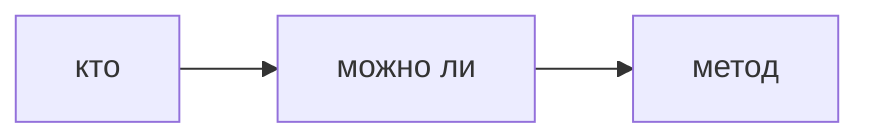
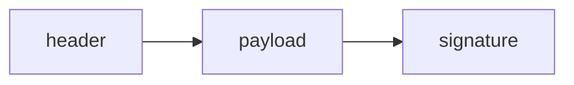
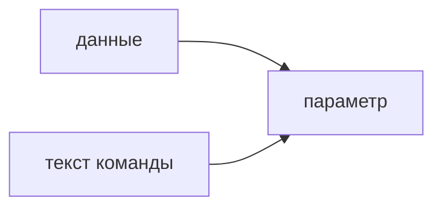
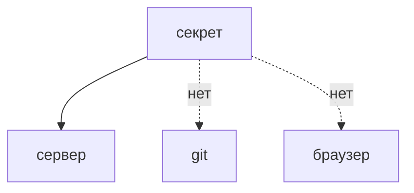

## Введение

Два слова путают всю беседу. Аутентификация отвечает, кто вы. Авторизация отвечает, можно ли вам это сделать. Скрытая кнопка не является авторизацией.

**JWT.** JWT удобно проверять без склада сессий. За удобство платят: нагрузка видна всем, у кого есть токен, а кража токена равна краже сессии до истечения срока.

**Инъекции.** Инъекция случается, когда кусок входных данных становится частью команды. В SQL это кавычка в строке запроса. В шелле — кусок, который оболочка исполнит. Лекарство одно: отделять данные от текста команды.

**Секреты.** Секрет, который попал в git, уже считайте известным. Удаление файла в следующем коммите историю не чистит. То же с клиентским бандлом: всё, что скачалось в браузер, больше не секрет.

## Раздел: Как отвечать одним блоком

Этот выпуск собрал соседние короткие темы трека: «Кто и что можно», «JWT», «Инъекции», «Секреты». Раньше каждая занимала отдельную карточку на несколько минут, а на собеседовании их спрашивают одним блоком. Ниже у каждой темы свой раздел, затем общие лабы, один тест и одна колода карточек. В ответе сначала назовите, какую тему спросили, потом определение и один пример. Не проговаривайте все разделы, если спросили один. Лабы можно пройти по порядку исходного трека. Если времени мало, сделайте первую и последнюю: первая ставит язык, последняя проверяет, что соседние темы вы не перепутали.

## Раздел: Кто и что можно: Где проверять

Пароль, ключ или внешний вход — на входе. Право на метод — на сервере для каждого действия, не только при отрисовке меню. Роль в теле запроса, которую клиент прислал сам, не доказательство.

## Раздел: Кто и что можно: Ответ вслух

Сначала я узнаю вызывающего. Потом на сервере проверяю право именно на этот метод и этот объект. Кнопку в интерфейсе могу спрятать, но не считаю это защитой: запрос подделают.

## Раздел: Кто и что можно: Плохой ответ

Плохой ответ: «у нас роли на фронте». Фронт показывает, сервер разрешает.

## Раздел: Кто и что можно: Термины

Аутентификация — authentication. Авторизация — authorization. Вызывающий — principal. Право — permission.

## Раздел: JWT: Практика

Три части, секрет подписи только на сервере. В payload — идентификатор и срок, не пароль. Access короткий. Refresh отдельно и не в месте, которое читает JavaScript, если можете позволить httpOnly cookie. Алгоритм none и подмена заголовка — классическая дыра, сервер не должен верить алгоритму из токена вслепую.

## Раздел: JWT: Ответ вслух

Я говорю: подпись проверяет целостность, payload читается. Пароль туда не кладу. Access короткий. Если токен в localStorage, любой XSS его заберёт. Алгоритм беру из настроек сервера, не из заголовка токена.

## Раздел: JWT: Плохой ответ

Плохой ответ: «JWT зашифрован». Это путают с JWE. Обычный JWT подписан.

## Раздел: JWT: Термины

Полезная нагрузка — payload. Подпись — signature. httpOnly — cookie, которую скрипт страницы не читает. None algorithm — дыра доверия к заголовку.

## Раздел: Инъекции: Как закрывать

Параметры запроса, не конкатенация. Для шелла — список аргументов без оболочки, если можно. Проверка «нет кавычек» ломается на кодировке и на втором языке. ORM не спасает, если внутри сырой SQL.

## Раздел: Инъекции: Ответ вслух

Я не склеиваю SQL. Значение идёт параметром, план команды фиксирован. То же с оболочкой: аргументы списком, не строкой для sh. Чёрный список символов не считаю защитой.

## Раздел: Инъекции: Плохой ответ

Плохой ответ: «мы экранируем кавычки руками». Ошибаются в одной ветке и забывают второй движок.

## Раздел: Инъекции: Термины

Инъекция — injection. Параметр — bind parameter. Сырой запрос — raw SQL. Оболочка — shell.

## Раздел: Секреты: Куда можно

Переменные окружения или хранилище секретов на сервере, разные значения для стендов, ротация после утечки. В образ «запекать» ключ нельзя: образ уезжает и кэшируется. В фронт нельзя класть ключ, которым можно писать в облако.

## Раздел: Секреты: Ответ вслух

Секрет живёт на сервере, не в репозитории и не в браузере. Если он засветился в git, я меняю сам секрет, а не только стираю файл. В клиент можно отдать только то, что и так публично, например идентификатор, но не ключ записи.

## Раздел: Секреты: Плохой ответ

Плохой ответ: «мы удалили .env в следующем коммите». История и форки секрет помнят.

## Раздел: Секреты: Термины

Секрет — secret. Ротация — rotation. Окружение — environment. Утечка — leak.

## Раздел: Формулировки из исходных выпусков

Кто и что можно. Вопрос «Пользователь вошёл, чужой заказ удалил. Что из двух сломано?»: авторизация. Личность была, права на объект не было.

Кто и что можно. Вопрос «Пароль неверен. Это 403?»: нет, это узнавание. Ближе к 401.

Кто и что можно. Вопрос «Роль admin в JSON тела. Верить?»: нет. Право назначает сервер.

Кто и что можно. Вопрос «Кнопки нет, метод открыт. Дыра есть?»: да. Интерфейс не граница.

Кто и что можно. Вопрос «Один и тот же человек, два объекта. Проверки хватит один раз на роль?»: не всегда. Часто нужно владение конкретным объектом.

Кто и что можно. Карточка «Authentication?» — Кто вы..

Кто и что можно. Карточка «Authorization?» — Что вам можно..

Кто и что можно. Карточка «Скрытая кнопка — авторизация?» — Нет..

Кто и что можно. Карточка «Где проверять DELETE?» — На сервере, на объекте..

Кто и что можно. Карточка «Роль из тела запроса?» — Не доказательство..

Кто и что можно. Карточка «401 ближе к чему?» — К неудачному узнаванию..

JWT. Вопрос «Пароль в payload. Подпись его спрячет?»: нет. Подпись не шифрование.

JWT. Вопрос «Access на 30 дней в localStorage. Чем рискуете?»: долгим окном кражи. XSS унесёт токен на месяц.

JWT. Вопрос «Сервер берёт alg из токена и принимает none. Это норма?»: нет. Алгоритм фиксирует сервер.

JWT. Вопрос «Refresh рядом с access в одном JS-хранилище. Зачем тогда делить?»: смысл теряется. Украдут оба сразу.

JWT. Вопрос «Сессий на сервере нет. Как проверить токен?»: подписью своим ключом. Склад сессий не обязателен.

JWT. Карточка «JWT шифрует payload?» — Нет, обычный JWT только подписывает..

JWT. Карточка «Что не кладут в payload?» — Пароль и другие секреты..

JWT. Карточка «Почему короткий access?» — Меньше окно после кражи..

JWT. Карточка «Чем плох localStorage?» — Скрипт страницы читает токен..

JWT. Карточка «Что такое alg none?» — Токен без подписи, если сервер повелся на заголовок..

JWT. Карточка «Где держать секрет подписи?» — Только на сервере..

Инъекции. Вопрос «Имя пользователя вклеено в SQL в кавычках. Это параметр?»: нет, это склейка. Кавычка в имени ломает текст.

Инъекции. Вопрос «ORM, но внутри raw с плюсом. Дыра осталась?»: да. ORM не лечит сырую склейку.

Инъекции. Вопрос «Чёрный список кавычек. Хватит?»: нет. Обход через кодировку и другие символы.

Инъекции. Вопрос «Команда оболочки одной строкой из поля формы. Нормально?»: нет. Поле станет аргументами шелла.

Инъекции. Вопрос «Параметр меняет план структуры SELECT?»: нет. Меняться должно значение, не текст команды.

Инъекции. Карточка «Что такое SQL-инъекция?» — Вход становится частью текста запроса..

Инъекции. Карточка «Как передавать значение?» — Параметром, не склейкой..

Инъекции. Карточка «ORM всегда безопасен?» — Нет, если есть сырой SQL..

Инъекции. Карточка «Чем плох чёрный список?» — Его обходят..

Инъекции. Карточка «Инъекция в shell?» — Данные исполняются оболочкой..

Инъекции. Карточка «Что фиксировано в безопасном запросе?» — Текст команды. Данные отдельно..

Секреты. Вопрос «Ключ записи в облако попал в JS-бандл. Его ещё можно считать тайным?»: нет. Его скачал каждый клиент.

Секреты. Вопрос «Удалили .env коммитом. Секрет мёртв?»: нет, история жива. Нужна ротация.

Секреты. Вопрос «Один пароль на тест и прод. Чем плохо?»: тест становится продом. Утечка стенда открывает боевое.

Секреты. Вопрос «Секрет в слое Docker-образа. Достаточно не публиковать Dockerfile?»: нет, образ уже содержит слой. Слои смотрят отдельно.

Секреты. Вопрос «Что делать первым после утечки в чат?»: сменить секрет. Извинение не закрывает доступ.

Секреты. Карточка «Секрет в git. Что первым?» — Сменить секрет, не только удалить файл..

Секреты. Карточка «Можно ли ключ записи во фронт?» — Нет, бандл публичен..

Секреты. Карточка «Почему не один пароль на все стенды?» — Утечка слабого стенда открывает сильный..

Секреты. Карточка «Образ с ключом внутри?» — Ключ уезжает вместе с образом..

Секреты. Карточка «Куда класть секрет?» — Окружение или хранилище на сервере..

Секреты. Карточка «Удаление файла чистит историю?» — Нет..

## Лаба

**Кто и что можно.**

**15 минут.** Для DELETE /orders/1 напишите, где проверка личности и где проверка владельца. Отдельно напишите, почему скрыть кнопку мало.

**JWT.**

**20 минут.** Разберите глазами одну среднюю часть JWT (это Base64). Убедитесь, что там нет пароля, и назовите срок жизни, который вы бы поставили access.

**Инъекции.**

**20 минут.** В [/game/sql](/game/sql) напишите выборку с параметром, не со склейкой. Рядом одной фразой объясните, что сломает строка `' OR 1=1` при склейке.

**Секреты.**

**15 минут.** Найдите в учебном проекте места, куда секрет нельзя: фронт, Dockerfile, история git. Напишите, куда его положить вместо этого.

## Схема: Кто и что можно: Два вопроса

## Схема: JWT: Части

## Схема: Инъекции: Граница

## Схема: Секреты: Граница секрета

## Тест

### Пользователь вошёл, чужой заказ удалил. Что из двух сломано?

**Ответ:** авторизация

**Пояснение:** Личность была, права на объект не было.

### Пароль в payload. Подпись его спрячет?

**Ответ:** нет

**Пояснение:** Подпись не шифрование.

### Имя пользователя вклеено в SQL в кавычках. Это параметр?

**Ответ:** нет, это склейка

**Пояснение:** Кавычка в имени ломает текст.

### Ключ записи в облако попал в JS-бандл. Его ещё можно считать тайным?

**Ответ:** нет

**Пояснение:** Его скачал каждый клиент.

### Пароль неверен. Это 403?

**Ответ:** нет, это узнавание

**Пояснение:** Ближе к 401.

## Шпаргалка

<ul><li>Кто и можно ли — разные вопросы</li><li>Сервер решает право</li><li>Кнопка не граница</li><li>Подпись не шифрует</li><li>Секрет не в payload</li><li>Место хранения — часть угрозы</li><li>Не склеивать команду и данные</li><li>Параметр, не фильтр символов</li><li>Сырой SQL в ORM всё ещё сырой</li><li>История git помнит</li><li>Браузер публичен</li><li>Утечка лечится сменой секрета</li></ul>

## Anki

### Front: Authentication?

Back: Кто вы.

### Front: JWT шифрует payload?

Back: Нет, обычный JWT только подписывает.

### Front: Что такое SQL-инъекция?

Back: Вход становится частью текста запроса.

### Front: Секрет в git. Что первым?

Back: Сменить секрет, не только удалить файл.

### Front: Authorization?

Back: Что вам можно.

### Front: Что не кладут в payload?

Back: Пароль и другие секреты.

## Итоги

- Кто и можно ли — разные вопросы
- Сервер решает право
- Кнопка не граница
- Подпись не шифрует
- Секрет не в payload
- Место хранения — часть угрозы
- Не склеивать команду и данные
- Параметр, не фильтр символов

## Ссылки

- [Песочница SQL](/game/sql)
- [CI](/game/learn/ops-linux-process)
