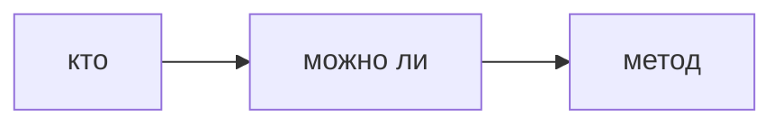

## Введение

Два слова путают всю беседу. Аутентификация отвечает, кто вы. Авторизация отвечает, можно ли вам это сделать. Скрытая кнопка не является авторизацией.

## Раздел: Где проверять

Пароль, ключ или внешний вход — на входе. Право на метод — на сервере для каждого действия, не только при отрисовке меню. Роль в теле запроса, которую клиент прислал сам, не доказательство.

## Раздел: Ответ вслух

Сначала я узнаю вызывающего. Потом на сервере проверяю право именно на этот метод и этот объект. Кнопку в интерфейсе могу спрятать, но не считаю это защитой: запрос подделают.

## Раздел: Плохой ответ

Плохой ответ: «у нас роли на фронте». Фронт показывает, сервер разрешает.

## Раздел: Термины

Аутентификация — authentication. Авторизация — authorization. Вызывающий — principal. Право — permission.

## Лаба

**15 минут.** Для DELETE /orders/1 напишите, где проверка личности и где проверка владельца. Отдельно напишите, почему скрыть кнопку мало.

## Схема: Два вопроса

## Тест

### Пользователь вошёл, чужой заказ удалил. Что из двух сломано?

**Ответ:** авторизация

**Пояснение:** Личность была, права на объект не было.

### Пароль неверен. Это 403?

**Ответ:** нет, это узнавание

**Пояснение:** Ближе к 401.

### Роль admin в JSON тела. Верить?

**Ответ:** нет

**Пояснение:** Право назначает сервер.

### Кнопки нет, метод открыт. Дыра есть?

**Ответ:** да

**Пояснение:** Интерфейс не граница.

### Один и тот же человек, два объекта. Проверки хватит один раз на роль?

**Ответ:** не всегда

**Пояснение:** Часто нужно владение конкретным объектом.

## Шпаргалка

<ul><li>Кто и можно ли — разные вопросы</li><li>Сервер решает право</li><li>Кнопка не граница</li></ul>

## Anki

### Front: Authentication?

Back: Кто вы.

### Front: Authorization?

Back: Что вам можно.

### Front: Скрытая кнопка — авторизация?

Back: Нет.

### Front: Где проверять DELETE?

Back: На сервере, на объекте.

### Front: Роль из тела запроса?

Back: Не доказательство.

### Front: 401 ближе к чему?

Back: К неудачному узнаванию.

## Итоги

- Кто и можно ли — разные вопросы
- Сервер решает право
- Кнопка не граница

## Ссылки

- [JWT](/game/learn/sec-jwt-storage)
- [Инъекции](/game/learn/sec-injection)
