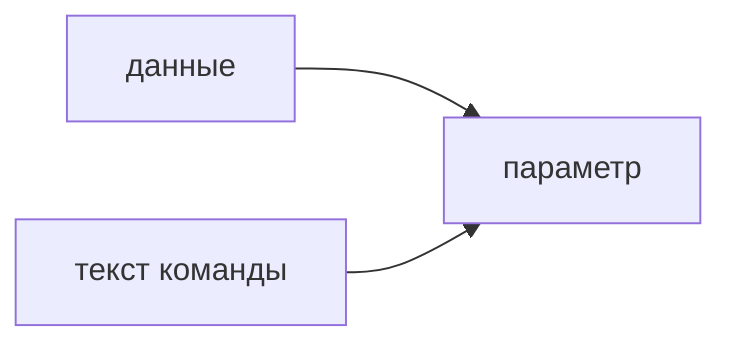

## Введение

Инъекция случается, когда кусок входных данных становится частью команды. В SQL это кавычка в строке запроса. В шелле — кусок, который оболочка исполнит. Лекарство одно: отделять данные от текста команды.

## Раздел: Как закрывать

Параметры запроса, не конкатенация. Для шелла — список аргументов без оболочки, если можно. Проверка «нет кавычек» ломается на кодировке и на втором языке. ORM не спасает, если внутри сырой SQL.

## Раздел: Ответ вслух

Я не склеиваю SQL. Значение идёт параметром, план команды фиксирован. То же с оболочкой: аргументы списком, не строкой для sh. Чёрный список символов не считаю защитой.

## Раздел: Плохой ответ

Плохой ответ: «мы экранируем кавычки руками». Ошибаются в одной ветке и забывают второй движок.

## Раздел: Термины

Инъекция — injection. Параметр — bind parameter. Сырой запрос — raw SQL. Оболочка — shell.

## Лаба

**20 минут.** В [/game/sql](/game/sql) напишите выборку с параметром, не со склейкой. Рядом одной фразой объясните, что сломает строка `' OR 1=1` при склейке.

## Схема: Граница

## Тест

### Имя пользователя вклеено в SQL в кавычках. Это параметр?

**Ответ:** нет, это склейка

**Пояснение:** Кавычка в имени ломает текст.

### ORM, но внутри raw с плюсом. Дыра осталась?

**Ответ:** да

**Пояснение:** ORM не лечит сырую склейку.

### Чёрный список кавычек. Хватит?

**Ответ:** нет

**Пояснение:** Обход через кодировку и другие символы.

### Команда оболочки одной строкой из поля формы. Нормально?

**Ответ:** нет

**Пояснение:** Поле станет аргументами шелла.

### Параметр меняет план структуры SELECT?

**Ответ:** нет

**Пояснение:** Меняться должно значение, не текст команды.

## Шпаргалка

<ul><li>Не склеивать команду и данные</li><li>Параметр, не фильтр символов</li><li>Сырой SQL в ORM всё ещё сырой</li></ul>

## Anki

### Front: Что такое SQL-инъекция?

Back: Вход становится частью текста запроса.

### Front: Как передавать значение?

Back: Параметром, не склейкой.

### Front: ORM всегда безопасен?

Back: Нет, если есть сырой SQL.

### Front: Чем плох чёрный список?

Back: Его обходят.

### Front: Инъекция в shell?

Back: Данные исполняются оболочкой.

### Front: Что фиксировано в безопасном запросе?

Back: Текст команды. Данные отдельно.

## Итоги

- Не склеивать команду и данные
- Параметр, не фильтр символов
- Сырой SQL в ORM всё ещё сырой

## Ссылки

- [Песочница SQL](/game/sql)
- [Секреты](/game/learn/sec-secrets)
