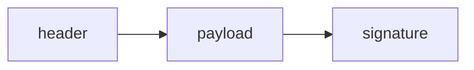

## Введение

JWT удобно проверять без склада сессий. За удобство платят: нагрузка видна всем, у кого есть токен, а кража токена равна краже сессии до истечения срока.

## Раздел: Практика

Три части, секрет подписи только на сервере. В payload — идентификатор и срок, не пароль. Access короткий. Refresh отдельно и не в месте, которое читает JavaScript, если можете позволить httpOnly cookie. Алгоритм none и подмена заголовка — классическая дыра, сервер не должен верить алгоритму из токена вслепую.

## Раздел: Ответ вслух

Я говорю: подпись проверяет целостность, payload читается. Пароль туда не кладу. Access короткий. Если токен в localStorage, любой XSS его заберёт. Алгоритм беру из настроек сервера, не из заголовка токена.

## Раздел: Плохой ответ

Плохой ответ: «JWT зашифрован». Это путают с JWE. Обычный JWT подписан.

## Раздел: Термины

Полезная нагрузка — payload. Подпись — signature. httpOnly — cookie, которую скрипт страницы не читает. None algorithm — дыра доверия к заголовку.

## Лаба

**20 минут.** Разберите глазами одну среднюю часть JWT (это Base64). Убедитесь, что там нет пароля, и назовите срок жизни, который вы бы поставили access.

## Схема: Части

## Тест

### Пароль в payload. Подпись его спрячет?

**Ответ:** нет

**Пояснение:** Подпись не шифрование.

### Access на 30 дней в localStorage. Чем рискуете?

**Ответ:** долгим окном кражи

**Пояснение:** XSS унесёт токен на месяц.

### Сервер берёт alg из токена и принимает none. Это норма?

**Ответ:** нет

**Пояснение:** Алгоритм фиксирует сервер.

### Refresh рядом с access в одном JS-хранилище. Зачем тогда делить?

**Ответ:** смысл теряется

**Пояснение:** Украдут оба сразу.

### Сессий на сервере нет. Как проверить токен?

**Ответ:** подписью своим ключом

**Пояснение:** Склад сессий не обязателен.

## Шпаргалка

<ul><li>Подпись не шифрует</li><li>Секрет не в payload</li><li>Место хранения — часть угрозы</li></ul>

## Anki

### Front: JWT шифрует payload?

Back: Нет, обычный JWT только подписывает.

### Front: Что не кладут в payload?

Back: Пароль и другие секреты.

### Front: Почему короткий access?

Back: Меньше окно после кражи.

### Front: Чем плох localStorage?

Back: Скрипт страницы читает токен.

### Front: Что такое alg none?

Back: Токен без подписи, если сервер повелся на заголовок.

### Front: Где держать секрет подписи?

Back: Только на сервере.

## Итоги

- Подпись не шифрует
- Секрет не в payload
- Место хранения — часть угрозы

## Ссылки

- [Кто и что можно](/game/learn/sec-authn-authz)
