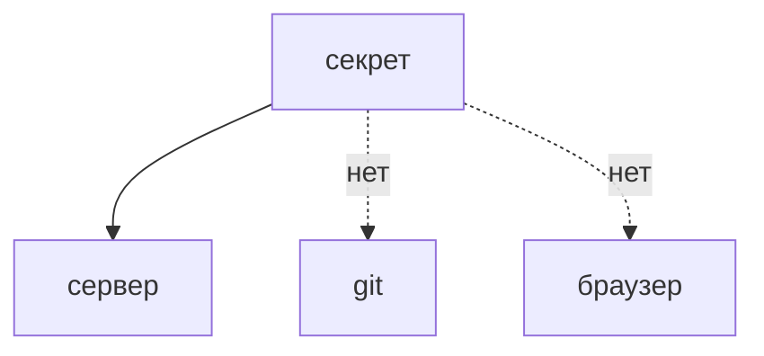

## Введение

Секрет, который попал в git, уже считайте известным. Удаление файла в следующем коммите историю не чистит. То же с клиентским бандлом: всё, что скачалось в браузер, больше не секрет.

## Раздел: Куда можно

Переменные окружения или хранилище секретов на сервере, разные значения для стендов, ротация после утечки. В образ «запекать» ключ нельзя: образ уезжает и кэшируется. В фронт нельзя класть ключ, которым можно писать в облако.

## Раздел: Ответ вслух

Секрет живёт на сервере, не в репозитории и не в браузере. Если он засветился в git, я меняю сам секрет, а не только стираю файл. В клиент можно отдать только то, что и так публично, например идентификатор, но не ключ записи.

## Раздел: Плохой ответ

Плохой ответ: «мы удалили .env в следующем коммите». История и форки секрет помнят.

## Раздел: Термины

Секрет — secret. Ротация — rotation. Окружение — environment. Утечка — leak.

## Лаба

**15 минут.** Найдите в учебном проекте места, куда секрет нельзя: фронт, Dockerfile, история git. Напишите, куда его положить вместо этого.

## Схема: Граница секрета

## Тест

### Ключ записи в облако попал в JS-бандл. Его ещё можно считать тайным?

**Ответ:** нет

**Пояснение:** Его скачал каждый клиент.

### Удалили .env коммитом. Секрет мёртв?

**Ответ:** нет, история жива

**Пояснение:** Нужна ротация.

### Один пароль на тест и прод. Чем плохо?

**Ответ:** тест становится продом

**Пояснение:** Утечка стенда открывает боевое.

### Секрет в слое Docker-образа. Достаточно не публиковать Dockerfile?

**Ответ:** нет, образ уже содержит слой

**Пояснение:** Слои смотрят отдельно.

### Что делать первым после утечки в чат?

**Ответ:** сменить секрет

**Пояснение:** Извинение не закрывает доступ.

## Шпаргалка

<ul><li>История git помнит</li><li>Браузер публичен</li><li>Утечка лечится сменой секрета</li></ul>

## Anki

### Front: Секрет в git. Что первым?

Back: Сменить секрет, не только удалить файл.

### Front: Можно ли ключ записи во фронт?

Back: Нет, бандл публичен.

### Front: Почему не один пароль на все стенды?

Back: Утечка слабого стенда открывает сильный.

### Front: Образ с ключом внутри?

Back: Ключ уезжает вместе с образом.

### Front: Куда класть секрет?

Back: Окружение или хранилище на сервере.

### Front: Удаление файла чистит историю?

Back: Нет.

## Итоги

- История git помнит
- Браузер публичен
- Утечка лечится сменой секрета

## Ссылки

- [Инъекции](/game/learn/sec-injection)
- [CI](/game/learn/ops-ci-pipeline)
