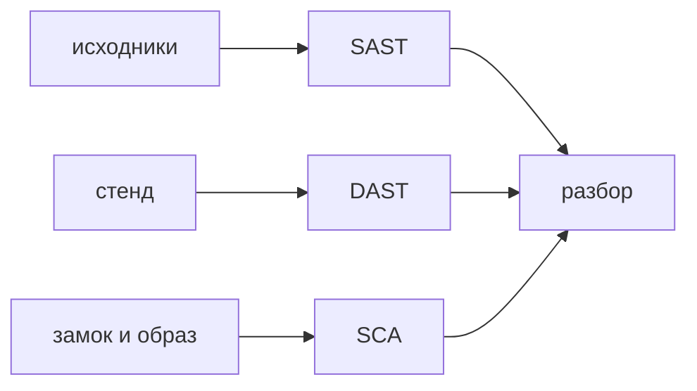

## Введение

Вакансии AppSec ставят в одну строку SAST, DAST и SCA: Semgrep или аналог по коду, ZAP или Burp по живому запросу, Trivy или Dependency-Check по зависимостям. На собеседовании их не смешивают и не считают отчёт готовым списком багов. Один смотрит исходники до выкладки и не видит, какой запрос реально дойдёт до ветки. Второй бьёт по поднятому стенду и не видит код, до которого запрос не дошёл. Третий знает опубликованные CVE в чужой библиотеке и не знает, вызываете ли вы опасный метод. Вместе они закрывают три вопроса. По отдельности каждый молчит о чужой зоне и шумит в своей.

Находка без разбора не равна дефекту. Разбор, triage, решает: это воспроизводимый сценарий, ложное срабатывание или риск, который осознанно отложили с датой. Ворота в CI ставят на подтверждённый класс, который команда умеет чинить, а не на сырое число строк в отчёте. Иначе сборка красная каждый день, и люди учатся нажимать «пропустить».

Выпуск раскладывает три находки сервиса заявок: склейка SQL в Python, кука без флага HttpOnly на ответе стенда и CVE в транзитивной библиотеке. У каждой свой сканер и свой первый вопрос перед заведением бага.

## Раздел: Кто что видит

SAST читает код и конфигурацию, не поднимая приложение. Он силён там, где опасный вызов виден текстом: склейка SQL, вызов оболочки со строкой запроса, отключённая проверка сертификата, секрет, похожий на ключ в репозитории. Он слаб на шуме. Не каждый `execute` — инъекция: строка может быть константой. Не каждый `innerHTML` в учебном примере доезжает до прода. Правило, которое кричит на весь репозиторий без пути от пользовательского ввода к опасному вызову, быстро отключают. Полезное правило коротко объясняет, какой источник и какой сток оно соединяет.

Статический разбор не видит поведения, которое собирается в рантайме из конфигурации стенда. Кука может появиться только в ответе конкретного маршрута. Поэтому «в коде чисто» не значит «ответ чистый».

DAST смотрит работающее приложение как клиент. Он шлёт запросы, читает заголовки, куки, коды, иногда пытается подставить типовые полезные нагрузки. Он видит лишний заголовок, куку без защитных флагов, открытый отладочный путь, отражение параметра в HTML. Он не видит ветку, до которой его сценарий не дошёл: роль, которую он не получил, кнопку за вторым шагом, который он не прошёл. Покрытие DAST — это покрытие его сценариев, не покрытие исходников. Отчёт «сканер прошёл» без списка маршрутов ничего не доказывает.

SCA смотрит замок зависимостей, пакеты и образы: известный CVE, иногда лицензию. Наличие записи в базе уязвимостей ещё не значит, что опасный метод вызывается вашим процессом. Транзитивная библиотека может лежать в дереве из-за инструмента сборки и не попадать в рантайм сервиса. Это отдельный разбор достижимости, не автоматический дефект на ночь. Путь, который вызывается и доступен снаружи, чинят или закрывают компенсирующим контролем со сроком. Путь, который не вызывается, записывают, почему не горит, и не делают вид, что отчёт пуст.

Триаж один на все три источника. Подтвердить на сценарии или на чтении кода. Оценить, достаёт ли это снаружи или только изнутри сети. Завести дефект с путём исправления либо явно закрыть как ложное с причиной, которую следующий прогон не откроет заново молча. Принятый риск имеет срок и хозяина. «Потом» без даты — это потерянная находка.

Ворота ставят узко. Например: новая склейка SQL в диффе блокирует слияние, потому что правило уже не шумит и команда знает, как параметризовать запрос. Весь отчёт SCA с сотней старых CVE не блокирует поставку целиком в первый день: очередь шума научит обходить ворота. Старое разбирают отдельно, новое не пускают. Так ворота растут от подтверждённых правил, а не от лицензии на сканер.

## Раздел: Разбор на примере

Первая находка. SAST на запросе слияния показывает место, где идентификатор фильтра подставляют в текст SQL. Вопрос перед багом: строка приходит от клиента или это внутренний перечень? Если от клиента, это дефект, слияние останавливают, даже если динамический сканер на стенде ещё не ходил в этот фильтр. Исправление — параметр запроса, не «подавить предупреждение». Если это константа, находку закрывают с причиной, иначе она вернётся в каждом прогоне и забьёт очередь.

Вторая находка. DAST на стенде видит куку сессии без HttpOnly. В исходнике флаг может собираться условием, и статический поиск по слову его не выделил. Вопрос: это кука сессии или техническая метка, которая не хранит доступ? Для сессии флаг нужен, дефект заводят на ответ, не на «сканер ругается». Проверка исправления — снова ответ стенда, не только дифф, потому что увидел проблему динамический прогон.

Третья находка. SCA пишет CVE высокой серьёзности в транзитивной библиотеке разбора XML. Вопрос: наш сервис вообще разбирает XML этой библиотекой на пути запроса? Если да и вход снаружи, обновление или другой разбор — работа со сроком. Если библиотека попала в замок через тест и в образ рантайма не входит, это не ночной блокер. Запись «недостижимо, потому что не в образе» обязательна. Удалить предупреждение без записи значит встретить ту же строку после следующего обновления замка и спорить заново.

В ворота этой команды на этой неделе попадает только первая категория: новая пользовательская склейка SQL. Кука чинится в обычном приоритете, пока нет признака, что её уже читает чужой скрипт. CVE без достижимости не красится в блокер. Через месяц, когда шум по кукам разобран, ворота могут расшириться. Расширение после разбора, не до него.

## Раздел: Где это ломается

Все сканеры включают блокером в первый день. Очередь красная, поставка стоит, люди ставят исключения на весь репозиторий. Исключение без причины хуже, чем узкие ворота.

Сырое число находок выносят на демо как «уровень безопасности». Сто ложных и один достижимый CVE выглядят одинаково в счётчике. Считают разобранное и открытые подтверждённые дефекты.

DAST гоняют против прода без границ и без учёта побочных эффектов. Сканер создаёт заявки, дергает оплату, путает данные. Динамический прогон — на стенде, с учёткой, которой можно мусорить, по маршрутам, которые перечислены.

SAST считают доказательством отсутствия дыр. Он не видит дыру доступа «этот id можно подставить», если нет шаблона. Модель и ревью закрывают смысл, сканер — шаблон.

CVE закрывают обновлением «всего и сразу» в пятницу без тестов. Обновление само становится инцидентом. Достижимое обновляют с прогоном, недостижимое записывают.

Ложное закрывают кнопкой «ignore» без текста. Та же находка возвращается у другого человека, и её чинят как новую или снова прячут. Причина в правиле подавления или в тикете.

## Раздел: Ответ вслух

SAST гоняю на изменении в запросе на слияние, DAST — на стенде по известным маршрутам, SCA — на замке зависимостей и образе. Каждую новую находку либо воспроизвожу, либо помечаю ложной с причиной, либо принимаю риск со сроком. CVE без вопроса «вызывается ли путь» дефектом не называю. В ворота пускаю правило, которое команда умеет чинить, иначе сборка красная без пользы. Три сканера не заменяют друг друга: код, ответ и чужой пакет — разные поверхности.

## Раздел: Плохой ответ

Плохой ответ: «включим все сканеры в блокер с первого дня». Очередь из шума научит людей нажимать «пропустить». Второй плохой ответ: «отчёт пустой, значит безопасно». Пустота значит, что правила не сработали на том, что они умеют. Она не смотрит право на объект и не смотрит ветку, куда запрос не ходил.

## Раздел: Термины

Статический анализ — SAST, разбор исходников и настроек до запуска. Динамический — DAST, запросы к работающему приложению. Анализ состава — SCA, зависимости и образы на известные уязвимости. Разбор находки — triage. Ложное срабатывание — false positive. Достижимость — вызывается ли уязвимый путь. Ворота — условие, без которого изменение не сливают. Принятый риск — записанное «живём до даты».

## Лаба

**Цель.** Развести три находки по сканерам и не завести баг вслепую.

**Шаги.**

1. Возьмите склейку SQL в Python, куку без HttpOnly на ответе стенда и CVE в транзитивной библиотеке.
2. Подпишите, кто это увидел: SAST, DAST или SCA. Одну находку не отдавайте всем троим «на всякий случай».
3. Для SQL напишите вопрос: данные от пользователя или константа. Если от пользователя, слияние останавливают.
4. Для куки напишите, чем подтвердите исправление: повторным ответом стенда.
5. Для CVE напишите вопрос достижимости и два исхода: обновлять или записать, почему не в рантайме.
6. Выберите одно правило, которое имеет право быть воротами на этой неделе, и почему не весь отчёт.

**Готово, если…**

- [ ] У каждой находки свой сканер
- [ ] Перед багом есть один вопрос
- [ ] Ложное без причины не предлагается
- [ ] Ворота уже, чем сырой отчёт

## Схема: Три входа

## Тест

### Кто увидит инъекцию в исходнике до выкладки?

**Ответ:** SAST

**Пояснение:** Динамический сканер ещё не имеет работающего запроса.

### Кто увидит лишнюю куку на ответе стенда?

**Ответ:** DAST

**Пояснение:** В исходнике кука может собираться условием, которое видно только в ответе.

### CVE в библиотеке. Это уже дыра продукта?

**Ответ:** ещё нет

**Пояснение:** Нужно понять, вызывается ли уязвимый путь.

### Почему сырой отчёт не ставят блокером целиком?

**Ответ:** шум остановит поставку

**Пояснение:** Ворота держат на правилах, которые команда подтвердила.

### Что сделать с ложным срабатыванием?

**Ответ:** закрыть с причиной

**Пояснение:** Иначе та же находка вернётся и забьёт очередь.

## Шпаргалка

<ul><li>SAST — код</li><li>DAST — запрос к стенду</li><li>SCA — чужой пакет</li><li>Находка проходит разбор</li><li>Ворота уже сырого отчёта</li></ul>

## Anki

### Front: Расшифровка SAST?

Back: Статический разбор исходников и настроек до запуска.

### Front: Расшифровка DAST?

Back: Запросы к работающему приложению снаружи.

### Front: Расшифровка SCA?

Back: Проверка зависимостей и образов на известные уязвимости.

### Front: Что такое triage?

Back: Решить, дефект это, ложное срабатывание или принятый риск.

### Front: Почему CVE не равен багу?

Back: Опасный код библиотеки может не вызываться.

### Front: Куда ставить SAST в поставке?

Back: На изменение в запросе на слияние, до выкладки.

## Итоги

- Три сканера не заменяют друг друга
- Отчёт без разбора — шум
- CVE ещё не дыра, пока не ясен путь
- Ворота растут от подтверждённых правил
- Ложное закрывают с причиной, иначе оно вернётся

## Ссылки

- [Инъекции](/game/learn/sec-authn-authz)
- [Secure SDLC](/game/learn/sec-sdlc)
