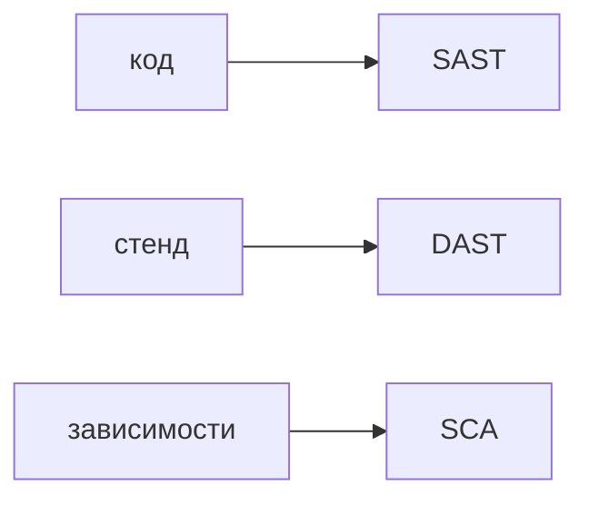

## Введение

Вакансии AppSec требуют SAST, DAST и SCA: Semgrep, ZAP или Burp, Trivy или Dependency-Check. На собесе их не смешивают и не считают отчёт готовым списком багов.

## Раздел: Кто что видит

SAST читает код и конфигурацию до выкладки. Он силён на опасных вызовах и слаб на шуме: не каждый `execute` — инъекция, если строка не от пользователя.

DAST бьёт по поднятому приложению как клиент. Он видит заголовок, куку и ответ. Он не видит ветку, до которой запрос не дошёл.

SCA смотрит зависимости и образы: известный CVE в библиотеке. Наличие CVE ещё не значит, что опасный метод вызывается. Это отдельный разбор.

Триаж: подтвердить на сценарии, оценить доступность снаружи, завести дефект с путём исправления или явно закрыть как ложное. Ворота в CI ставят на подтверждённый класс, не на сырое число находок.

## Раздел: Ответ вслух

SAST гоняю на изменении в запросе на слияние, DAST — на стенде, SCA — на замке зависимостей и образе. Каждую новую находку либо воспроизвожу, либо помечаю ложной с причиной. В ворота пускаю правило, которое команда умеет чинить, иначе сборка красная без пользы.

## Раздел: Плохой ответ

Плохой ответ: «включим все сканеры в блокер с первого дня». Очередь из шума научит людей нажимать «пропустить».

## Раздел: Термины

Статический анализ — SAST. Динамический — DAST. Состав зависимостей — SCA. Разбор находки — triage. Ложное срабатывание — false positive.

## Лаба

**25 минут.** Разложите три находки: склейка SQL в Python, заголовок без флага HttpOnly на стенде, CVE в транзитивной библиотеке. Для каждой напишите, какой сканер её увидел и какой один вопрос вы зададите перед заведением бага.

## Схема: Где стоит сканер

## Тест

### Кто увидит инъекцию в исходнике до выкладки?

**Ответ:** SAST

**Пояснение:** Динамический сканер ещё не имеет работающего запроса.

### Кто увидит лишнюю куку на ответе стенда?

**Ответ:** DAST

**Пояснение:** В исходнике кука может собираться условием, которое видно только в ответе.

### CVE в библиотеке. Это уже дыра продукта?

**Ответ:** ещё нет

**Пояснение:** Нужно понять, вызывается ли уязвимый путь.

### Почему сырой отчёт не ставят блокером целиком?

**Ответ:** шум остановит поставку

**Пояснение:** Ворота держат на правилах, которые команда подтвердила.

### Что сделать с ложным срабатыванием?

**Ответ:** закрыть с причиной

**Пояснение:** Иначе та же находка вернётся и забьёт очередь.

## Шпаргалка

<ul><li>SAST — код</li><li>DAST — запрос к стенду</li><li>SCA — чужой пакет</li><li>Находка проходит разбор</li></ul>

## Anki

### Front: Расшифровка SAST?

Back: Статический разбор исходников и настроек до запуска.

### Front: Расшифровка DAST?

Back: Запросы к работающему приложению снаружи.

### Front: Расшифровка SCA?

Back: Проверка зависимостей и образов на известные уязвимости.

### Front: Что такое triage?

Back: Решить, дефект это, ложное срабатывание или принятый риск.

### Front: Почему CVE не равен багу?

Back: Опасный код библиотеки может не вызываться.

### Front: Куда ставить SAST в поставке?

Back: На изменение в запросе на слияние, до выкладки.

## Итоги

- Три сканера не заменяют друг друга
- Отчёт без разбора — шум
- Ворота растут от подтверждённых правил

## Ссылки

- [Инъекции](/game/learn/sec-injection)
- [Secure SDLC](/game/learn/sec-sdlc)
