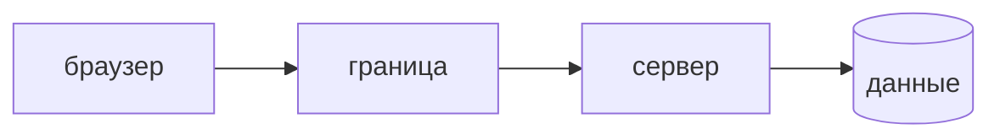

## Введение

AppSec-вакансии ждут threat modeling до кода, не после инцидента. На собесе хватает одного потока «заявка» и честного списка, чему вы не доверяете.

## Раздел: Лист

Актив — то, что больно потерять: запись заявки, токен, персональные данные. Актор — пользователь, сотрудник, внешний сервис, злоумышленник без учётки. Граница доверия — место, где данные перестают быть «нашими»: браузер, чужой API, очередь.

Сценарий пишут глаголом: подменить автора заявки, прочитать чужой объект, положить скрипт в поле, которое вернётся другому человеку. Для сценария называют контроль: проверка права на сервере, параметризованный запрос, ограничение разметки.

Полный STRIDE по каждому полю на старте не нужен. Нужен один сценарий, который команда закрывает в этой итерации, и явный отложенный риск.

## Раздел: Ответ вслух

Я рисую, откуда приходят данные и где решение о доступе. Браузеру и очереди я не доверяю содержимое. Для потока выбираю один сценарий злоупотребления и контроль, который его закрывает. Остальное записываю как отложенный риск, а не делаю вид, что модель «вся закрыта».

## Раздел: Плохой ответ

Плохой ответ: «угрозы — это вирус и файрвол». Для приложения угроза начинается с запроса, который ваш же API принимает.

## Раздел: Термины

Модель угроз — threat model. Актив — asset. Граница доверия — trust boundary. Сценарий злоупотребления — abuse case. Контроль — control.

## Лаба

**20 минут.** На потоке «создать заявку из браузера» отметьте актив, границу и один сценарий: клиент присылает чужой user id. Напишите контроль на сервере и что вы сознательно не моделируете в этой итерации.

## Схема: Граница

## Тест

### Что такое граница доверия?

**Ответ:** место, где данным нельзя верить

**Пояснение:** Браузер, чужой сервис и сообщение из очереди — за границей.

### Зачем сценарий злоупотребления?

**Ответ:** назвать конкретную атаку на поток

**Пояснение:** Список страшилок без потока не даёт контроля в задаче.

### Клиент прислал роль администратора в JSON. Где контроль?

**Ответ:** на сервере по сессии

**Пояснение:** Поле тела не доказательство права.

### Нужно ли закрыть все пункты STRIDE в первом релизе?

**Ответ:** нет, нужен выбранный риск

**Пояснение:** Отложенное записывают явно, иначе модель притворяется полной.

### Чем модель отличается от отчёта сканера?

**Ответ:** она про сценарий до кода

**Пояснение:** Сканер ищет шаблон в уже написанном. Модель выбирает, что писать.

## Шпаргалка

<ul><li>Актив и актор</li><li>Граница, где не верим</li><li>Один сценарий и один контроль</li><li>Отложенный риск записан</li></ul>

## Anki

### Front: Что такое asset в модели угроз?

Back: То, потеря или порча чего причиняет вред.

### Front: Что такое trust boundary?

Back: Линия, за которой вход считают недоверенным.

### Front: Что такое abuse case?

Back: Сценарий, как актор ломает поток в свою пользу.

### Front: Где проверять право, если роль пришла в теле?

Back: На сервере, из уже установленной сессии.

### Front: Зачем писать отложенный риск?

Back: Чтобы не считать неразобранное закрытым.

### Front: STRIDE на старте целиком?

Back: Нет. Берут сценарий текущей поставки.

## Итоги

- Модель начинается с потока данных
- Контроль стоит на границе
- Незакрытое называют, а не прячут

## Ссылки

- [Аутентификация и авторизация](/game/learn/sec-authn-authz)
- [Secure SDLC](/game/learn/sec-sdlc)
