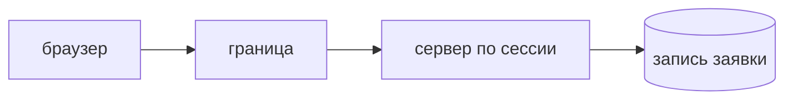

## Введение

AppSec-вакансии ждут модель угроз до кода, не после инцидента. На собеседовании не нужен полный плакат STRIDE на каждый метод. Нужен один поток, который команда и так собирается выпускать, и честный список того, чему на этом потоке нельзя верить. Для сервиса заявок хватает листа «создать заявку из браузера»: что больно потерять, кто приходит с той стороны границы, какой один сценарий злоупотребления закрывают в этой итерации и что сознательно откладывают.

Модель отличается от отчёта сканера. Сканер ищет известный шаблон в уже написанном. Модель выбирает, что писать и какой контроль поставить, пока ещё дёшево перенести проверку права на сервер, а не прятать кнопку. Список страшилок без потока не даёт задачи. «Возможен вирус и нужен файрвол» не говорит, что делать с полем `userId` в JSON.

Выпуск собирает такой лист и показывает, куда девается контроль: в историю, в критерий, в ревью. Незакрытое записывают как отложенный риск, а не объявляют модель полной.

## Раздел: Лист

Актив — то, потеря, порча или утечка чего причиняет вред. У заявки это сама запись, вложенный текст, токен сессии, персональные данные автора. «Сервер» активом слишком крупный: его нельзя защитить одним контролем. Берут то, что лежит в потоке этой поставки.

Актор — кто действует. Обычный пользователь, сотрудник с другой ролью, внешний сервис, человек без учётки. Актор не обязан быть «хакером в капюшоне». Часто это клиент, который подставляет чужой идентификатор, потому что форма это позволяет, или скрипт, который шлёт то же, что шлёт браузер. Модель без актора превращается в свойства системы «должна быть безопасной».

Граница доверия — линия, за которой данным нельзя верить. Браузер за границей: всё, что он прислал, могли подменить. Чужой API за границей. Сообщение из очереди за границей, если его мог положить не только ваш процесс. Своя база по эту сторону, но только после того, как сервер сам решил, что писать. Границу рисуют на потоке, не на оргструктуре. «Внутренний сотрудник» не отменяет границу браузера: его браузер тоже присылает JSON.

Сценарий злоупотребления пишут глаголом на этом потоке. Подменить автора заявки, прочитать чужой объект, положить в поле разметку, которая вернётся другому человеку, положить в очередь событие без подписи. Для сценария называют контроль: проверка права на сервере по сессии, а не по полю роли в теле; параметризованный запрос; текст на экране, а не сырой HTML. Контроль — место в системе, которое делает сценарий невыгодным или невозможным. «Будьте внимательны» контролем не считается.

Полный STRIDE по каждому полю на старте не нужен. Подмена, раскрытие, отказ, отрицание авторства и повышение прав — полезная сетка, когда лист уже есть и вы проверяете, не забыли ли класс. На старте берут один сценарий, который команда закрывает в этой итерации, и явный отложенный риск. Отложенное без записи считается закрытым по умолчанию, и модель врёт. Запись короткая: что не моделировали, почему можно подождать, когда вернуться. Например: «отказ в обслуживании очереди не берём в эту поставку, вернёмся, когда появится внешний продюсер».

Модель живёт рядом с историей. Один абзац в задаче или на странице решения лучше отдельного документа, который не открывают. Если сценарий не попал в критерий или в проверку ревью, листа не было.

## Раздел: Разбор на примере

Поток: браузер создаёт заявку. Актив — запись заявки и идентификатор автора. Актор — любой, кто может послать POST, включая владельца обычной учётки. Граница — между браузером и API. Телу запроса не верят.

Сценарий этой итерации: клиент присылает чужой `userId` и становится автором чужих заявок или создаёт заявку от имени коллеги. Контроль: сервер берёт автора из сессии, поле `userId` в теле игнорирует или сверяет и отклоняет. Критерий истории говорит это наблюдаемо: заявка создаётся от текущего пользователя, чужой идентификатор в теле статус автора не меняет. Ревью смотрит, что ручка не пишет `body.userId` в колонку.

Второй сценарий, который видно сразу, но не берут в ту же поставку: в заголовке заявки приедет разметка, и другой сотрудник увидит её как HTML. Его записывают отложенным, если экран ещё не показывает заголовок другим людям, и ставят срок — до того экрана, не «когда-нибудь». Если экран уже общий, откладывать нельзя: это тот же релиз. Честность модели в том, что откладывают только то, что правда не в этом потоке наружу.

Что не пишут на листе. «Нужен WAF». «Шифровать всё». «STRIDE: да». Без актора, границы и контроля это не лист, это слова. WAF может быть компенсирующим слоем позже. Он не заменяет решение сервера, кому принадлежит заявка.

Связь со сканером. Модель не найдёт эту дыру регулярным выражением, если автор просто присвоил поле. Её находит вопрос «откуда берётся автор». Поэтому модель стоит до кода и повторяется на ревью диффа. Отчёт SAST может быть пустым, сценарий при этом открыт.

## Раздел: Где это ломается

Модель делают после инцидента и прячут в презентацию. Контроль уже дорогой: данные чужие, миграция, разбор. Лист на один поток в начале истории дешевле.

Рисуют границы по микросервисам, но верят браузеру. Внутренний вызов между своими сервисами тоже граница, если тот сервис принимает то, что пришло от клиента, и не проверяет заново. «Нас вызвал свой шлюз» не доказывает право пользователя.

Закрывают все буквы STRIDE галочками в первый день. Галочки без контроля создают чувство полноты. Один закрытый сценарий и список отложенного честнее.

Сценарий без глагола: «угроза конфиденциальности». Из этого не получается теста. «Чужой id в теле меняет автора» получается.

Контроль стоит только в интерфейсе. Кнопку спрятали, запрос с чужим id всё ещё проходит. Контроль на сервере, интерфейс лишь не зовёт людей в дыру.

Отложенный риск не имеет даты. Его не возвращают, когда появляется экран, ради которого риск откладывали. Дата или событие-триггер обязательны.

Модель не связана с задачей. Документ в вики, в спринте другие критерии. Сценарий, который не в истории, не будет сделан.

## Раздел: Ответ вслух

Я рисую поток, откуда приходят данные и где решение о доступе. Браузеру, чужому API и очереди я не доверяю содержимое. Актив называю конкретно: запись заявки, а не «система». Для потока выбираю один сценарий злоупотребления и контроль на сервере. Остальное записываю как отложенный риск с поводом вернуться, а не делаю вид, что модель вся закрыта. Полный STRIDE на старте не обещаю. Если роль пришла в JSON, право беру из сессии.

## Раздел: Плохой ответ

Плохой ответ: «угрозы — это вирус и файрвол». Для приложения угроза начинается с запроса, который ваш же API принимает. Второй плохой ответ: «мы заполнили таблицу STRIDE, значит безопасно». Таблица без контроля в коде не меняет поведение ручки.

## Раздел: Термины

Модель угроз — threat model. Актив — asset, то, что больно потерять или испортить. Актор — кто действует, не обязательно внешний злоумышленник. Граница доверия — trust boundary. Сценарий злоупотребления — abuse case. Контроль — control, механизм, который сценарий закрывает. STRIDE — сетка классов угроз, не обязательный объём первого релиза. Отложенный риск — записанное «не в этой поставке».

## Лаба

**Цель.** Собрать один лист на создание заявки и не притвориться, что закрыто всё.

**Шаги.**

1. Назовите актив потока «создать заявку из браузера» и актора, который может послать тот же POST, что и форма.
2. Проведите границу: что в теле запроса считается недоверенным.
3. Опишите один сценарий: клиент присылает чужой user id. Контроль — автор берётся из сессии, поле тела не определяет автора.
4. Сформулируйте наблюдаемый критерий, который можно отдать в историю.
5. Запишите один отложенный риск, который не входит в эту итерацию, и событие, когда к нему вернуться. Не оставляйте его пустым «и так понятно».
6. Одной фразой объясните, почему спрятанная кнопка этот сценарий не закрывает.

**Готово, если…**

- [ ] Есть актив, актор и граница
- [ ] Сценарий сформулирован глаголом
- [ ] Контроль стоит на сервере
- [ ] Отложенное записано, а не объявлено закрытым

## Схема: Граница

## Тест

### Что такое граница доверия?

**Ответ:** место, где данным нельзя верить

**Пояснение:** Браузер, чужой сервис и сообщение из очереди — за границей.

### Зачем сценарий злоупотребления?

**Ответ:** назвать конкретную атаку на поток

**Пояснение:** Список страшилок без потока не даёт контроля в задаче.

### Клиент прислал роль администратора в JSON. Где контроль?

**Ответ:** на сервере по сессии

**Пояснение:** Поле тела не доказательство права.

### Нужно ли закрыть все пункты STRIDE в первом релизе?

**Ответ:** нет, нужен выбранный риск

**Пояснение:** Отложенное записывают явно, иначе модель притворяется полной.

### Чем модель отличается от отчёта сканера?

**Ответ:** она про сценарий до кода

**Пояснение:** Сканер ищет шаблон в уже написанном. Модель выбирает, что писать.

## Шпаргалка

<ul><li>Актив и актор</li><li>Граница, где не верим</li><li>Один сценарий и один контроль</li><li>Отложенный риск записан</li><li>Контроль на сервере, не на кнопке</li></ul>

## Anki

### Front: Что такое asset в модели угроз?

Back: То, потеря или порча чего причиняет вред.

### Front: Что такое trust boundary?

Back: Линия, за которой вход считают недоверенным.

### Front: Что такое abuse case?

Back: Сценарий, как актор ломает поток в свою пользу.

### Front: Где проверять право, если роль пришла в теле?

Back: На сервере, из уже установленной сессии.

### Front: Зачем писать отложенный риск?

Back: Чтобы не считать неразобранное закрытым.

### Front: STRIDE на старте целиком?

Back: Нет. Берут сценарий текущей поставки.

## Итоги

- Модель начинается с потока данных, не с таблицы страшилок
- Контроль стоит на границе и на сервере
- Один закрытый сценарий честнее полного листа галочек
- Незакрытое называют и датируют
- Сканер не заменяет вопрос «откуда взялся автор»

## Ссылки

- [Аутентификация и авторизация](/game/learn/sec-authn-authz)
- [Secure SDLC](/game/learn/sec-sdlc)
