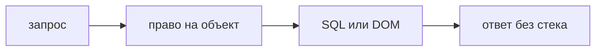

## Введение

Вакансии просят читать Python и JavaScript, чтобы видеть уязвимый шаблон, а не только уметь запустить сканер. Security review — это ревью с узким списком вопросов. Оно не повторяет обычный code review про имена и не заменяет SAST. Обычное ревью спрашивает, совпало ли поведение с задачей. Разбор на безопасность спрашивает, что сможет сделать человек, который пошлёт запрос мимо интерфейса или подставит строку туда, где её исполнят. Сканер знает известный шаблон. Глаза видят новый смысл: этот идентификатор взяли из тела, эту строку вставили в HTML, этот токен попал в лог.

Четыре места покрывают большую часть прикладных дыр в связке FastAPI и React. Доступ на объект. Происхождение строки, которая становится SQL, командой, путём или разметкой. Секрет и лишние данные в журнале и в бандле. Контракт ошибки: что уезжает клиенту при 500. Замечание формулируют как сценарий: кто вызовет и что получит. «Небезопасно» автор не чинит.

## Раздел: Четыре места

Доступ. Каждый путь, который читает или меняет объект, проверяет право на этот объект на сервере. Спрятанная кнопка в React не считается: запрос можно собрать руками. Вопрос к диффу один: откуда взялся идентификатор и какая строка запрещает чужому. Если идентификатор из URL, а фильтра по владельцу нет, это блокер, даже когда задача была «просто поправить поле». Роль, присланная в JSON, не доказательство. Право берут из сессии, которую сервер сам установил.

Происхождение строки. Ищут сток: место, где данные становятся командой, запросом или HTML. SQL, собранный конкатенацией с куском запроса. Вызов оболочки. Путь к файлу из параметра. Разметка, в которую попал текст заявки. Параметр запроса и шаблон — разные вещи: параметр не исполняется как SQL. Если в склейку попали данные запроса, это вопрос номер один, раньше стиля. На экране название заявки показывают как текст. Вставка HTML-строки — сток, даже если «сейчас там никто не пишет скрипт». Завтра напишет.

Секрет и журнал. Ключ, токен, тело с паспортом или с полным текстом чужой заявки не печатают «для отладки». То же во фронтовом бандле: переменная сборки, которая попадает в клиент, не место для ключа записи. Ключ чтения публичного конфига и ключ, которым подписывают сессию, не одно и то же. В диффе ищут новые `print`, логирование тела и префикс переменной, которая встраивается в статику.

Контракт ошибки. Стек, внутренний путь и строка SQL в JSON ответа 500 помогают понять устройство сервера. Наружу — код и короткое сообщение. Подробность остаётся в журнале на сервере, без секрета. Дифф, который «для удобства фронта» прокидывает `str(exception)`, останавливают.

Сканер мог это не увидеть. Новая склейка ещё не в правиле. Проверка владельца вообще не похожа на шаблон инъекции. Поэтому молчание SAST при дыре в диффе не повод сливать. Оба нужны: глаза на смысл этого изменения, сканер на известный класс по всему репозиторию.

## Раздел: Разбор на примере

Ручка `PATCH /tickets/{id}` меняет заголовок. В диффе берут `id` из пути и пишут `UPDATE` без проверки, что заявка этого пользователя. Замечание: «любой, кто знает id, меняет чужой заголовок; нужна проверка владельца до записи, ожидаю отказ». Это не стиль. Рядом в том же диффе заголовок логируют целиком. Второе замечание: убрать текст из лога или оставить идентификатор без содержания.

Компонент рисует название через вставку HTML, потому что в макете было жирное слово. Замечание: показать название как текст, жирное сделать разметкой приложения, не строкой с сервера. Сценарий: автор заявки кладёт в название фрагмент скрипта, сотрудник поддержки открывает карточку. Даже если сегодня скрипт не подтверждён, сток уже есть.

Ответ 500 отдаёт трассировку, чтобы «фронт показал детали». Замечание: клиенту код ошибки, трассировку оставить на сервере. Иначе перечисление таблиц уезжает в браузер.

Что не пишут в этом проходе. Имя переменной `t`. Длину функции, если она не прячет отсутствие проверки. Обычное ревью может сказать об имени следом. Разбор на безопасность не начинает с него.

Если сканер молчит, а склейка в диффе видна, слияние останавливают. Правило сканера потом дополняют, чтобы следующий такой дифф поймался сам. Сначала люди, потом автоматизация класса, который уже подтвердили.

## Раздел: Где это ломается

Ревью сводят к линтеру. Линтер не знает, можно ли этому пользователю этот объект. Зелёный SAST при отсутствующей проверке владельца — типичная дыра, которую «автоматика пропустила» честно, потому что её не просили.

Смотрят только бэкенд. Секрет в переменной React и `dangerouslySetInnerHTML` уезжают в том же запросе. Дифф читают целиком по четырём местам, не по языку.

Замечание без сценария. «Потенциальная уязвимость» не говорит, какой запрос послать. Автор спорит. Сценарий «чужой id, ожидаю отказ» спорить не о чем.

Прячут стек на фронте, а не на сервере. Клиент его просто не рисует, но ответ сети уже содержит пути. Режут тело ответа.

Логируют «временно» на время инцидента и забывают. Временный лог тела — такой же дефект, как постоянный. Срок удаления или сразу идентификатор без содержания.

Считают code review безопасности отдельной редкой церемонией раз в квартал. Дыра уезжает в ближайшем сливе. Узкий список вопросов входит в обычный проход опасных ручек, а не в отдельный фестиваль.

## Раздел: Ответ вслух

В диффе FastAPI я ищу, откуда взялся идентификатор и есть ли проверка права на объект. В SQL и в вызовах оболочки ищу склейку с данными запроса. В React смотрю, не попал ли чужой HTML в разметку и не лежит ли секрет в переменной сборки, которая попадёт в браузер. В ответе ошибки не хочу видеть стек. Замечание пишу сценарием: кто вызовет и что получит. Сканер, который молчит, не отменяет стоп на видимой склейке. Имена обсуждаю после этих четырёх мест.

## Раздел: Плохой ответ

Плохой ответ: «security review — это прогнать линтер». Линтер не знает права на объект и не знает, секрет ли строка в бандле. Второй плохой ответ: «кнопки нет, значит нельзя». Кнопки нет у честного клиента. Запрос к API остаётся.

## Раздел: Термины

Разбор на безопасность — security code review. Источник данных — source, откуда строка пришла. Сток — sink, где она становится командой, запросом или HTML. Проверка права — authorization check на конкретный объект, не только «пользователь вошёл». Бандл — собранный клиентский код, который видит браузер. Контракт ошибки — что позволено увидеть клиенту.

## Лаба

**Цель.** Прочитать одну ручку и один компонент как сценарий, не как стиль.

**Шаги.**

1. Мысленно откройте `PATCH /tickets/{id}` и компонент, который рисует название заявки.
2. Выпишите вопрос доступа: кто имеет право на этот id и какая ветка отвечает отказам. Безопасный вариант — проверка на сервере до записи.
3. Выпишите вопрос стока: как название попадёт в DOM. Безопасный вариант — текст, не HTML-строка с сервера.
4. Добавьте третьей строкой, чего не должно быть в логе и в теле 500: содержимое заявки и стек.
5. Сформулируйте одно замечание к ревью в виде сценария, если проверки владельца нет.
6. Напишите, что делаете, если SAST при этой склейке молчит: останавливаете слияние и потом расширяете правило.

**Готово, если…**

- [ ] Доступ отделён от видимости кнопки
- [ ] Название не объявлено разметкой
- [ ] Замечание содержит ожидаемый отказ
- [ ] Молчание сканера не названо разрешением слить

## Схема: От входа до стока

## Тест

### Что смотреть раньше стиля в security review?

**Ответ:** право и происхождение строки

**Пояснение:** Кривое имя не открывает чужую заявку.

### Кнопка скрыта в React. Доступ закрыт?

**Ответ:** нет, решает сервер

**Пояснение:** Запрос можно послать мимо интерфейса.

### Какой сток опасен для текста заявки на экране?

**Ответ:** вставка HTML

**Пояснение:** Текст показывают как текст, не как разметку.

### Стек исключения в JSON клиенту. Чем плохо?

**Ответ:** отдаёт устройство сервера

**Пояснение:** Наружу достаточно кода ошибки без внутренних путей.

### Сканер молчит, в диффе склейка SQL. Что делать?

**Ответ:** остановить слияние

**Пояснение:** Новый код может быть вне правила сканера.

## Шпаргалка

<ul><li>Право на объект на сервере</li><li>Нет склейки в SQL и оболочку</li><li>Секрет не в бандле и не в логе</li><li>Наружу без стека</li><li>Замечание — это сценарий</li></ul>

## Anki

### Front: Что такое sink?

Back: Место, где недоверенные данные становятся командой, запросом или HTML.

### Front: Прячет ли UI авторизацию?

Back: Нет. Проверка права живёт на сервере.

### Front: Как показать название заявки в React?

Back: Как текст, не через вставку HTML-строки.

### Front: Что нельзя писать в лог целиком?

Back: Токен, ключ и лишние персональные данные.

### Front: Чем security review отличается от обычного?

Back: Ищет сценарий злоупотребления, не качество имён.

### Front: Сканер заменяет такое ревью?

Back: Нет. Глаза видят новый смысл, сканер — известный шаблон.

## Итоги

- Diff читают как сценарий, не как стиль
- Сервер решает доступ на объект
- Строка пользователя не становится командой и не становится HTML
- Секрет не уезжает в бандл и в журнал
- Молчание сканера не отменяет видимую дыру

## Ссылки

- [SAST, DAST, SCA](/game/learn/sec-sast-dast-sca)
- [Code review](/game/learn/py-code-review)
