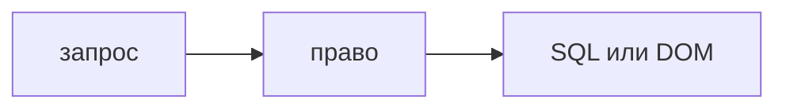

## Введение

Вакансии просят читать Python и JavaScript, чтобы видеть уязвимый шаблон. Это ревью с узким списком, а не повтор обычного code review и не замена сканера.

## Раздел: Четыре места

Доступ: каждый путь, который читает или меняет объект, проверяет право на этот объект на сервере. Спрятанная кнопка в React не считается.

Происхождение строки: кусок SQL, команда оболочки, HTML, путь к файлу. Если в склейку попали данные запроса, это вопрос номер один. Параметр запроса и шаблон — разные вещи.

Секрет и лишнее в журнале: ключ, токен, тело с паспортом. То же во фронтовом бандле: ключ записи нельзя собирать в клиент.

Контракт ошибки: стек и внутренний адрес в ответе 500 помогают атакующему. Наружу — код и короткое сообщение.

Сканер мог это не увидеть, если ветка новая. Глаза смотрят diff, сканер смотрит шаблон. Оба нужны.

## Раздел: Ответ вслух

В диффе FastAPI я ищу, откуда взялся идентификатор и есть ли проверка права. В SQL ищу склейку. В React смотрю, не попал ли чужой HTML в разметку и не лежит ли секрет в переменной сборки, которая попадёт в браузер. Замечание формулирую как сценарий: кто вызовет и что получит.

## Раздел: Плохой ответ

Плохой ответ: «security review — это прогнать линтер». Линтер не знает, можно ли этому пользователю этот объект.

## Раздел: Термины

Разбор на безопасность — security code review. Источник данных — source. Сток — sink. Проверка права — authorization check.

## Лаба

**20 минут.** Прочитайте мысленно ручку `PATCH /tickets/{id}` и компонент, который рисует название заявки. Выпишите два вопроса: кто имеет право на id и как название попадёт в DOM. На каждый дайте безопасный вариант одной фразой.

## Схема: От входа до стока

## Тест

### Что смотреть раньше стиля в security review?

**Ответ:** право и происхождение строки

**Пояснение:** Кривое имя не открывает чужую заявку.

### Кнопка скрыта в React. Доступ закрыт?

**Ответ:** нет, решает сервер

**Пояснение:** Запрос можно послать мимо интерфейса.

### Какой сток опасен для текста заявки на экране?

**Ответ:** вставка HTML

**Пояснение:** Текст показывают как текст, не как разметку.

### Стек исключения в JSON клиенту. Чем плохо?

**Ответ:** отдаёт устройство сервера

**Пояснение:** Наружу достаточно кода ошибки без внутренних путей.

### Сканер молчит, в диффе склейка SQL. Что делать?

**Ответ:** остановить слияние

**Пояснение:** Новый код может быть вне правила сканера.

## Шпаргалка

<ul><li>Право на объект на сервере</li><li>Нет склейки в SQL и оболочку</li><li>Секрет не в бандле и не в логе</li><li>Наружу без стека</li></ul>

## Anki

### Front: Что такое sink?

Back: Место, где недоверенные данные становятся командой, запросом или HTML.

### Front: Прячет ли UI авторизацию?

Back: Нет. Проверка права живёт на сервере.

### Front: Как показать название заявки в React?

Back: Как текст, не через вставку HTML-строки.

### Front: Что нельзя писать в лог целиком?

Back: Токен, ключ и лишние персональные данные.

### Front: Чем security review отличается от обычного?

Back: Ищет сценарий злоупотребления, не качество имён.

### Front: Сканер заменяет такое ревью?

Back: Нет. Глаза видят новый смысл, сканер — известный шаблон.

## Итоги

- Diff читают как сценарий атаки
- Сервер решает доступ
- Строка пользователя не становится командой и не становится HTML

## Ссылки

- [SAST, DAST, SCA](/game/learn/sec-sast-dast-sca)
- [Code review](/game/learn/py-code-review)
