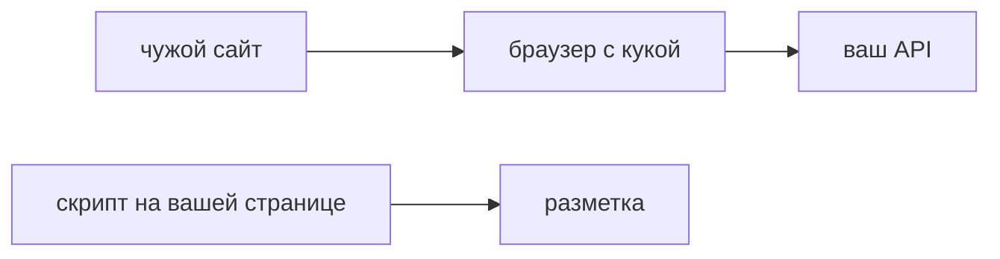

## Введение

Для React и Python на собеседовании часто слипаются три буквы: XSS, CSRF и заголовок CSP. Это разные дыры и разные контроли. XSS — на вашей странице выполняется чужой скрипт. CSRF — чужой сайт заставляет браузер жертвы отправить запрос на ваш API, и браузер сам прикладывает куку сессии. CSP говорит браузеру, откуда страница может брать скрипт и связанные ресурсы. SameSite и токен на изменение говорят, можно ли приложить куку к запросу с чужого сайта. Один заголовок не лечит оба класса.

React снижает риск вставки текста: обычный вывод экранируется. Он не выключает `dangerouslySetInnerHTML`, чужой адрес скрипта и куку сессии. Фраза «у нас React, значит нет XSS и CSRF» на собеседовании слабая. Нужно назвать инициатора: скрипт на вашей странице или чужой сайт плюс ваша кука.

Выпуск разбирает сессию в куке и POST, который меняет заявку. Что сможет послать чужой сайт, что добавят SameSite и токен, чего CSP в этом сценарии не остановит, и почему Bearer в заголовке меняет картину CSRF, но не лечит XSS.

## Раздел: Две политики

CSP — политика содержимого. Браузер сверяет, откуда загружен скрипт, куда уходит часть запросов, можно ли исполнить встроенный скрипт. Политика без `'unsafe-inline'` режет вставленный фрагмент, которого нет в разрешённом источнике. Это как раз типичный XSS через строку в HTML, если браузер ещё не успел его исполнить по другим причинам. Политику включают сперва отчётом: нарушения приходят вам, страница не ломается. Потом запретом. Сразу жёсткий запрет ломает легавый код, о котором забыли: старый инлайн, виджет, расширение сборки. Отчёт даёт список легавых источников. Запрет без этого списка — простой кабинета.

`'unsafe-inline'` ослабляет политику именно там, где она должна резать вставку. Его оставляют только с осознанной заменой, например одноразовым nonce на легавый скрипт, и не «чтобы перестало падать».

CSRF жив, пока сессия — куку, которую браузер прикладывает сам. Пользователь открыт на вашем сайте, в другом табе открывает чужую страницу, та страница шлёт POST на ваш API. Браузер прикладывает куку. Сервер видит законную сессию. Защита складывается. SameSite просит браузер не прикладывать куку к чужому сайту; режим выбирают явно, не надеются на умолчание навсегда. Проверка источника смотрит, откуда пришёл запрос на изменение. Отдельный токен на изменение читает только ваш JavaScript с вашей страницы и кладёт в заголовок или в тело. Чужая страница не прочитает токен из-за той же политики браузера, если вы не отдали его сами. Токен полезен как второй контроль, особенно где есть исключения из SameSite.

Если доступ — Bearer в заголовке, а не кука, классический CSRF почти не работает: чужой сайт не может прочитать заголовок вашей страницы и подставить его. Зато XSS украдёт Bearer из памяти страницы, если скрипт уже выполняется у вас. Поэтому место токена и CSP обсуждают вместе, но это не один баг. Bearer не лечит XSS. CSP не лечит кражу куки скриптом, который уже исполнился в разрешённом контексте: он не даёт выполниться вставке, но не отнимает у выполненного скрипта доступ к тому, что страница и так может.

Кука сессии, если она остаётся, получает HttpOnly, чтобы скрипт её не прочитал, и Secure, чтобы не уйти по голому HTTP, и осмысленный SameSite. HttpOnly не останавливает CSRF: браузер всё равно приложит куку сам. Он останавливает чтение куки из скрипта. Путать эти флаги — частая ошибка ответа.

## Раздел: Разбор на примере

Сессия в куке, изменение заявки методом POST. Чужой сайт без всякой CSP на вашей стороне может попросить браузер жертвы отправить этот POST. Если кука уходит с кросс-сайтовым запросом, заявка меняется. CSP вашей страницы этот запрос с чужого сайта не видит: политика относится к вашей странице, а вредоносная страница чужая. Поэтому ответом «у нас CSP» на CSRF не отделываются.

Что добавляют. SameSite, чтобы браузер не прикладывал куку к чужому сайту. Токен на изменение, который форма или клиент вашего кабинета кладёт в запрос, а чужой сайт не знает. Оба, если изменение критичное: один контроль ломается конфигурацией, второй остаётся. Проверка только заголовка Origin тоже уместна на API, как дополнительная, не как единственная, если клиенты бывают без этого заголовка и вы уже поняли, кого отрежете.

Отдельно XSS. Название заявки попадает в DOM как HTML. Злоумышленник создаёт заявку с фрагментом скрипта, сотрудник её открывает. Это уже ваша страница и ваш CSP. Без `'unsafe-inline'` и без разрешения произвольного источника вставка не исполнится, если она именно инлайн и политика включена запретом. React, который выводит текст обычным способом, до этого места не доводит. `dangerouslySetInnerHTML` доводит. Чинить надо сток, CSP оставить защитой глубины, не единственной стеной.

Bearer вместо куки на том же POST. Чужой сайт токен не приложит. CSRF слабеет. Если XSS всё же выполнился, скрипт прочитает токен из памяти и пошлёт запрос сам, уже как ваша страница. Поэтому переход на Bearer не отменяет разбор HTML и CSP.

Включать CSP сразу запретом на старом кабинете опасно: отчёт сначала покажет, какие скрипты легальны. Потом запрет. Исключение `unsafe-inline` «на неделю» без даты легко становится постоянным.

## Раздел: Где это ломается

Называют XSS и CSRF синонимами. Лечение тогда одно и неверное. Инициатор разный: чужой код у вас или чужой сайт и ваша кука.

Считают, что React закрыл оба класса. Опасный HTML и кука сессии остаются.

Ждут, что CSP остановит CSRF-POST с чужого сайта. Не остановит. Нужны SameSite и токен на изменение.

Ставят SameSite и выкидывают токен на всех маршрутах, включая тех, где режим куки ослаблен исключениями. Для изменения оставляют второй контроль.

Включают `'unsafe-inline'`, чтобы починить отчёт, и считают политику включённой. Политика больше не режет вставку.

HttpOnly объявляют защитой от CSRF. Он про чтение куки скриптом. Браузер по-прежнему отправит её сам.

Прячут токен в куку, которую чужой сайт заставит приложить так же, как сессию, без дополнительного секрета, который чужой прочитать не может. Токен должен быть недоступен чужому происхождению.

## Раздел: Ответ вслух

Я разделяю: XSS — чужой код на моей странице, CSRF — мой браузер послал мой запрос с чужого сайта. Для куки ставлю SameSite и токен на изменение, плюс HttpOnly, чтобы скрипт куку не прочитал. Для скриптов собираю CSP без произвольной вставки, сначала отчётом, потом запретом. Bearer не лечит XSS. CSP не лечит CSRF и не лечит кражу, если скрипт уже выполнился. В React первым делом смотрю места сырого HTML. Обычный вывод текста оставляю обычным.

## Раздел: Плохой ответ

Плохой ответ: «у нас React, значит XSS и CSRF нет». Фреймворк не спасает место, где вы сами включили HTML, и не отменяет куку, которую браузер прикладывает сам. Второй плохой ответ: «CSP закрывает всё». Она сужает источники скрипта на вашей странице. Чужой сайт с вашей кукой — другая задача.

## Раздел: Термины

Политика содержимого — Content-Security-Policy. Межсайтовая подделка запроса — CSRF. Межсайтовый скрипт — XSS. Атрибут куки SameSite управляет, прикладывать ли её к чужому сайту. HttpOnly запрещает скрипту читать куку. Токен запроса — CSRF token, секрет изменения, который чужое происхождение не знает. Nonce — одноразовое разрешение конкретному скрипту вместо сплошного unsafe-inline.

## Лаба

**Цель.** Развести инициаторов и не лечить оба класса одним заголовком.

**Шаги.**

1. Зафиксируйте: сессия в куке, изменение заявки — POST. Опишите, какой запрос сможет инициировать чужой сайт без участия вашей CSP.
2. Напишите, что добавите: SameSite, токен или оба, и почему для изменения критичного поля лучше оба.
3. Одной фразой опишите, что CSP в этом CSRF-сценарии не остановит.
4. Отдельным абзацем опишите XSS: название заявки вставляют как HTML. Что делает обычный вывод React и что ломает dangerouslySetInnerHTML.
5. Объясните, почему переход на Bearer ослабляет классический CSRF и не отменяет CSP.
6. Напишите порядок включения CSP: отчёт, список легавых источников, запрет без unsafe-inline.

**Готово, если…**

- [ ] XSS и CSRF названы разными инициаторами
- [ ] Для куки есть SameSite и токен, не только CSP
- [ ] HttpOnly не выдан за защиту от CSRF
- [ ] Сырой HTML в React отмечен как риск

## Схема: Кто инициатор

## Тест

### Чем CSRF отличается от XSS?

**Ответ:** браузер сам шлёт свой запрос

**Пояснение:** При XSS на вашей странице выполняется чужой скрипт. При CSRF скрипт чужой страницы пользуется вашей кукой.

### Когда классический CSRF почти не работает?

**Ответ:** когда сессия только в Bearer

**Пояснение:** Чужой сайт не может прочитать и подставить ваш заголовок.

### Зачем SameSite у куки сессии?

**Ответ:** не прикладывать её к чужому сайту

**Пояснение:** Браузер перестаёт отправлять куку на кросс-сайтовый запрос. Режим выбирают явно.

### Что режет вставленный inline-скрипт?

**Ответ:** CSP без unsafe-inline

**Пояснение:** Политика запрещает скрипт, которого нет в разрешённом источнике.

### React-приложение с dangerouslySetInnerHTML. Риск остался?

**Ответ:** да, это XSS

**Пояснение:** Фреймворк не спасает место, где вы сами включили HTML.

## Шпаргалка

<ul><li>XSS — чужой скрипт у вас</li><li>CSRF — чужой сайт и ваша кука</li><li>Bearer не лечит XSS</li><li>CSP включают с отчёта</li><li>HttpOnly не равен защите от CSRF</li></ul>

## Anki

### Front: Что ограничивает CSP?

Back: Откуда страница может брать скрипт и связанные ресурсы.

### Front: Что нужно атакующему для CSRF?

Back: Браузер жертвы с живой кукой и запрос, который кука прикладывает сама.

### Front: Зачем CSRF-токен, если есть SameSite?

Back: Как второй контроль на изменение, особенно для исключений из SameSite.

### Front: Почему unsafe-inline ослабляет CSP?

Back: Разрешает как раз вставленный скрипт, который политика должна резать.

### Front: Спасёт ли CSP кражу куки уже выполненным скриптом?

Back: Нет, если скрипт успел выполниться в разрешённом контексте.

### Front: Что проверить в React в первую очередь?

Back: Места, где в DOM попадает сырой HTML.

## Мнемоника

### acronym: Браузерные дыры

**Задание:** Три защиты, которые путают.

**Элементы:**
- CSP
- CSRF токен
- XSS

**Подсказка:** CSP ограничивает источники скрипта. CSRF-токен отличает чужой сайт. XSS — это внедрённый скрипт.

**Ответ:** CSP, CSRF, XSS

## Итоги

- Называйте инициатора: скрипт на вашей странице или чужой сайт
- Кука и Bearer защищают от разного
- SameSite и токен закрывают CSRF, CSP закрывает источники скрипта
- Политику включают с отчёта, без постоянного unsafe-inline
- React не отменяет опасный HTML и не отменяет куку

## Ссылки

- [JWT и хранение](/game/learn/sec-authn-authz)
- [DOM и XSS](/game/learn/js-dom-events)
