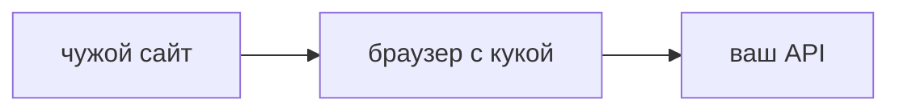

## Введение

Для React и Python это две разные дыры, которые на собесе слипаются. XSS выполняет чужой скрипт. CSRF заставляет браузер жертвы отправить свой запрос. CSP и SameSite закрывают разное.

## Раздел: Две политики

CSP говорит браузеру, откуда можно загружать скрипт и куда можно отправлять форму. Политика без `'unsafe-inline'` режет вставленный скрипт. Её включают отчётом, потом запретом: сразу жёсткий запрет ломает легавый код, о котором забыли.

CSRF жив, пока сессия — куку, которую браузер прикладывает сам. Запрос с чужого сайта уходит с этой кукой. Защита: SameSite, проверка источника и отдельный токен на изменение, который чужая страница не прочитает. Токен в заголовке, который ставит только ваш JavaScript, чужой сайт подставить не может из-за той же политики браузера.

Если доступ — Bearer в заголовке, а не кука, классический CSRF слабее: чужой сайт не прочитает заголовок. Зато XSS украдёт Bearer из памяти страницы. Поэтому CSP и место токена обсуждают вместе, но это не один баг.

## Раздел: Ответ вслух

Я разделяю: XSS — чужой код на моей странице, CSRF — мой браузер послал мой запрос с чужого сайта. Для куки ставлю SameSite и токен на изменение. Для скриптов собираю CSP без произвольной вставки. Bearer не лечит XSS. CSP не лечит кражу куки, если скрипт уже выполнился и пользователь сам нажал.

## Раздел: Плохой ответ

Плохой ответ: «у нас React, значит XSS и CSRF нет». React снижает риск вставки текста, но `dangerouslySetInnerHTML`, чужой URL скрипта и кука сессии остаются дырами.

## Раздел: Термины

Политика содержимого — Content-Security-Policy. Межсайтовая подделка запроса — CSRF. Межсайтовый скрипт — XSS. Атрибут куки — SameSite. Токен запроса — CSRF token.

## Лаба

**20 минут.** Сессия в куке, изменение заявки методом POST. Напишите, какой запрос сможет послать чужой сайт без CSP и что добавите: SameSite, токен или оба. Отдельно одной фразой опишите, что CSP не остановит в этом сценарии.

## Схема: Кто инициатор

## Тест

### Чем CSRF отличается от XSS?

**Ответ:** браузер сам шлёт свой запрос

**Пояснение:** При XSS на вашей странице выполняется чужой скрипт. При CSRF скрипт чужой страницы пользуется вашей кукой.

### Когда классический CSRF почти не работает?

**Ответ:** когда сессия только в Bearer

**Пояснение:** Чужой сайт не может прочитать и подставить ваш заголовок.

### Зачем SameSite у куки сессии?

**Ответ:** не прикладывать её к чужому сайту

**Пояснение:** Браузер перестаёт отправлять куку на кросс-сайтовый запрос. Режим выбирают явно.

### Что режет вставленный inline-скрипт?

**Ответ:** CSP без unsafe-inline

**Пояснение:** Политика запрещает скрипт, которого нет в разрешённом источнике.

### React-приложение с dangerouslySetInnerHTML. Риск остался?

**Ответ:** да, это XSS

**Пояснение:** Фреймворк не спасает место, где вы сами включили HTML.

## Шпаргалка

<ul><li>XSS — чужой скрипт у вас</li><li>CSRF — чужой сайт и ваша кука</li><li>Bearer не лечит XSS</li><li>CSP включают с отчёта</li></ul>

## Anki

### Front: Что ограничивает CSP?

Back: Откуда страница может брать скрипт и связанные ресурсы.

### Front: Что нужно атакующему для CSRF?

Back: Браузер жертвы с живой кукой и запрос, который кука прикладывает сама.

### Front: Зачем CSRF-токен, если есть SameSite?

Back: Как второй контроль на изменение, особенно для исключений из SameSite.

### Front: Почему unsafe-inline ослабляет CSP?

Back: Разрешает как раз вставленный скрипт, который политика должна резать.

### Front: Спасёт ли CSP кражу куки уже выполненным скриптом?

Back: Нет, если скрипт успел выполниться в разрешённом контексте.

### Front: Что проверить в React в первую очередь?

Back: Места, где в DOM попадает сырой HTML.

## Итоги

- Называйте инициатора: скрипт или чужой сайт
- Кука и Bearer защищают от разного
- Политику скриптов собирают по факту легавых источников

## Ссылки

- [JWT и хранение](/game/learn/sec-jwt-storage)
- [DOM и XSS](/game/learn/js-dom-events)
