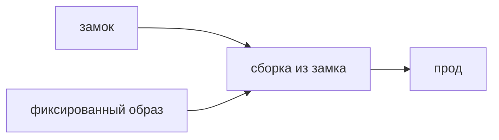

## Введение

Цепочка поставок в AppSec — всё, что вы не писали, но выкладываете. Для React и Python это дерево npm и дерево pip или poetry, плюс базовый образ контейнера, из которого собирается прод. Чужой пакет попадает в процесс наравне с вашим модулем: его код исполняется, его скрипт установки может выполниться на машине CI, его транзитивная зависимость приезжает молча. «Мы используем библиотеку» значит «мы поставляем её код».

Вакансии ждут не лозунг «обновляйте зависимости», а повторяемую сборку и разбор находки. Замок фиксирует дерево. CI ставит из замка, не «самую свежую на сегодня». Новую прямую зависимость смотрят как код: автор, скрипты установки, нет ли двойника по имени. SCA показывает известный CVE. Критичный и достижимый путь обновляют. Недостижимый записывают. Бот по понедельникам сам это не различит.

## Раздел: Что фиксировать

Замок — `package-lock.json`, `poetry.lock` или другой файл, который фиксирует не только прямую библиотеку, но и транзитивное дерево с конкретными версиями. Его коммитят. Установка в CI идёт из замка. Иначе стенд собрался в понедельник на одной транзитивной версии, прод в пятницу на другой, и набор уязвимостей вместе с поведением разъехались без вашего коммита. «Поставим последнюю» в проде — отказ от повторяемости. Сюрприз приезжает в момент выкладки, а не в момент ревью.

Прямую зависимость добавляют осознанно. Кроме README смотрят, кто владелец пакета, как давно имя существует, какие скрипты выполняются при установке, какие права просит пакет. Пакет-двойник отличается на символ в имени и подменяет известную библиотеку. Это не CVE из базы, это намерение автора свежего пакета, и SCA про опубликованные уязвимости его не поймает, пока никто не успел занести запись. Поэтому SCA не заменяет чтение новой зависимости. Он закрывает известное. Глаза закрывают «зачем нам этот пакет».

Образ собирают от фиксированного базового тега или дайджеста, не от плавающего `latest`. `latest` сегодня один слой, завтра другой. Прод меняется без коммита вашего репозитория. То же относится к образу, который «просто тянем в кластере».

Секрет сборки — в переменных CI, не в репозитории и не в замке. Замок иногда содержит URL с учётными данными, если так написали источник пакетов. Это утечка наравне с паролем в коде. Источник пакетов без секрета в файле, секрет снаружи.

Находка SCA. Высокая серьёзность и достижимый путь — обновление или явный срок с компенсирующим контролем. Достижимость значит: уязвимый код вызывается в вашем приложении, а не просто лежит в дереве. Недостижимый путь не обязан ехать в ту же ночь, но запись «почему не горит» обязательна, иначе предупреждение либо вечно красное, либо его выключат целиком. Удалили import, пакет остался в замке и в образе — риск не ушёл. Сборка всё ещё его содержит, а скрипт установки мог уже выполниться. Убирают из замка и из образа, не только строку import в одном файле.

Подозрительный пакет удаляют так же: из замка, из образа, из кэша CI, не «просто перестали импортировать в новой ветке», оставив lock на main.

## Раздел: Разбор на примере

Фронт хочет библиотеку дат, бэкенд — клиент HTTP, которого нет в стандартной поставке. Обе прямые. Для npm смотрят имя, скачивания, скрипт `postinstall`: если он ходит в сеть или запускает произвольный бинарник, это уже не «мелочь дат». Для Python смотрят, откуда ставится пакет и нет ли в замке неожиданного git-адреса. Оба замка коммитят. CI: `npm ci` и установка poetry строго из замка, не обновление дерева на каждом прогоне.

Базовый образ Python фиксируют тегом с патчем или дайджестом. В Dockerfile нет `latest`. Секрет индекса, если нужен, приходит переменной пайплайна.

Приходит CVE в транзитивном парсере, который тянет только тестовый инструмент и не входит в образ рантайма. Запись: недостижимо для прода, обновление плановое, не блокер ночи. Другой CVE в библиотеке, которой разбирают тело запроса от клиента. Это достижимо. Обновление в ближайшей поставке, с тестом на контракт, не «бот влил мажор в пятницу».

Пакет с именем, похожим на популярный логгер, на один символ короче, предлагают в примере из комментария. Его не ставят, пока не ясно, что это тот самый проект. SCA ещё молчит: пакет новый. Чтение имени — как раз тот шаг, который сканер не заменяет.

## Раздел: Где это ломается

Замок не в git. У каждого разработчика своё дерево, «у меня собирается». Прод собирается иначе. Коммитят замок.

CI делает установку с обновлением. Повторяемости нет. Команда ставит из замка, обновление — отдельный осознанный коммит.

`latest` у базового образа. Ночная пересборка привозит другой слой и другой CVE или другую поломку без диффа приложения.

Бот обновляет всё по понедельникам, люди не смотрят. Он не отличает достижимый RCE от шума в неиспользуемой ветке и может влить ломающий мажор. Бот готовит предложение, человек смотрит достижимость и тесты.

CVE без разбора объявляют либо все блокером, либо все шумом. Оба края врут. Вопрос один: вызывается ли путь.

Import удалили, замок нет. Образ всё ещё содержит код. Чистят дерево и пересобирают.

Секрет в URL замка. Репозиторий публичный или просто широкий по доступу, ключ уже утёк. URL без секрета, ключ в CI, ключ ещё и меняют, раз он побывал в файле.

Новый пакет ставят «на выходные, посмотреть», и он остаётся в проде. Прямая зависимость — решение, не эксперимент в main.

## Раздел: Ответ вслух

Сборка повторяема: замок в репозитории, CI ставит из него. Прямую зависимость добавляю осознанно и смотрю скрипты установки и имя, не только README. Образ собираю от фиксированного базового тега, не от latest. Секрет сборки держу в переменных CI. Находку SCA либо закрываю обновлением, если путь достижим, либо оставляю с причиной и сроком, если недостижим. Удаление import без замка и образа не считаю исправлением. SCA не заменяет взгляд на новый пакет: он не знает намерение автора, пока нет опубликованной записи.

## Раздел: Плохой ответ

Плохой ответ: «зависимости обновляет бот по понедельникам, мы не смотрим». Бот не отличает достижимый дефект от шума и не ловит пакет-двойник в день публикации. Второй плохой ответ: «раз CVE есть, значит нас уже взломали». Запись в базе — повод проверить путь, не автоматический инцидент.

## Раздел: Термины

Цепочка поставок — supply chain. Замок версий — lockfile, конкретное дерево, включая транзитивные. Достижимость — reachability, вызывается ли уязвимый код у вас. Базовый образ — base image. Плавающий тег — latest и аналоги, которые меняются без вашего коммита. CVE — известная уязвимость с номером. Пакет-двойник — похожее имя вместо известной библиотеки. SCA — проверка состава на известное, не чтение намерений.

## Лаба

**Цель.** Описать одну прямую зависимость фронта и одну бэкенда так, чтобы сборка не плавала.

**Шаги.**

1. Выберите пакет дат для npm и HTTP-клиент для Python. Напишите, где ляжет замок и какой командой CI ставит строго из него.
2. Для npm-пакета выпишите, что смотрите кроме README: скрипт установки и что имя не двойник.
3. Базовый образ укажите фиксированным тегом. Напишите, чем плох latest: прод меняется без коммита.
4. Придумайте CVE высокой серьёзности в коде, который вы не вызываете. Обновлять в ту же ночь не обязаны; запишите причину.
5. Второй исход: CVE на пути разбора тела запроса. Это обновление со сроком, не запись «потом».
6. Секрет индекса положите в переменную CI, не в файл замка.

**Готово, если…**

- [ ] Замок назван источником дерева
- [ ] Образ не плавает
- [ ] Достижимый и недостижимый CVE разведены
- [ ] Новый пакет не отдаётся только сканеру

## Схема: Откуда берётся код прода

## Тест

### Зачем коммитить lockfile?

**Ответ:** чтобы сборка повторялась

**Пояснение:** Иначе транзитивное дерево на проде живёт своей жизнью.

### Плавающий тег latest у базового образа. Чем плох?

**Ответ:** прод меняется без вашего коммита

**Пояснение:** Сегодня один слой, завтра другой, диффа приложения нет.

### CVE в пакете, чей код вы не вызываете. Обязаны обновлять в ту же ночь?

**Ответ:** нет, если путь недостижим

**Пояснение:** Запись причины нужна, ночной блокер — нет.

### Что смотреть у нового npm-пакета кроме README?

**Ответ:** скрипты установки и владельца

**Пояснение:** Свежий пакет-двойник ещё не имеет CVE.

### Удалили import, пакет остался в замке. Риск ушёл?

**Ответ:** нет, он всё ещё в сборке

**Пояснение:** Убирают из дерева и из образа.

## Шпаргалка

<ul><li>Замок в git</li><li>CI ставит из замка</li><li>Образ не с latest</li><li>CVE с вопросом достижимости</li><li>Секрет сборки не в репозитории</li></ul>

## Anki

### Front: Что фиксирует lockfile?

Back: Конкретное дерево зависимостей, включая транзитивные.

### Front: Почему не ставить «последнюю версию» в проде?

Back: Сборка перестаёт быть повторяемой и может привезти сюрприз.

### Front: Что такое reachability для CVE?

Back: Вызывается ли уязвимый путь в вашем приложении.

### Front: Куда класть секрет сборки?

Back: В переменные CI, не в репозиторий.

### Front: Чем опасен пакет-двойник?

Back: Похожее имя ставится вместо известной библиотеки.

### Front: SCA заменяет чтение новой зависимости?

Back: Нет. Он знает опубликованные CVE, не намерение автора свежего пакета.

## Мнемоника

### link: Чужая зависимость

**Задание:** Порядок, прежде чем выполнить npm install с новым пакетом.

**Элементы:**
- имя
- замок версий
- хеш
- кто публикует

**Подсказка:** Одинаковое имя с опечаткой — уже атака.

**Ответ:** имя → lock → хеш → владелец

## Итоги

- Чужой пакет — часть вашего релиза
- Повторяемость важнее «всегда свежее»
- Шум CVE отличают от достижимого пути
- Имя и скрипт установки читают до сканера
- Убрать import недостаточно, пока код в образе

## Ссылки

- [Секреты](/game/learn/sec-authn-authz)
- [SAST, DAST, SCA](/game/learn/sec-sast-dast-sca)
