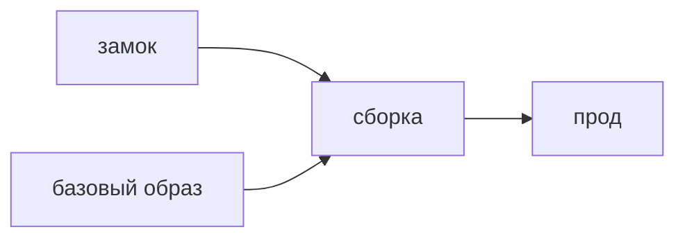

## Введение

AppSec называет это supply chain: всё, что вы не писали, но выкладываете. Для стека React и Python это npm и pip, плюс базовый образ контейнера.

## Раздел: Что фиксировать

Замок (`package-lock.json`, `poetry.lock` или аналог) фиксирует дерево, не только прямую библиотеку. Установка в CI идёт из замка, не «самую свежую на сегодня». Иначе стенд и прод расходятся, а вместе с ними и набор уязвимостей.

Новую зависимость смотрят как код: кто автор, какой объём прав просит скрипт установки, нет ли свежего пакета-двойника по имени. SCA в CI показывает известный CVE. Критичный и достижимый — обновление или явный срок. Недостижимый — запись, почему не горит.

Секреты в CI — отдельные переменные, не в репозитории замка. Подозрительный пакет удаляют из замка и из образа, не только из import в одном файле.

## Раздел: Ответ вслух

Сборка повторяема: замок в репозитории, CI ставит из него. Прямую зависимость добавляю осознанно и смотрю скрипты установки. Образ собираю от фиксированного базового тега, не от плавающего latest. Находку SCA либо закрываю обновлением, либо оставляю с датой и причиной, если путь недостижим.

## Раздел: Плохой ответ

Плохой ответ: «зависимости обновляет бот по понедельникам, мы не смотрим». Бот не отличает достижимый RCE от шума в неиспользуемой ветке.

## Раздел: Термины

Цепочка поставок — supply chain. Замок версий — lockfile. Достижимость — reachability. Образ — base image. Известная уязвимость — CVE.

## Лаба

**20 минут.** Выберите одну прямую зависимость фронта и одну бэкенда. Напишите, где лежит замок, что сделает CI при CVE высокой серьёзности и в каком случае вы отложите обновление.

## Схема: Откуда берётся код прода

## Тест

### Зачем коммитить lockfile?

**Ответ:** чтобы сборка повторялась

**Пояснение:** Без замка сегодня и завтра установятся разные деревья.

### Плавающий тег latest у базового образа. Чем плох?

**Ответ:** прод меняется без вашего коммита

**Пояснение:** В образ приедет то, что опубликовали утром.

### CVE в пакете, чей код вы не вызываете. Обязаны обновлять в ту же ночь?

**Ответ:** нет, если путь недостижим

**Пояснение:** Причину и срок всё равно записывают, иначе находка вечная.

### Что смотреть у нового npm-пакета кроме README?

**Ответ:** скрипты установки и владельца

**Пояснение:** Скрипт установки выполняется у вас на CI.

### Удалили import, пакет остался в замке. Риск ушёл?

**Ответ:** нет, он всё ещё в сборке

**Пояснение:** Пока замок и образ содержат пакет, он выкладывается.

## Шпаргалка

<ul><li>Замок в git</li><li>CI ставит из замка</li><li>Образ не с latest</li><li>CVE с вопросом достижимости</li></ul>

## Anki

### Front: Что фиксирует lockfile?

Back: Конкретное дерево зависимостей, включая транзитивные.

### Front: Почему не ставить «последнюю версию» в проде?

Back: Сборка перестаёт быть повторяемой и может привезти сюрприз.

### Front: Что такое reachability для CVE?

Back: Вызывается ли уязвимый путь в вашем приложении.

### Front: Куда класть секрет сборки?

Back: В переменные CI, не в репозиторий.

### Front: Чем опасен пакет-двойник?

Back: Похожее имя ставится вместо известной библиотеки.

### Front: SCA заменяет чтение новой зависимости?

Back: Нет. Он знает опубликованные CVE, не намерение автора свежего пакета.

## Итоги

- Чужой пакет — часть вашего релиза
- Повторяемость важнее «всегда свежее»
- Шум CVE отличают от достижимого пути

## Ссылки

- [Секреты](/game/learn/sec-secrets)
- [SAST, DAST, SCA](/game/learn/sec-sast-dast-sca)
