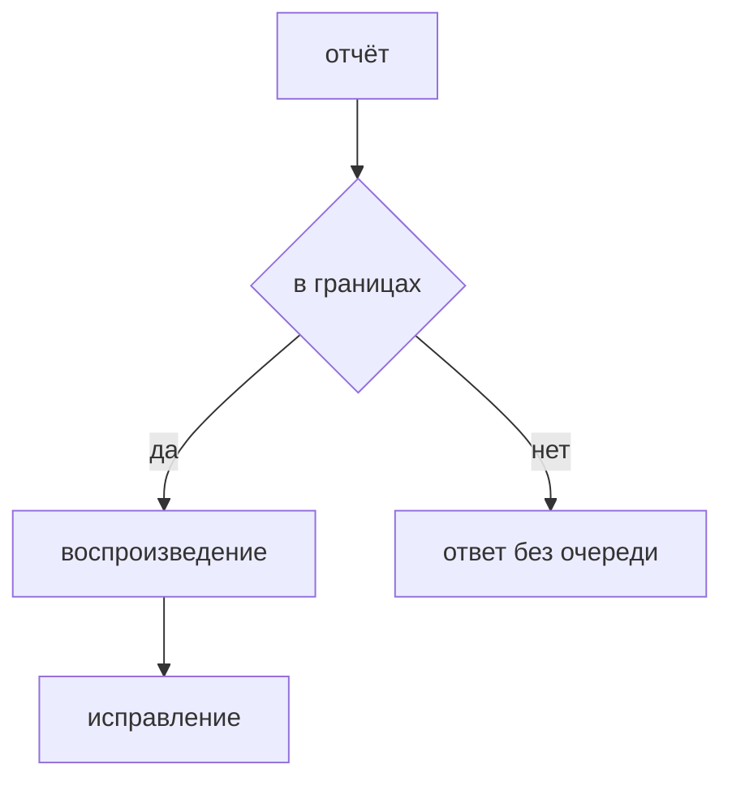

## Введение

Вакансии упоминают bug bounty рядом с пентестом. Для команды это канал отчётов, а не отдельная магия. Правила те же: граница, воспроизведение, приоритет, исправление, проверка.

## Раздел: Как не утонуть

В программе написано, что можно трогать: прод или отдельный стенд, какие домены, что запрещено (чужие данные, отказ в обслуживании). Отчёт вне границ не становится «всё равно почините сегодня».

Входящий отчёт проверяют: шаги, учётная запись, эффект. Дубль сливают с уже открытым дефектом. Шум без сценария закрывают коротко, чтобы автор программы видел причину.

Подтверждённое идёт в ту же очередь, что внутренние находки, с вредом и сроком. Исправление проверяют тем же сценарием. Публичный разбор раньше фикса не открывают, если отчёт ещё эксплуатируется.

## Раздел: Ответ вслух

Я смотрю границы программы и воспроизвожу шаги на разрешённом стенде. Дубль не завожу второй раз. Если эффект есть, ставлю срок по вреду, не по громкости письма. После фикса прошу тот же сценарий или прогоняю его сам. Автору отвечаю статусом, а не спором о термине.

## Раздел: Плохой ответ

Плохой ответ: «баунти — это когда нам присылают сканы и мы всё чиним в ночь». Без границ и без воспроизведения очередь становится чужим сырым отчётом сканера.

## Раздел: Термины

Программа вознаграждения — bug bounty. Границы — scope. Дубль — duplicate. Воспроизведение — reproduction. Срок исправления — remediation SLA.

## Лаба

**20 минут.** Придумайте отчёт: «можно прочитать чужую заявку по id». Отметьте, попадает ли он в границы учебного стенда, какие три шага нужны для воспроизведения и чем он отличается от письма «у вас устарел заголовок».

## Схема: Путь отчёта

## Тест

### Что проверяют до оценки вреда?

**Ответ:** границы и шаги

**Пояснение:** Вне программы и без воспроизведения это ещё не дефект очереди.

### Два письма про один и тот же id. Что сделать?

**Ответ:** слить в один дефект

**Пояснение:** Второй автор получает статус дубля, работа одна.

### Чем баунти отличается от внутреннего сканера?

**Ответ:** сценарий придумал человек снаружи

**Пояснение:** Разбор и срок после подтверждения те же.

### Когда не публиковать детали?

**Ответ:** пока сценарий ещё работает на проде

**Пояснение:** Сначала закрывают эффект, потом разбор.

### Письмо без шагов, только «найдите сами». Какой статус?

**Ответ:** недостаточно данных

**Пояснение:** Очередь не обязана достраивать атаку по намёку.

## Шпаргалка

<ul><li>Сначала границы</li><li>Потом шаги</li><li>Дубль не плодит тикет</li><li>Фикс проверяют тем же сценарием</li></ul>

## Anki

### Front: Что такое scope программы?

Back: Какие системы и действия разрешено проверять.

### Front: Что такое duplicate?

Back: Тот же дефект, который уже заведён.

### Front: Что нужно в хорошем отчёте?

Back: Шаги, учётку стенда и наблюдаемый эффект.

### Front: Куда попадает подтверждённый отчёт?

Back: В общую очередь уязвимостей со сроком по вреду.

### Front: Зачем отвечать автору?

Back: Чтобы программа видела статус, а не тишину.

### Front: Почему не чинить сырой скан из баунти в ту же ночь?

Back: Нет подтверждённого сценария и нет места в вреде.

## Итоги

- Программа задаёт границы
- В работу берётся воспроизведённый эффект
- Срок зависит от вреда, не от тона письма

## Ссылки

- [SAST, DAST, SCA](/game/learn/sec-sast-dast-sca)
- [Модель угроз](/game/learn/sec-threat-model)
