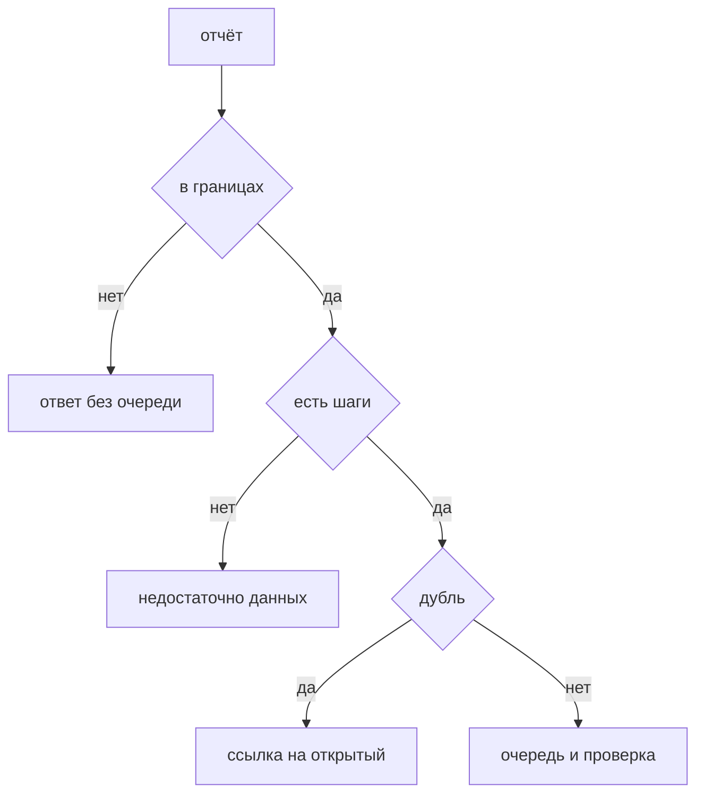

## Введение

Вакансии упоминают bug bounty рядом с пентестом. Для команды это канал отчётов, а не отдельная магия и не обязанность чинить ночью всё, что прислали. Платят за воспроизводимый сценарий внутри оговорённых границ. Внутри компании правила те же, что для своей находки: граница, шаги, дубль, вред, срок, исправление, проверка тем же сценарием. Громкость письма и приложенный сырой скан приоритет не задают.

Программа заранее пишет, что можно трогать: прод или отдельный стенд, какие домены, какие учётки, что запрещено. Чужие персональные данные, отказ в обслуживании, выход за домен — типичные запреты. Отчёт вне границ не становится «всё равно почините сегодня». Ему отвечают, что он вне программы, и не кладут в ночную очередь. Иначе внешний человек управляет вашим спринтом сырыми сканами.

Выпуск проводит отчёт «можно прочитать чужую заявку по id» от границ до проверки фикса и отдельно отличает его от письма «у вас устарел заголовок».

## Раздел: Как не утонуть

Сначала границы и шаги, потом оценка вреда. Нет смысла спорить о критичности сценария, который программа не разрешала или который не из чего повторить. Хороший отчёт содержит шаги, учётную запись стенда или способ получить такую же, и наблюдаемый эффект: что человек увидел чужого. «Найдите сами» — статус «недостаточно данных», не дефект. Очередь не обязана достраивать атаку по намёку. Автору отвечают, каких шагов не хватает. Тишина хуже отказа: программа решает, что отчёты пропадают, и тон следующих писем только растёт.

Дубль сливают с уже открытым дефектом. Два письма про один и тот же id — один тикет, вторая ссылка, не второй срок и не вторая выплата за тот же корень, если правила программы так и говорят. Расходящиеся статусы двух тикетов — способ закрыть один и забыть второй.

Подтверждённое попадает в ту же очередь, что внутренние находки, с вредом и сроком. Не в отдельную «срочное, потому что снаружи». Внешний автор не повышает вред. Вред повышает эффект: чтение чужих заявок выше, чем отсутствующий заголовок, который не даёт сценария. Срок исправления, remediation, привязан к вреду и к договору программы, не к времени суток, когда письмо пришло. Сырой скан из вложения не чинят в ту же ночь: нет подтверждённого сценария и нет места во вреде.

Исправление проверяют тем же сценарием на сборке, где фикс есть. «Мы поправили проверку владельца» без повторного чтения чужого id — надежда. После проверки автору отвечают статусом. Публичный разбор раньше фикса не открывают, если отчёт ещё эксплуатируется на проде: детали — инструкция для тех, кто письмо не присылал. Раскрытие после закрытия дыры — отдельное решение программы, не часть ночного чата.

Границы перечитывают, когда появляется новый домен или стенд. Старая программа «можно всё на звёздочке» быстро включает чужие сервисы, которые вы не готовы отдавать в исследование. Узкий список честнее широкого обещания, которое потом нарушают молча.

## Раздел: Разбор на примере

Письмо: на учебном стенде, который входит в программу, учётка обычного пользователя читает заявку другого пользователя, подставив id в GET. Шаги три: войти учебной учёткой, открыть свою заявку, заменить id в пути, увидеть чужой заголовок. Эффект наблюдаемый. Границы совпали: стенд назван, данных прода нет, отказа в обслуживании нет.

Это не дубль, если в очереди ещё нет проверки владельца на чтении. Заводят дефект в общую очередь, вред высокий, срок по шкале чтения чужих данных, не «когда-нибудь». Исправление — проверка на сервере. Проверка фикса — те же три шага на названной сборке, чужой заголовок больше не виден. Автору пишут, что воспроизвели и закрыли на такой-то сборке. Детали диффа наружу до закрытия не кладут.

Второе письмо в тот же день про тот же GET и тот же тип id. Это дубль: ссылка на первый дефект, второй тикет не плодят, выплату не удваивают правилами программы. Автору так и отвечают.

Третье письмо: «просканировал, вот XML на двести находок, заголовок сервера старый, найдите сами остальное». Шагов нет, эффекта нет. Статус — недостаточно данных. В ночь это не берут. Если заголовок и правда лишний и он в границах, его могут завести отдельно как низкий вред из своего разбора, не потому что так потребовал объём вложения.

Что не делают. Не спорят в ответе о термине «это не баг, это фича», если чужие данные читаются: сначала закрывают чтение, потом обсуждают формулировку. Не просят автора прислать дамп чужих персональных данных «для доказательства». Хватает одного поля, по которому видно чужую запись, на стенде.

## Раздел: Где это ломается

Чинят всё, что прислали, в ночь, без границ. Спринт принадлежит случайному скану. Границы и шаги стоят до оценки вреда.

Нет ответа автору. Программа выглядит мёртвой, отчёты дублируются сердито, хорошие исследователи уходят. Короткий статус лучше длинного спора.

Два тикета на один корень. Один закрыли фиксом, второй висит, метрика врёт, выплата путается. Дубль сливают сразу.

Публикуют сценарий, пока прод ещё открыт. Это раздача инструкции. Публикация после проверки фикса.

Проверяют «у себя локально», не тем сценарием и не на сборке. На стенде программы дыра жива. Шаги из отчёта — чеклист проверки.

Считают баунти заменой своего ревью и модели. Внешний человек не обязан найти проверку владельца, которую вы не написали. Канал снаружи дополняет внутренние точки, не отменяет их.

Платят и чинят отчёт вне стенда, на проде, где программа прод не разрешала, и тем самым поощряют выход за границы. Вне границ отвечают отказом в рамках программы. Если эффект всё же серьёзный и вы сами подтвердили его легально, это уже ваш инцидент, не автоматическая выплата за нарушение правил. Это различие стоит проговорить в правилах заранее.

## Раздел: Ответ вслух

Я смотрю границы программы и воспроизвожу шаги на разрешённом стенде. Без шагов ставлю «недостаточно данных» и отвечаю, чего не хватает. Дубль не завожу второй раз. Если эффект есть, ставлю срок по вреду, не по громкости письма, и кладу в ту же очередь, что внутренние дыры. После фикса прогоняю тот же сценарий на названной сборке. Автору отвечаю статусом. Детали не публикую, пока сценарий ещё работает. Сырой скан без эффекта в ночь не беру.

## Раздел: Плохой ответ

Плохой ответ: «баунти — это когда нам присылают сканы и мы всё чиним в ночь». Без границ и без воспроизведения очередь становится чужим сырым отчётом. Второй плохой ответ: «внешним не отвечаем, чтобы не подсказывать». Статус закрытия не обязан содержать инструкцию. Молчание ломает канал.

## Раздел: Термины

Программа вознаграждения — bug bounty. Границы — scope, что разрешено трогать. Дубль — duplicate, тот же дефект. Воспроизведение — reproduction по шагам. Срок исправления — remediation. Недостаточно данных — отчёт, из которого эффект не повторить. Раскрытие — публикация деталей, уместная после закрытия дыры.

## Лаба

**Цель.** Провести один отчёт по очереди и отбраковать шум.

**Шаги.**

1. Возьмите отчёт: на учебном стенде можно прочитать чужую заявку по id. Отметьте, что стенд входит в границы, прод и чужие базы не требуются.
2. Выпишите три шага воспроизведения и наблюдаемый эффект. Без этого в работу не берите.
3. Проверьте дубль: второй письмо про тот же id сливается в один дефект.
4. Назначьте вред по эффекту чтения чужих данных, не по тону. Срок — из шкалы этого вреда.
5. Опишите проверку фикса: те же шаги, сборка названа, чужой заголовок не виден.
6. Отдельно классифицируйте письмо «устарел заголовок, найдите сами»: недостаточно данных, не ночная очередь.

**Готово, если…**

- [ ] Границы проверены до вреда
- [ ] Есть шаги и эффект
- [ ] Дубль не плодит тикет
- [ ] Фикс проверяется тем же сценарием
- [ ] Сырой намёк не равен дефекту

## Схема: Путь отчёта

## Тест

### Что проверяют до оценки вреда?

**Ответ:** границы и шаги

**Пояснение:** Нет смысла мерить критичность неразрешённого или невоспроизводимого.

### Два письма про один и тот же id. Что сделать?

**Ответ:** слить в один дефект

**Пояснение:** Второй тикет расходится в статусе и путает срок.

### Чем баунти отличается от внутреннего сканера?

**Ответ:** сценарий придумал человек снаружи

**Пояснение:** Внутри всё равно нужны воспроизведение и очередь, не особый ритуал.

### Когда не публиковать детали?

**Ответ:** пока сценарий ещё работает на проде

**Пояснение:** Ранний разбор становится инструкцией.

### Письмо без шагов, только «найдите сами». Какой статус?

**Ответ:** недостаточно данных

**Пояснение:** Очередь не обязана достраивать атаку по намёку.

## Шпаргалка

<ul><li>Сначала границы</li><li>Потом шаги и эффект</li><li>Дубль не плодит тикет</li><li>Срок по вреду, не по тону</li><li>Фикс проверяют тем же сценарием</li></ul>

## Anki

### Front: Что такое scope программы?

Back: Какие системы и действия разрешено проверять.

### Front: Что такое duplicate?

Back: Тот же дефект, который уже заведён.

### Front: Что нужно в хорошем отчёте?

Back: Шаги, учётку стенда и наблюдаемый эффект.

### Front: Куда попадает подтверждённый отчёт?

Back: В общую очередь уязвимостей со сроком по вреду.

### Front: Зачем отвечать автору?

Back: Чтобы программа видела статус, а не тишину.

### Front: Почему не чинить сырой скан из баунти в ту же ночь?

Back: Нет подтверждённого сценария и нет места в вреде.

## Итоги

- Программа задаёт границы раньше очереди
- В работу берётся воспроизведённый эффект
- Срок зависит от вреда, не от тона письма
- Проверка фикса повторяет шаги отчёта
- Внешний канал не заменяет свои ревью и модель

## Ссылки

- [SAST, DAST, SCA](/game/learn/sec-sast-dast-sca)
- [Модель угроз](/game/learn/sec-threat-model)
