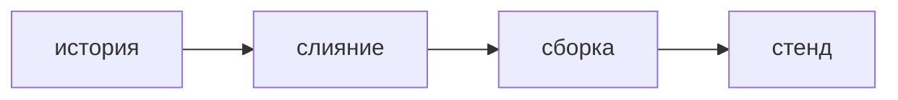

## Введение

Вакансии называют Secure SDLC и shift-left: безопасность в каждом этапе, не отделом в конце. Для React и Python это конкретные точки, а не лозунг.

## Раздел: Точки на пути

В истории — сценарий злоупотребления и контроль, хотя бы один. В дизайне — граница доверия и где живёт секрет. В запросе на слияние — ревью доступа и SAST. В сборке — замок зависимостей и образ. На стенде — DAST по критичным маршрутам. Перед продом — известный список принятых рисков, а не пустой отчёт «сканер молчит».

Ворота ставят на то, что команда умеет починить за день. Всё остальное — видимый долг со сроком. Чемпион безопасности в команде тащит чеклист, эксперт AppSec разбирает спорный сценарий и не пишет продукт вместо команды.

Инцидент после выкладки возвращается в чеклист: какой точки не было.

## Раздел: Ответ вслух

Я не оставляю безопасность на последнюю неделю. У истории есть злоупотребление, у PR — проверка права и статический прогон, у сборки — зависимости. Жёстко блокирую только то, что уже договорились считать дефектом. Остальное видно в очереди. После релиза смотрю, какой шаг процесс пропустил, и добавляю его, а не ещё один общий сканер.

## Раздел: Плохой ответ

Плохой ответ: «перед релизом прогоним всё и подпишем». За неделю до выкладки уже нельзя переделать границу доверия.

## Раздел: Термины

Безопасный жизненный цикл — secure SDLC. Сдвиг влево — shift-left. Ворота качества — quality gate. Чемпион — security champion. Принятый риск — risk acceptance.

## Лаба

**20 минут.** Разложите поставку «форма заявки» по пяти точкам: история, дизайн, PR, сборка, стенд. В каждую впишите одну проверку. Отметьте, какая из них имеет право остановить слияние на этой неделе.

## Схема: Точки, не финал

## Тест

### Где впервые появляется сценарий злоупотребления?

**Ответ:** в истории или дизайне

**Пояснение:** После написанного кода его уже дороже встраивать.

### Что имеет право быть воротами в первый месяц?

**Ответ:** правило, которое умеют чинить

**Пояснение:** Незнакомый блокирующий шум обходят, и ворота умирают.

### Чем чемпион отличается от эксперта AppSec?

**Ответ:** чемпион внутри команды

**Пояснение:** Эксперт задаёт практику и разбирает спор. Продукт пишет команда.

### Сканер молчит. Рисков нет?

**Ответ:** нет, молчание не доказательство

**Пояснение:** Принятые и не проверенные сценарии всё ещё существуют.

### Инцидент после релиза. Куда его вернуть?

**Ответ:** в пропущенную точку процесса

**Пояснение:** Иначе тот же класс вернётся следующим релизом.

## Шпаргалка

<ul><li>Сценарий в истории</li><li>Ревью и SAST на PR</li><li>Замок на сборке</li><li>Блокируют только договорённое</li></ul>

## Anki

### Front: Что такое shift-left для AppSec?

Back: Проверка раньше, на истории и на PR, а не только перед продом.

### Front: Что такое quality gate?

Back: Условие, без которого изменение не сливают или не выкладывают.

### Front: Кто такой security champion?

Back: Человек в команде, который держит чеклист и зовёт эксперта на спорное.

### Front: Что такое risk acceptance?

Back: Осознанно жить с риском до названного срока, записав причину.

### Front: Почему поздний пентест не заменяет SDLC?

Back: Границу доверия уже поздно дёшево переделать.

### Front: Что добавить в историю кроме критерия приёмки?

Back: Один сценарий злоупотребления и контроль.

## Итоги

- Безопасность — шаги поставки, не отчёт в конце
- Ворота узкие и понятные
- Инцидент дополняет чеклист

## Ссылки

- [Модель угроз](/game/learn/sec-threat-model)
- [Пайплайн](/game/learn/ops-ci-pipeline)
