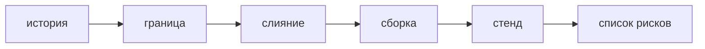

## Введение

Вакансии называют Secure SDLC и shift-left: безопасность в каждом этапе поставки, не отделом в конце. Для React и Python это не лозунг и не ещё один сканер «на всё». Это конкретные точки, где команда уже и так меняет код: история, дизайн, запрос на слияние, сборка, стенд, список принятых рисков перед продом. Сдвиг влево значит, что сценарий злоупотребления появляется, когда историю ещё можно сузить, а не в ночь перед выкладкой, когда границу доверия уже дорого переносить.

Поздний пентест полезен как проверка того, что точки не сработали. Он не заменяет точки. За неделю до релиза уже нельзя дёшево переделать, кто считается автором заявки. Можно лишь поставить заплатку и записать долг. Ворота качества ставят на то, что команда умеет починить за день. Всё остальное — видимый долг со сроком, а не красная сборка из шума и не пустой отчёт «сканер молчит, рисков нет».

Выпуск раскладывает поставку «форма заявки» по пяти точкам и выбирает, какая одна проверка имеет право остановить слияние на этой неделе.

## Раздел: Точки на пути

В истории — один сценарий злоупотребления и контроль, рядом с обычным критерием приёмки. Для формы заявки это «чужой идентификатор автора в теле не делает автором». Если в истории только «пользователь создаёт заявку», безопасность придётся выдумывать на ревью, когда оценка уже дана. Сценарий в истории дешевле сценария в инциденте.

В дизайне — граница доверия и где живёт секрет. Браузеру не верят. Ключ подписи не попадает в бандл. Это ещё не код, но это уже запрет на решение «роль пришлём с клиента» и «ключ положим в переменную сборки». Дизайн без этой границы придётся ломать после первого диффа.

В запросе на слияние — ревью доступа и SAST по правилам, которые уже не шумят. Глаза смотрят, откуда взялся автор. Сканер смотрит склейку, если класс подтверждён. Молчание сканера не доказательство отсутствия риска: он не обязан знать новое правило доступа.

В сборке — замок зависимостей и фиксированный образ. Поставка не должна менять чужой код без коммита. Секрет сборки лежит в CI, не в репозитории.

На стенде — DAST или хотя бы один проход по критичным маршрутам: создание, чтение чужого id, ответ ошибки без стека. Динамика видит куку и заголовок, которых не было в диффе текстом.

Перед продом — известный список принятых рисков, а не пустой лист. Принятый риск — осознанно жить с названным сценарием до даты, с причиной и хозяином. Пустой отчёт «ничего не нашли» не равен списку. В нём нет ни закрытых сценариев, ни отложенных.

Ворота узкие. В первый месяц команда может блокировать слияние только на отсутствии проверки владельца в новой ручке и на новой склейке SQL. Остальные находки видны в очереди и не красят весь пайплайн. Через месяц, когда очередь разобрана, ворота можно расширить. Расширять до умения чинить — способ научить людей обходить ворота.

Чемпион безопасности в команде держит чеклист этих точек и зовёт эксперта AppSec на спорный сценарий. Эксперт не пишет продукт вместо команды и не становится единственным, кто «нажимает безопасно» в ночь релиза. Если чемпиона нет, чеклист всё равно может быть коротким и общим. Роль нужна, чтобы список не умер в вики.

Инцидент после выкладки возвращается в чеклист: какой точки не было. Утекли чужие заявки, потому что в истории не было сценария, а ревью смотрело имена. Добавляют вопрос в историю и в ревью, а не «ещё один общий сканер на всякий случай».

## Раздел: Разбор на примере

Поставка формы заявки. История: куратор создаёт заявку от своего имени; злоупотребление — подмена автора полем тела; контроль — автор из сессии; критерий наблюдаемый. Дизайн: сессия на сервере, браузер за границей, секрет подписи не во фронте. На этом листе уже нельзя честно нарисовать «роль присылает React».

PR: ревьюер ищет присваивание автора из тела. SAST подключён к склейке, но эта дыра может быть не про склейку. Слияние имеет право остановить отсутствие проверки, потому что команда уже умеет её ставить и правило договорено. Предупреждение про стиль заголовка слияние не останавливает.

Сборка: lockfile на месте, образ не `latest`. Падение SCA по недостижимому CVE не ворота этой недели: есть запись и срок. Так узкие ворота отличаются от «красный любой отчёт».

Стенд: запрос с чужим id не создаёт заявку от чужого имени; ответ 500 без стека. Это можно сделать руками один раз, если DAST ещё не покрыл маршрут. Факт прохода записан.

Перед продом список: сценарий автора закрыт; отложен риск «разметка в заголовке», потому что общий экран чужого заголовка выходит следующим релизом, дата названа. Пустого «сканер молчит» в списке нет.

Если через месяц заголовок всё же отрисовали как HTML и это всплыло инцидентом, в чеклист дизайна добавляют вопрос стока DOM, а не только «купить ещё лицензию». Точка, которой не было, становится точкой.

## Раздел: Где это ломается

Безопасность оставляют на последнюю неделю и «прогон всего». Границу уже не переделать, команда подписывает исключения пачкой. Точки стоят раньше.

Ворота равны сырому отчёту всех сканеров. Поставка стоит, исключения вешают на весь репозиторий, доверия к красному нет. Блокируют только договорённое и чинимое.

Чемпиона нет, эксперт пишет заплаты ночью и не возвращает вопрос в историю. Следующая форма повторяет дыру. Эксперт разбирает спорное, команда держит чеклист.

Молчание сканера принимают за отсутствие рисков. Список принятого и закрытого пуст, значит смотреть было нечего или смотреть забыли. Молчание — не доказательство.

Инцидент чинят точечно и не меняют процесс. Следующий PR снова без сценария. Инцидент дополняет конкретную точку.

Пентест заменяют SDLC в резюме. Пентест в конце полезен. Он не ставит контроль в историю задним числом дёшево.

Shift-left понимают как «разработчики теперь вместо AppSec». Сдвиг — про момент проверки, не про исчезновение человека, который помогает на спорной границе.

## Раздел: Ответ вслух

Я не оставляю безопасность на последнюю неделю. У истории есть злоупотребление и контроль, у дизайна — граница и место секрета, у PR — проверка права и статический прогон по договоренным правилам, у сборки — замок и образ, у стенда — критичный маршрут. Жёстко блокирую только то, что уже умеем чинить. Остальное видно как долг со сроком. Пустой отчёт сканера не называю отсутствием рисков. После инцидента добавляю пропущенную точку в чеклист, а не ещё один общий сканер. Чемпион в команде держит этот список, эксперт зовётся на спорное.

## Раздел: Плохой ответ

Плохой ответ: «перед релизом прогоним всё и подпишем». За неделю до выкладки уже нельзя дёшево переделать границу доверия. Второй плохой ответ: «shift-left значит, что сканер стоит в IDE и процесс закончен». Сканер не пишет сценарий в историю и не ведёт список принятых рисков.

## Раздел: Термины

Безопасный жизненный цикл — secure SDLC, проверки по ходу поставки. Сдвиг влево — shift-left, раньше по времени, на истории и на PR. Ворота качества — quality gate, условие, без которого не сливают или не выкладывают. Чемпион — security champion, человек команды с чеклистом. Принятый риск — risk acceptance, жить с риском до срока, записав причину. Долг — видимая находка вне узких ворот, не забытая.

## Лаба

**Цель.** Разложить форму заявки по точкам и выбрать одни узкие ворота.

**Шаги.**

1. В историю впишите один сценарий: подмена автора, и контроль — сессия, не поле тела.
2. В дизайн впишите границу браузера и запрет класть секрет во фронт.
3. На PR назовите, что смотрит человек и что смотрит SAST. Слияние имеет право остановить отсутствие проверки владельца.
4. На сборке назовите замок. Недостижимый CVE в ворота этой недели не ставьте, поставьте ему срок.
5. На стенде опишите один запрос, который подтверждает контроль автора.
6. Перед продом запишите один отложенный риск с датой. Пустую фразу «сканер молчит» не используйте как список.

**Готово, если…**

- [ ] Сценарий появился в истории, не в ночь релиза
- [ ] Ворота одни и команда умеет их чинить
- [ ] Есть принятый или отложенный риск с датой
- [ ] Инцидент в ответе дополняет точку, а не лицензию

## Схема: Точки, не финал

## Тест

### Где впервые появляется сценарий злоупотребления?

**Ответ:** в истории или дизайне

**Пояснение:** На ревью его уже дороже вписывать в оценку.

### Что имеет право быть воротами в первый месяц?

**Ответ:** правило, которое умеют чинить

**Пояснение:** Нечинимый блокер научит обходить пайплайн.

### Чем чемпион отличается от эксперта AppSec?

**Ответ:** чемпион внутри команды

**Пояснение:** Он держит чеклист. Эксперт разбирает спорное и не пишет продукт вместо команды.

### Сканер молчит. Рисков нет?

**Ответ:** нет, молчание не доказательство

**Пояснение:** Нужен список закрытого и принятого, не пустой отчёт.

### Инцидент после релиза. Куда его вернуть?

**Ответ:** в пропущенную точку процесса

**Пояснение:** Иначе следующая история повторит дыру.

## Шпаргалка

<ul><li>Сценарий в истории</li><li>Граница в дизайне</li><li>Ревью и SAST на PR</li><li>Замок на сборке</li><li>Блокируют только договорённое</li></ul>

## Anki

### Front: Что такое shift-left для AppSec?

Back: Проверка раньше, на истории и на PR, а не только перед продом.

### Front: Что такое quality gate?

Back: Условие, без которого изменение не сливают или не выкладывают.

### Front: Кто такой security champion?

Back: Человек в команде, который держит чеклист и зовёт эксперта на спорное.

### Front: Что такое risk acceptance?

Back: Осознанно жить с риском до названного срока, записав причину.

### Front: Почему поздний пентест не заменяет SDLC?

Back: Границу доверия уже поздно дёшево переделать.

### Front: Что добавить в историю кроме критерия приёмки?

Back: Один сценарий злоупотребления и контроль.

## Итоги

- Безопасность — шаги поставки, не отчёт в конце
- Ворота узкие и понятные команде
- Молчание сканера не заменяет список рисков
- Чемпион держит чеклист, эксперт помогает на спорном
- Инцидент дополняет пропущенную точку

## Ссылки

- [Модель угроз](/game/learn/sec-threat-model)
- [Пайплайн](/game/learn/ops-ci-pipeline)
