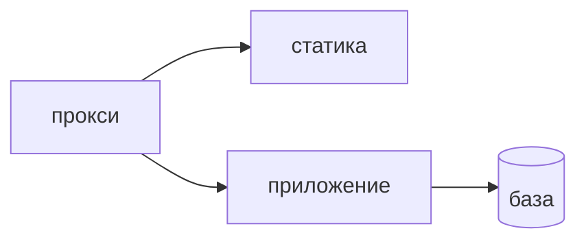

## Введение

Вакансии AppSec упоминают Kubernetes рядом с Python и React: RBAC, политики, секреты. Разработчику не нужен курс администратора кластера. Нужны три границы пода, в котором живёт процесс. Какой учёткой процесс говорит с API кластера. Откуда берётся секрет и куда он не должен попасть. К каким адресам этому поду вообще можно подключаться. Под, который может всё в кластере и хранит ключ в образе, — уже инцидентная заготовка, даже если приложение ещё не взломали. Взломанный процесс унаследует то, что ему выдали.

«Внутри кластера все свои» — слабая модель. Соседний под — такой же недоверенный сосед, как внешний запрос, только ближе: общая сеть по умолчанию часто позволяет дойти до чужого сервиса, если это явно не запретили. Фронтовый контейнер со статикой и процесс API — разные соседи. Статике не нужна база. API не нужен доступ читать все секреты неймспейса.

Выпуск разбирает связку: контейнер со статикой React и под FastAPI, который ходит в Postgres. Где строка подключения, кто не root, кому не дают API Kubernetes.

## Раздел: Три границы

Учётка пода — service account, с которой процесс говорит с API кластера. Обычному приложению API кластера не нужен вовсе: оно слушает HTTP и ходит в базу, а не создаёт поды и не читает чужие секреты. Учётка с правом читать все секреты превращает один взломанный процесс в склад ключей. Право оставляют пустым или минимальным. Широкий доступ «на всякий случай, вдруг пригодится отладка» в постоянном манифесте прода не оставляют. Временная роль на отладку — отдельная учётная запись со сроком, её снимают, а не дописывают в боевой под.

Секрет приходит в под при старте из хранилища, которое для этого предназначено, а не запекается в слой образа и не лежит в репозитории манифеста открытым текстом. Строка подключения к Postgres — секрет. Она не в Dockerfile, не в `ENV` слоя, который уезжает в реестр, не в git в явном виде. Образ, куда секрет попал, приходится считать скомпрометированным: слой остаётся в истории реестра, даже если следующий коммит строку убрал. Монтирование при старте этого следа не оставляет в слоях. В лог команду отладки секрет не печатают: упавший под не должен оставлять пароль в сборщике логов.

Процесс не от root, где это возможно. root в контейнере проще превратить в проблему узла, если нашлась дыра выхода из изоляции. Файловая система корня только для чтения мешает записать себе новый бинарник в каталоги системы. Временные файлы, если они нужны, идут в явно смонтированный каталог, а не в режим «можно писать куда угодно». Это не замена патчам приложения. Это уменьшение выигрыша от уже взломанного процесса.

Сеть: под приложения ходит в базу и принимает вход от прокси, не во все неймспейсы. Политика сети это фиксирует: куда можно установить соединение. Без политики часто действует «можно ко всем». Фронтовый под отдаёт статику. Ему не нужен маршрут в Postgres и не нужен маршрут к API кластера. Если статика сама ходит в базу, граница сервиса сломана ещё до Kubernetes: браузерный контейнер не место для строки подключения. API ходит в базу. API не ходит в чужие неймспейсы «потому что внутри». Политику пишут allow-списком нужных адресов, не бесконечным списком исключений, который забывают пополнить.

Падение пода — не повод оставить секрет в аргументах команды, которую скопировали в тикет «на всякий случай». Отладка смотрит статус и журнал без пароля. Если пароль уже засветился в тикете, его меняют, а не «убирают из комментария».

## Раздел: Разбор на примере

Два пода. Первый отдаёт собранный React. У него нет учётки с правами на секреты, нет переменной с паролем базы, политика сети не пускает его в Postgres. Он принимает трафик от входного прокси и отдаёт файлы. Всё.

Второй под — FastAPI. Service account без права читать чужие секреты и без права создавать ресурсы кластера. Строка подключения монтируется при старте из секрета, в манифесте в git её нет, в Dockerfile её нет. Процесс не root, корень файловой системы только для чтения, каталог временных файлов отдельно, если загрузкам он нужен. Политика сети: вход от прокси, выход на порт Postgres, и больше ничего лишнего. Чужой неймспейс и метаданные, которые не нужны приложению, не входят в allow.

Проверка, которую можно сделать без курсов администратора. В манифесте API нет поля с паролем текстом. В манифесте статики нет ссылки на сервис базы. В описании учётки нет `*` на секреты. Образ не запускает процесс нулевым пользователем без причины, записанной как исключение со сроком.

Отладка «не коннектится к базе» не решается выдачей кластерной роли администратора. Решается проверкой политики сети и тем, что секрет смонтирован в этот под, а не в соседний. Временный широкий доступ, если без него никак в аварии, оформляют отдельной ролью и снимают в тот же день. Постоянный манифест прода таким доступом не оставляют.

## Раздел: Где это ломается

Приложению выдают учётку, которая читает все секреты, потому что так в примере из статьи. Один RCE в приложении становится чтением чужих баз. Пример не копируют в прод.

Пароль в Dockerfile или в открытом yaml. Реестр и git помнят секрет после удаления строки. Секрет только в рантайме, старый пароль меняют, если успел попасть в слой.

root и записываемый корень «чтобы проще». Проще и атакующему положить свой бинарник. Исключение записывают, по умолчанию не root и read-only.

Сети нет как политики. Фронт может открыть соединение к базе, если в статике или в чужом скрипте окажется клиент. Политика режет адрес, не полагаясь на то, что «в коде такого импорта нет».

«В кластере все свои». Соседний под после своей уязвимости ходит к вашему API мимо внешних фильтров, которые вы считали периметром. Периметр пода — его политика и его учётка.

Секрет в логе старта «для проверки, что подхватили». Журнал становится вторым хранилищем паролей. В логе факт «секрет смонтирован», не значение.

Временную роль отладки забывают. Через месяц это уже постоянный администратор. Срок и снятие — часть оформления, не добрый жест.

## Раздел: Ответ вслух

Сервису выдаю отдельную учётку без лишних прав на API кластера, обычно без прав вовсе. Ключ не кладу в Dockerfile и в git манифеста. В рантайме монтирую секрет и не печатаю его при старте. Процесс не от root, корень файловой системы по возможности только для чтения. Сеть режу до нужных адресов: API в базу, статика без базы. Если команде нужен широкий доступ для отладки, это временная роль со сроком, не постоянный манифест прода. Соседний под я не считаю «своим» только потому, что он в том же кластере.

## Раздел: Плохой ответ

Плохой ответ: «внутри кластера все свои, сеть можно не резать». Соседний под ближе внешнего атакующего и часто доступнее. Второй плохой ответ: «секрет в переменной образа удобнее монтирования». Удобство остаётся в истории реестра. Утечка слоя не лечится следующим коммитом без ротации.

## Раздел: Термины

Учётные записи и права в кластере — RBAC. Учётка пода — service account. Секрет рантайма — объект секрета или внешнее хранилище, которое монтируют при старте, не слой образа. Политика сети — network policy, куда под может установить соединение. Неймспейс — граница имён, не автоматическая стена без политики. Корень в контейнере — пользователь root. Только чтение корня — readOnlyRootFilesystem.

## Лаба

**Цель.** Развести статику и API по учёткам, секретам и сети.

**Шаги.**

1. Для контейнера React напишите: куда ему можно ходить (входной прокси и отдача файлов), что ему не нужно (Postgres и API кластера), и что в его манифесте нет строки подключения.
2. Для пода FastAPI напишите: выход только в Postgres, учётка без права читать все секреты.
3. Укажите, где лежит строка подключения: секрет, который монтируют при старте. Назовите два места, где её не хранят: слой образа и открытый git.
4. Добавьте, что процесс не root и зачем корень только для чтения: сложнее записать новый бинарник.
5. Оформите временный широкий доступ для отладки: отдельная роль и срок снятия, не правка боевого манифеста навсегда.
6. Одной фразой отвергните тезис «в кластере все свои».

**Готово, если…**

- [ ] Статика не ходит в базу
- [ ] Учётка API не читает все секреты
- [ ] Пароль не в образе
- [ ] Сеть названа allow-списком, не «можно всем»
- [ ] Отладка со сроком, не навсегда

## Схема: Кто с кем говорит

## Тест

### Зачем приложению service account с правом читать все секреты?

**Ответ:** обычно низачем

**Пояснение:** Процессу API кластера чаще всего не нужен. Широкое право умножает взлом.

### Куда класть пароль базы?

**Ответ:** в секрет рантайма

**Пояснение:** Не в слой образа и не в открытый манифест.

### Почему не root в контейнере?

**Ответ:** проще выйти за процесс

**Пояснение:** Тот же пользователь, что у узловых задач, облегчает следующий шаг.

### Фронтовый под ходит в Postgres. Это норма?

**Ответ:** нет

**Пояснение:** Статике не нужна строка подключения. Данные отдаёт API.

### Временный широкий доступ для отладки. Как его оформить?

**Ответ:** отдельной ролью со сроком

**Пояснение:** Постоянный манифест прода таким доступом не оставляют.

## Шпаргалка

<ul><li>Учётка пода минимальна</li><li>Секрет не в образе</li><li>Не от root</li><li>Корень только для чтения, где можно</li><li>Сеть до нужных адресов</li></ul>

## Anki

### Front: Что такое service account пода?

Back: Учётка, с которой процесс говорит с API кластера.

### Front: Где не хранить секрет?

Back: В слое образа и в открытом манифесте в git.

### Front: Зачем readOnlyRootFilesystem?

Back: Процессу сложнее записать себе новый бинарник.

### Front: Что описывает network policy?

Back: К каким адресам под вообще может подключиться.

### Front: Почему «в кластере все свои» слабо?

Back: Взломанный соседний под становится внутренним атакующим.

### Front: Нужен ли статике React доступ к базе?

Back: Нет. Данные отдаёт API.

## Мнемоника

### peg: Под в кластере

**Задание:** Четыре настройки, которые спрашивают про под.

**Элементы:**
- не root
- лимит
- сеть
- секрет не в образе

**Подсказка:** Секрет в слое образа остаётся в реестре.

**Ответ:** 1 user · 2 limit · 3 network · 4 secret

## Итоги

- Под приложения не администратор кластера
- Секрет появляется в рантайме и не печатается в лог
- Процесс без root и без записи в корень уменьшает выигрыш атакующего
- Сеть короче, чем «весь кластер»
- Временная отладка имеет срок и не остаётся в манифесте прода

## Ссылки

- [Секреты](/game/learn/sec-authn-authz)
- [Pod и Service](/game/learn/ops-linux-process)
