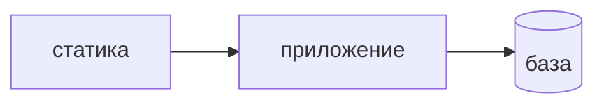

## Введение

Вакансии AppSec упоминают Kubernetes: RBAC, политики и секреты рядом с Python и React. Разработчику достаточно трёх границ пода, не курса администратора кластера.

## Раздел: Три границы

Учётка пода — только те вызовы API кластера, без которых процесс не живёт. Обычно приложению API кластера не нужен вовсе. Учётка с правом читать все секреты превращает один взломанный процесс в склад ключей.

Секрет приходит в под из хранилища при старте, не запекается в слой образа и не попадает в репозиторий манифеста в открытую. Образ запускают не от root, файловая система контейнера только для чтения, где это возможно.

Сеть: под приложения ходит в базу и во входной прокси, не во все неймспейсы. Политика сети это фиксирует. Фронтовый контейнер отдаёт статику, у него нет причин открывать базу.

Падение пода не должно оставлять секрет в логе команды, которой отлаживают «на всякий случай».

## Раздел: Ответ вслух

Сервису выдаю отдельную учётку без лишних прав на API кластера. Ключ не кладу в Dockerfile. В рантайме монтирую секрет и не печатаю его при старте. Сеть режу до базы и входа. Образ без root. Если команде нужен широкий доступ для отладки, это временная роль со сроком, не постоянный манифест прода.

## Раздел: Плохой ответ

Плохой ответ: «внутри кластера все свои, сеть можно не резать». Соседний под — такой же недоверенный сосед, как внешний запрос, только ближе.

## Раздел: Термины

Учётные записи и права — RBAC. Учётка пода — service account. Политика сети — network policy. Неймспейс — namespace. Корень в контейнере — root.

## Лаба

**20 минут.** Для API на FastAPI и отдельного контейнера со статикой React выпишите: куда каждому можно ходить, нужен ли им доступ к API Kubernetes и где лежит строка подключения к Postgres.

## Схема: Кто с кем говорит

## Тест

### Зачем приложению service account с правом читать все секреты?

**Ответ:** обычно низачем

**Пояснение:** Такой под при компрометации забирает чужие ключи.

### Куда класть пароль базы?

**Ответ:** в секрет рантайма

**Пояснение:** Слой образа и git манифеста с паролем уже утечка.

### Почему не root в контейнере?

**Ответ:** проще выйти за процесс

**Пояснение:** Лишний пользователь в образе уменьшает ущерб от дыры в приложении.

### Фронтовый под ходит в Postgres. Это норма?

**Ответ:** нет

**Пояснение:** Статике достаточно отдавать файлы. База — за API.

### Временный широкий доступ для отладки. Как его оформить?

**Ответ:** отдельной ролью со сроком

**Пояснение:** Постоянный манифест прода таким доступом не оставляют.

## Шпаргалка

<ul><li>Учётка пода минимальна</li><li>Секрет не в образе</li><li>Не от root</li><li>Сеть до нужных адресов</li></ul>

## Anki

### Front: Что такое service account пода?

Back: Учётка, с которой процесс говорит с API кластера.

### Front: Где не хранить секрет?

Back: В слое образа и в открытом манифесте в git.

### Front: Зачем readOnlyRootFilesystem?

Back: Процессу сложнее записать себе новый бинарник.

### Front: Что описывает network policy?

Back: К каким адресам под вообще может подключиться.

### Front: Почему «в кластере все свои» слабо?

Back: Взломанный соседний под становится внутренним атакующим.

### Front: Нужен ли статике React доступ к базе?

Back: Нет. Данные отдаёт API.

## Итоги

- Под приложения не администратор кластера
- Секрет появляется в рантайме
- Сеть короче, чем «весь кластер»

## Ссылки

- [Секреты](/game/learn/sec-secrets)
- [Pod и Service](/game/learn/ops-k8s-objects)
