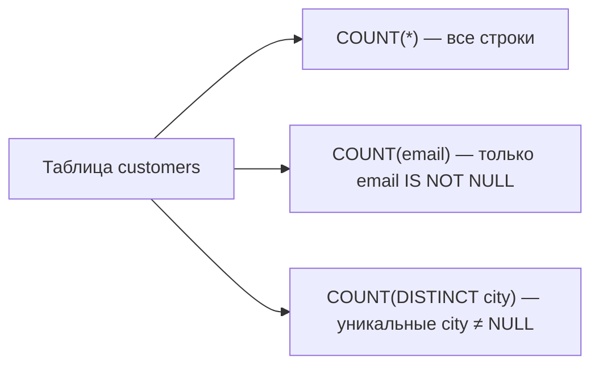
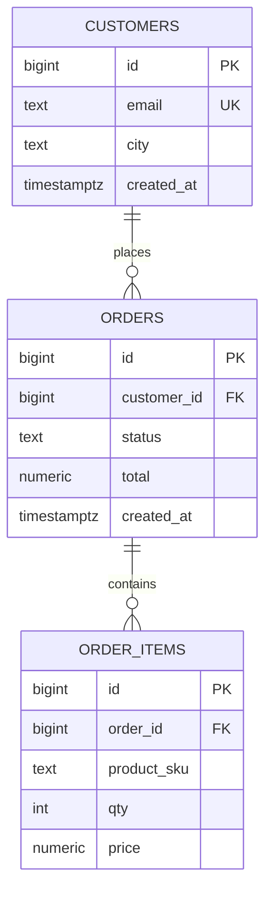

## Введение

Два коротких, но коварных вопроса: «как получить текущую дату?» (Q14) и «как посчитать количество записей?» (Q30). Кажется trivial, пока не всплывут диалекты, `COUNT(col)` с NULL и «зачем вообще полный COUNT на огромной таблице».

**Сводная лаба SQL.** Теория Q1–Q30 без клавиатуры выветривается. Этот выпуск — **сводная лаба** на одной схеме: ключи и JOIN, удаление данных, агрегаты, подзапросы. Цель — уверенно писать запросы вслух и в psql, как на live-coding части собеса.

## Раздел: Как отвечать одним блоком

Этот выпуск собрал соседние короткие темы трека: «Текущая дата и способы», «Сводная лаба SQL». Раньше каждая занимала отдельную карточку на несколько минут, а на собеседовании их спрашивают одним блоком. Ниже у каждой темы свой раздел, затем общие лабы, один тест и одна колода карточек. В ответе сначала назовите, какую тему спросили, потом определение и один пример. Не проговаривайте все разделы, если спросили один. Лабы можно пройти по порядку исходного трека. Если времени мало, сделайте первую и последнюю: первая ставит язык, последняя проверяет, что соседние темы вы не перепутали.

## Раздел: Текущая дата и способы: Текущая дата и время (Q14)

В **PostgreSQL** основные варианты:

| Выражение | Тип / смысл |
|-----------|-------------|
| `CURRENT_DATE` | дата без времени (`date`) |
| `CURRENT_TIME` | время с таймзоной |
| `CURRENT_TIMESTAMP` / `now()` | timestamptz «сейчас» |
| `LOCALTIMESTAMP` | timestamp без таймзоны |
| `clock_timestamp()` | «стенные часы» даже внутри транзакции (редко нужно) |

Нюанс транзакции: `now()` / `CURRENT_TIMESTAMP` в PostgreSQL стабильны **внутри одной транзакции** (время старта). Если нужен реальный тик на каждом вызове — `clock_timestamp()`.

В **MSSQL** классика — `GETDATE()` (datetime), также `SYSDATETIME()`, `CURRENT_TIMESTAMP`. В **MySQL** — `CURDATE()`, `NOW()`, `CURRENT_TIMESTAMP`.

На собесе ответьте так: «В PostgreSQL — `CURRENT_DATE` для даты и `now()`/`CURRENT_TIMESTAMP` для момента; в SQL Server — `GETDATE()`; синтаксис стандарта пересекается, но типы и таймзоны различаются».

Практика фильтра «за сегодня»:

```sql
SELECT *
FROM orders
WHERE created_at::date = CURRENT_DATE;
-- или диапазоном (дружелюбнее к индексу):
WHERE created_at >= CURRENT_DATE
  AND created_at < CURRENT_DATE + INTERVAL '1 day';
```

## Раздел: Текущая дата и способы: Способы посчитать строки (Q30)

**1. `COUNT(*)`** — число строк в группе/выборке. Не игнорирует NULL в отдельных столбцах: считает строки как сущности.

**2. `COUNT(column)`** — число строк, где `column IS NOT NULL`. Поэтому `COUNT(*)` и `COUNT(email)` могут различаться.

**3. `COUNT(DISTINCT column)`** — число уникальных не-NULL значений.

```sql
SELECT
  count(*) AS all_rows,
  count(email) AS with_email,
  count(DISTINCT city) AS distinct_cities
FROM customers;
```

**4. Условный подсчёт:** `count(*) FILTER (WHERE status = 'paid')` в PostgreSQL или `sum(CASE WHEN … THEN 1 ELSE 0 END)` — портативнее между диалектами.

**5. Приближённая оценка (когда полный COUNT дорог):**

```sql
SELECT reltuples::bigint AS estimate
FROM pg_class
WHERE oid = 'orders'::regclass;
```

Или смотреть оценку в `EXPLAIN` без `ANALYZE`. Это **не** аудитовая цифра: после массовых DML статистика устаревает, пока не сделают `ANALYZE`. На собесе: «для UI „примерно N миллионов“ — estimate; для биллинга — точный `COUNT` или поддерживаемый счётчик».

Другие ответы, которые засчитывают: отдельная таблица счётчиков + триггер/приложение; `pg_stat_user_tables`; в некоторых СУБД — sample/`TABLESAMPLE`. Главное — различать **точный** и **приближённый** подсчёт и цену блокировок/I/O.

## Раздел: Текущая дата и способы: Частые вопросы с собеседования

**Вопрос.** `CURRENT_DATE` vs `now()` timezone?

**Ответ.** `now()` timestamptz зависит от session timezone; «сегодня» для отчёта часто `(now() AT TIME ZONE 'Europe/Moscow')::date` или явный TZ. Собес ловит фильтр `created_at::date = CURRENT_DATE` без индекса.

**Вопрос.** GROUP BY все неагрегированные столбцы?

**Ответ.** В SQL каждый SELECT столбец либо в GROUP BY, либо внутри агрегата. PostgreSQL historically permissive с FUNCTIONALLY DEPENDENT — не полагайтесь без понимания ONLY_FULL_GROUP_BY в MySQL.

**Вопрос.** HAVING vs WHERE?

**Ответ.** WHERE фильтрует строки до группировки; HAVING — группы после агрегации (`HAVING count(*) > 5`). Предикаты на агрегаты только в HAVING.

**Вопрос.** COUNT DISTINCT vs подзапрос?

**Ответ.** `COUNT(DISTINCT user_id)` считает уникальных в группе; для сложных условий иногда подзапрос или COUNT FILTER (PostgreSQL). Выбор по читаемости и плану.

## Раздел: Сводная лаба SQL: Учебная схема магазина

```sql
CREATE TABLE customers (
  id          bigserial PRIMARY KEY,
  email       text UNIQUE NOT NULL,
  city        text,
  created_at  timestamptz NOT NULL DEFAULT now()
);

CREATE TABLE orders (
  id           bigserial PRIMARY KEY,
  customer_id  bigint NOT NULL REFERENCES customers(id),
  status       text NOT NULL CHECK (status IN ('new', 'paid', 'cancelled')),
  total        numeric(12,2) NOT NULL CHECK (total >= 0),
  created_at   timestamptz NOT NULL DEFAULT now()
);

CREATE TABLE order_items (
  id          bigserial PRIMARY KEY,
  order_id    bigint NOT NULL REFERENCES orders(id) ON DELETE CASCADE,
  product_sku text NOT NULL,
  qty         int NOT NULL CHECK (qty > 0),
  price       numeric(12,2) NOT NULL CHECK (price >= 0)
);

CREATE INDEX ON orders (customer_id);
CREATE INDEX ON orders (created_at);
CREATE INDEX ON order_items (order_id);
```

Смысл сущностей (связка с нормализацией из SQL07): клиент 1—N заказов; заказ 1—N позиций. Денормализовать `total` можно, но в лабе считайте сумму и сверяйте.

Минимум данных: 4 клиента (один без заказов), 5+ заказов разных статусов, позиции с разными `qty`.

## Раздел: Сводная лаба SQL: Набор задач «как на собесе»

Выполните и **проговорите** зачем каждый приём:

1. **INNER JOIN** — заказы с email клиента.
2. **LEFT JOIN** — все клиенты и число заказов (`count(o.id)`), включая нули.
3. **Anti-join** — клиенты без заказов (`NOT EXISTS` или `LEFT … WHERE o.id IS NULL`).
4. **Подзапрос** — заказы с `total` выше среднего по `paid`.
5. **COUNT** — `count(*)` заказов за сегодня vs `count(*) FILTER (WHERE status = 'paid')`.
6. **DELETE vs TRUNCATE** — в транзакции удалите позиции одного заказа (`DELETE`); отдельно на копии таблицы сравните `TRUNCATE` (сброс identity, нельзя WHERE; в PG — быстрее, меньше WAL при полном очищении, права иные).
7. **Целостность** — попробуйте вставить `order_items` с несуществующим `order_id` — ожидайте FK error.
8. **Операторы** — выборка `status IN (…)`, `total BETWEEN`, скидка `price * qty * 0.9`.

Это покрывает практику вокруг Q1–Q30: подмножества SQL, ключи, JOIN, NULL/COUNT, удаление, подзапросы, операторы, дату.

## Раздел: Сводная лаба SQL: Частые вопросы с собеседования

**Вопрос.** Anti-join словами на собесе?

**Ответ.** Строки левой таблицы без совпадения справа: `LEFT JOIN ... WHERE right.id IS NULL` или `NOT EXISTS`. Эквивалентны при корректной логике; EXISTS часто яснее с NULL.

**Вопрос.** Зачем в лабе сравнивать DELETE и TRUNCATE?

**Ответ.** Закрепить: WHERE только у DELETE, identity/WAL/права различаются, rollback зависит от СУБД. Без практики путают на Q1 drill.

**Вопрос.** Почему избегать `NOT IN` в лаб-решениях?

**Ответ.** Nullable FK в подзапросе даёт пустой результат NOT IN. NOT EXISTS учат как default для «нет детей».

**Вопрос.** Индекс на FK в учебной схеме?

**Ответ.** Ускоряет JOIN и проверки referential integrity при изменениях parent — good habit с первой миграции, не «оптимизация потом».

## Лаба

**Текущая дата и способы.**

**Цель.** Сравнить функции даты и три формы COUNT на учебных данных с NULL.

**Шаги.**
1. Создайте `customers(id, email text, city text)` и вставьте строки, у части `email` = NULL.
2. Выведите `CURRENT_DATE`, `now()`, `CURRENT_TIMESTAMP` и типы через `pg_typeof(...)`.
3. Посчитайте `count(*)`, `count(email)`, `count(DISTINCT city)` — зафиксируйте разницу.
4. Добавьте `orders(created_at timestamptz)` и отфильтруйте «за сегодня» диапазоном без `::date` на столбце.
5. Снимите `EXPLAIN` для `SELECT count(*) FROM orders` и отдельно посмотрите `reltuples` в `pg_class`.

**В группу:** один считает «сегодня» через `created_at::date = CURRENT_DATE`, другой — диапазоном; сравните, чей план может использовать индекс по `created_at`.

**Готово, если…**
- [ ] Называете PG- и MSSQL-функции «текущего момента»
- [ ] Объясняете, почему COUNT(*) ≠ COUNT(col) при NULL
- [ ] Знаете, когда уместна приближённая оценка

**Сводная лаба SQL.**

**Цель.** Поднять схему, залить фикстуры и закрыть чеклист из восьми задач выше с проверкой результатов.

**Шаги.**
1. Создайте БД/схему `sql12_lab` и три таблицы со всеми CHECK/FK/индексами.
2. Вставьте фикстуры (в т.ч. клиент без заказов и заказ без… нет, позиции пусть будут у всех заказов, кроме одного «пустого» для anti-join по items — по желанию).
3. Решите задачи 1–5; сохраните SQL в файл `lab12.sql`.
4. В одной транзакции сделайте `DELETE FROM order_items WHERE order_id = …; ROLLBACK;` — убедитесь, что данные на месте; затем осознанный `COMMIT` на тестовой копии.
5. На временной таблице сравните `DELETE` без WHERE и `TRUNCATE`: время, `IDENTITY`, возможность `WHERE`.
6. Напишите краткий README: какие вопросы из Q1–Q30 закрыла каждая задача.

**В группу:** code review чужого `lab12.sql` — ищите `NOT IN` с nullable столбцом, деление integer, фильтр «сегодня» через `::date` на столбце.

**Готово, если…**
- [ ] Схема поднимается с нуля одним скриптом
- [ ] Есть INNER, LEFT, anti-join, subquery, агрегаты
- [ ] Можете за 60 секунд объяснить DELETE vs TRUNCATE на примере этой схемы

## Схема: Текущая дата и способы: COUNT(*) vs COUNT(col)



## Схема: Сводная лаба SQL: ER магазина



## Тест

### Как в PostgreSQL получить текущую дату без времени?

**Ответ:** `CURRENT_DATE`

**Пояснение:** для момента со временем — `now()` или `CURRENT_TIMESTAMP`; в MSSQL часто отвечают `GETDATE()`.

### Как найти клиентов без заказов без NOT IN?

**Ответ:** `NOT EXISTS` или `LEFT JOIN orders … WHERE orders.id IS NULL`

**Пояснение:** оба — anti-join; `NOT IN` рискован при NULL в подзапросе.

### Чем `COUNT(*)` отличается от `COUNT(email)`?

**Ответ:** `COUNT(*)` считает строки; `COUNT(email)` — только строки с не-NULL email

**Пояснение:** это прямой ответ на Q30 и частая причина расхождений в отчётах.

### Чем TRUNCATE принципиально отличается от DELETE всех строк?

**Ответ:** TRUNCATE без WHERE, быстрее

**Пояснение:** DELETE — DML с WHERE и ROW-триггерами; в PG TRUNCATE транзакционен.

### Когда на собесе уместно говорить про estimate вместо COUNT(*)?

**Ответ:** большая таблица, порядок величины

**Пояснение:** reltuples/EXPLAIN; для аудита и денег — только точный COUNT.

## Шпаргалка

<ul><li>PG: CURRENT_DATE, now(), CURRENT_TIMESTAMP</li><li>MSSQL: GETDATE(), SYSDATETIME()</li><li>Фильтр «сегодня»: полуоткрытый диапазон по timestamptz</li><li>Оценка: pg_class.reltuples / EXPLAIN</li><li>customers 1—N orders 1—N order_items</li><li>JOIN / anti-join / subquery / COUNT / дата / DELETE vs TRUNCATE</li></ul>

## Anki

### Front: Q14 — текущая дата в PostgreSQL и MSSQL?

Back: PG: CURRENT_DATE / now(); MSSQL: GETDATE() (и аналоги)

### Front: Минимальная схема для SQL live-coding?

Back: customers → orders → order_items с PK/FK и парой индексов

### Front: COUNT(*) vs COUNT(column)?

Back: * — все строки; column — без NULL в этом столбце

### Front: Три запроса, которые почти всегда просят на практике?

Back: JOIN с атрибутами родителя; anti-join «без детей»; агрегат COUNT/SUM с GROUP BY

### Front: Быстрая оценка числа строк в PG?

Back: reltuples в pg_class или оценка узлов в EXPLAIN; не для аудита

### Front: Что проговорить про DELETE vs TRUNCATE?

Back: WHERE только у DELETE; TRUNCATE чистит всё быстрее; отличаются права, identity, триггеры, WAL

## Мнемоника

### acronym: Агрегаты

**Задание:** Четыре функции и ловушка COUNT.

**Элементы:**
- COUNT
- SUM
- AVG
- GROUP BY

**Подсказка:** COUNT(*) считает строки. COUNT(col) пропускает NULL.

**Ответ:** COUNT SUM AVG GROUP BY

## Итоги

- Дата/время — стандартные имена плюс диалект (`GETDATE` vs `now`)
- Три точных COUNT и условный FILTER/CASE — must-have middle
- Огромные таблицы: сознательно разделяйте точный COUNT и estimate
- Одна схема закрывает большую часть практики Q1–Q30
- Умение выбрать JOIN / NOT EXISTS / подзапрос важнее заучивания определений
- После лабы переходите к CTE, окнам и EXPLAIN (SQL13–14)

## Ссылки

- [PostgreSQL: Date/Time Functions](https://www.postgresql.org/docs/current/functions-datetime.html)
- [PostgreSQL: Aggregate Functions](https://www.postgresql.org/docs/current/functions-aggregate.html)
- [PG Exercises](https://pgexercises.com/)
- [OTUS / Хабр — часть I](https://habr.com/ru/companies/otus/articles/461067/)
- [Select Star SQL](https://selectstarsql.com/)
- [PostgreSQL: Tutorial](https://www.postgresql.org/docs/current/tutorial.html)
- [CTE и окна](/game/learn/sql-cte-window)
