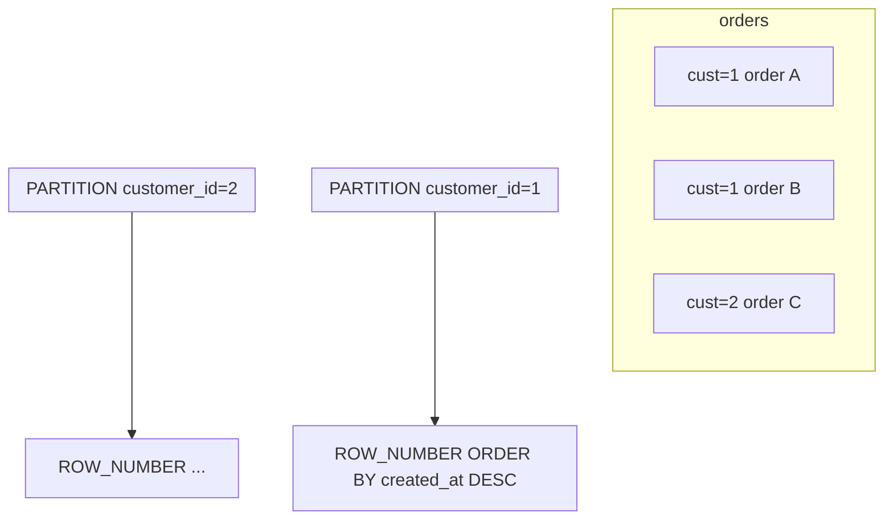
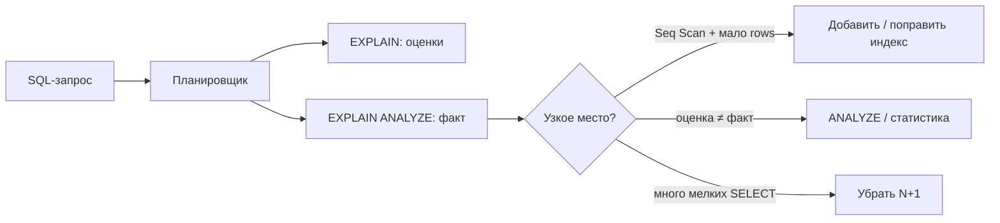

## Введение

В исходной Части I (Q1–Q30) CTE и оконные функции почти не разобраны, но на реальных собесах 2020-х это **обязательная** полка. Выпуск — мост от middle-лабы к senior: читаемый `WITH`, ранжирование и бегущие агрегаты без самоджойна кошмара.

**EXPLAIN, индексы и N+1.** Знать JOIN мало: на senior ждут «почему медленно» и «что смотреть». Этот выпуск — практичный слой сверх Q1–Q30: `EXPLAIN (ANALYZE)`, здравый смысл индексов и классика N+1 между приложением и БД.

## Раздел: Как отвечать одним блоком

Этот выпуск собрал соседние короткие темы трека: «CTE и оконные функции», «EXPLAIN, индексы и N+1». Раньше каждая занимала отдельную карточку на несколько минут, а на собеседовании их спрашивают одним блоком. Ниже у каждой темы свой раздел, затем общие лабы, один тест и одна колода карточек. В ответе сначала назовите, какую тему спросили, потом определение и один пример. Не проговаривайте все разделы, если спросили один. Лабы можно пройти по порядку исходного трека. Если времени мало, сделайте первую и последнюю: первая ставит язык, последняя проверяет, что соседние темы вы не перепутали.

## Раздел: CTE и оконные функции: CTE — WITH и рекурсия

**CTE (Common Table Expression)** — именованный подзапрос в предложении `WITH`, видимый основному запросу (и следующим CTE в том же `WITH`).

```sql
WITH paid AS (
  SELECT customer_id, sum(total) AS paid_sum
  FROM orders
  WHERE status = 'paid'
  GROUP BY customer_id
),
top_clients AS (
  SELECT customer_id, paid_sum
  FROM paid
  WHERE paid_sum > 10000
)
SELECT c.email, t.paid_sum
FROM top_clients t
JOIN customers c ON c.id = t.customer_id
ORDER BY t.paid_sum DESC;
```

Зачем на собесе: читаемость, декомпозиция, меньше вложенности; в PostgreSQL CTE по умолчанию могут оптимизироваться по-разному в разных версиях (инлайн vs materialize) — если спрашивают про perf, скажите «смотрю `EXPLAIN`, при необходимости `MATERIALIZED` / `NOT MATERIALIZED` (PG12+)».

**Рекурсивный CTE** — иерархии (оргструктура, категории): якорная часть `UNION ALL` рекурсивная. Кратко уметь нарисовать обход дерева; детали оптимизации — бонус.

CTE ≠ временная таблица: живёт в одном запросе; `CREATE TEMP TABLE` — отдельный объект сессии.

## Раздел: CTE и оконные функции: Оконные функции

Окно считает выражение по **набору связанных строк**, не схлопывая результат (в отличие от `GROUP BY`).

Каркас:

```sql
<func>() OVER (
  [PARTITION BY ...]
  [ORDER BY ...]
  [ROWS/RANGE BETWEEN ...]
)
```

Must-have функции:

| Функция | Смысл |
|---------|--------|
| `ROW_NUMBER()` | уникальный номер в разделе (1…n) |
| `RANK()` | ранг с дырками при ничьих |
| `DENSE_RANK()` | ранг без дырок |
| `SUM() OVER (...)` | накопительная/раздельная сумма |
| `LAG` / `LEAD` | соседние строки |

Типичная задача: «последний заказ каждого клиента»:

```sql
WITH ranked AS (
  SELECT o.*,
         row_number() OVER (
           PARTITION BY customer_id
           ORDER BY created_at DESC, id DESC
         ) AS rn
  FROM orders o
)
SELECT *
FROM ranked
WHERE rn = 1;
```

Накопительная сумма по клиенту во времени:

```sql
SELECT id, customer_id, total, created_at,
       sum(total) OVER (
         PARTITION BY customer_id
         ORDER BY created_at, id
         ROWS BETWEEN UNBOUNDED PRECEDING AND CURRENT ROW
       ) AS running_total
FROM orders
WHERE status = 'paid';
```

`RANK` vs `ROW_NUMBER`: при одинаковых ключах сортировки `ROW_NUMBER` всё равно уникален (порядок ничьих недетерминирован без tie-breaker); `RANK` даёт одинаковый ранг и пропускает номера.

Связь с подзапросами (SQL10): многие коррелированные скаляры переписываются в окна — часто яснее и быстрее.

## Раздел: CTE и оконные функции: Частые вопросы с собеседования

**Вопрос.** Оконная функция vs GROUP BY — когда что?

**Ответ.** GROUP BY схлопывает строки в группы; окно сохраняет детализацию строк и добавляет вычисление «рядом» (running sum, rank). «Топ-1 на группу без потери колонок заказа» — window, не только GROUP BY.

**Вопрос.** `ROW_NUMBER` vs `RANK` при ничьих?

**Ответ.** ROW_NUMBER уникален (нужен tie-breaker в ORDER BY); RANK пропускает номера после ничьих. DENSE_RANK без дырок. На собесе называют tie-breaker (`id DESC`).

**Вопрос.** CTE materialized vs not in PostgreSQL?

**Ответ.** `MATERIALIZED` заставляет сохранить результат CTE один раз — помогает, если CTE используется многократно; без hint оптимизатор может inline. Злоупотребление materialized скрывает дублирование work.

**Вопрос.** Можно ли фильтровать по алиасу window в том же SELECT?

**Ответ.** В стандарте нельзя в WHERE — нужен подзапрос/CTE. В PostgreSQL иногда `QUALIFY` нет — паттерн `WITH ranked AS (...) SELECT * FROM ranked WHERE rn = 1`.

## Раздел: EXPLAIN, индексы и N+1: EXPLAIN и EXPLAIN ANALYZE

В PostgreSQL:

```sql
EXPLAIN
SELECT * FROM orders WHERE customer_id = 42;

EXPLAIN (ANALYZE, BUFFERS, FORMAT TEXT)
SELECT c.email, o.total
FROM orders o
JOIN customers c ON c.id = o.customer_id
WHERE o.status = 'paid';
```

- **`EXPLAIN`** — план *ожидаемый* (оценки строк, стоимость).
- **`EXPLAIN ANALYZE`** — план *исполненный* (реальное время и rows); **выполняет** запрос (для пишущих DML опаснее — обычно откатывают транзакцию или используют копию).

Что читать в первую очередь:

1. Тип узла: `Seq Scan`, `Index Scan`, `Index Only Scan`, `Bitmap Heap Scan`, `Hash Join`, `Nested Loop`, `Sort`.
2. Расхождение `rows` estimated vs actual — повод для `ANALYZE` таблицы / плохой статистики.
3. Толстые `Seq Scan` на больших таблицах при селективном фильтре — кандидат на индекс.
4. `Sort` + большой объём — возможный `work_mem` / индекс под `ORDER BY`.

Стоимость — условные единицы планировщика, не миллисекунды; для времени смотрите `actual time` в ANALYZE.

## Раздел: EXPLAIN, индексы и N+1: Индексы, covering и N+1

**Когда индекс помогает:** высокая селективность (`customer_id = ?`, email UNIQUE), JOIN/FK-колонки, частые `ORDER BY` + `LIMIT`, предикаты диапазона по времени.

**Когда вредит или бесполезен:**

- почти все строки всё равно нужны (селективность ≈ 1) — Seq Scan дешевле;
- низкая кардинальность (`boolean`, статус из 3 значений) без дополнительной колонки;
- функция на столбце (`WHERE lower(email) = …`) — нужен индекс по выражению;
- слишком много индексов — замедляют `INSERT`/`UPDATE`/`DELETE` и раздувают storage.

**Идея covering / Index Only Scan:** индекс содержит все нужные столбцы, heap не читаем (в PG помогает `VACUUM` видимости / `INCLUDE` в CREATE INDEX).

```sql
CREATE INDEX ON orders (customer_id) INCLUDE (status, total);
```

**N+1:** приложение делает 1 запрос список заказов + N запросов « sucй клиента» в цикле. Симптом: тысячи одинаковых `SELECT … WHERE id = $1` в логах. Лечение: JOIN / `WHERE id IN (…)`, batch, dataloader; на стороне SQL — один наборный запрос. На собесе свяжите с ORM (`select_related` / `joinedload`).

Связка с SQL06: типы индексов (B-tree по умолчанию в PG) — база; здесь акцент на **наблюдаемости плана**, а не на зубрёжке названий.

Кратко по диалектам: в MSSQL — план в SSMS, `SET STATISTICS IO`; в MySQL — `EXPLAIN ANALYZE` (в новых версиях). Идея та же: смотреть доступ к данным и JOIN strategy.

## Раздел: EXPLAIN, индексы и N+1: Частые вопросы с собеседования

**Вопрос.** Seq Scan vs Index Scan — когда seq нормален?

**Ответ.** Малая доля таблицы не всегда триггер — planner смотрит statistics: при ~30%+ строк или cold cache seq может выиграть. EXPLAIN ANALYZE показывает фактические rows vs estimate.

**Вопрос.** N+1 на уровне приложения — SQL-лечение?

**Ответ.** Один запрос с JOIN или IN (...), batch load, или aggregation в SQL вместо цикла ORM. EXPLAIN проверяет, что не nested loop на огромном outer.

**Вопрос.** Index Only Scan — условие?

**Ответ.** Все нужные столбцы в индексе и visibility map позволяет не ходить в heap (PostgreSQL). Covering index `(user_id) INCLUDE (email)` для узких SELECT.

**Вопрос.** `EXPLAIN` без ANALYZE — чего не хватает?

**Ответ.** План без фактического времени и rows — только оценка. ANALYZE выполняет запрос (осторожно на UPDATE!) и даёт loops, actual time — must для tuning.

## Лаба

**CTE и оконные функции.**

**Цель.** На схеме SQL12 написать CTE-отчёт и выборку «топ-1 заказ на клиента» через `ROW_NUMBER`.

**Шаги.**
1. Возьмите `customers` / `orders` из sql-agg-dates-count (или пересоздайте кратко).
2. Через `WITH` посчитайте сумму `paid` по клиентам и отфильтруйте порог.
3. Выберите последний заказ каждого клиента (`ROW_NUMBER` + фильтр `rn = 1`).
4. Добавьте `SUM(total) OVER (PARTITION BY customer_id ORDER BY created_at)` и сверьте руками на 2–3 строках.
5. Сравните `RANK` и `DENSE_RANK` на искусственных одинаковых `total`.

**В группу:** один решает «последний заказ» через коррелированный подзапрос, другой — через окно; сравните читаемость и `EXPLAIN`.

**Готово, если…**
- [ ] Пишете цепочку из 2 CTE без подглядывания
- [ ] Объясняете PARTITION BY vs GROUP BY
- [ ] Отличаете ROW_NUMBER / RANK / DENSE_RANK

**EXPLAIN, индексы и N+1.**

**Цель.** Снять планы до/после индекса и смоделировать N+1 vs один JOIN.

**Шаги.**
1. На схеме SQL12 залейте достаточно строк (тысячи orders — скриптом генерации).
2. Сделайте `EXPLAIN ANALYZE` выборки `WHERE customer_id = …` без индекса по `customer_id` (временно дропните) и с индексом.
3. Найдите запрос с `WHERE status = 'paid'` на большой таблице — обсудите, почему один индекс по status может не использоваться.
4. Напишите псевдокод N+1 в Python/любом языке и эквивалент одним SQL JOIN.
5. Создайте индекс с `INCLUDE` и поймайте `Index Only Scan` (или объясните, почему его ещё нет — visibility map).

**В группу:** один ломает статистику (`DELETE` массы строк без `ANALYZE`), второй читает план и ставит диагноз.

**Готово, если…**
- [ ] Отличаете EXPLAIN от EXPLAIN ANALYZE
- [ ] Называете 2 случая «индекс не поможет»
- [ ] Объясняете N+1 и исправление наборным запросом

## Схема: CTE и оконные функции: Окно PARTITION BY customer



## Схема: EXPLAIN, индексы и N+1: От запроса к плану



## Тест

### Чем CTE отличается от подзапроса в FROM?

**Ответ:** CTE именован в WITH и улучшает читаемость/переиспользование в одном запросе; семантика близка derived table

**Пояснение:** senior добавляет про оптимизацию (inline/materialize) и отличие от TEMP TABLE.

### Чем EXPLAIN ANALYZE опаснее обычного EXPLAIN?

**Ответ:** он реально выполняет запрос, включая побочные эффекты DML

**Пояснение:** для диагностики SELECT на проде всё равно осторожны с нагрузкой; для UPDATE/DELETE — только в транзакции с ROLLBACK или на копии.

### Зачем ROW_NUMBER, если уже есть RANK?

**Ответ:** ROW_NUMBER всегда уникален в разделе — удобно для «ровно одна строка на группу»

**Пояснение:** RANK/DENSE_RANK отражают соревновательную семантику ничьих; для de-dup обычно ROW_NUMBER.

### Когда Seq Scan может быть правильным выбором?

**Ответ:** когда нужно прочитать большую долю таблицы — случайный доступ по индексу дороже последовательного чтения

**Пояснение:** senior не орёт «везде индексы», а говорит о селективности и стоимости.

### Чем оконный SUM отличается от SUM + GROUP BY?

**Ответ:** окно сохраняет строки

**Пояснение:** GROUP BY схлопывает группу; running total — через OVER.

## Шпаргалка

<ul><li>Рекурсия: WITH RECURSIVE … UNION ALL …</li><li>PG12+: MATERIALIZED / NOT MATERIALIZED</li><li>ROW_NUMBER — уникальный номер; RANK — с дырками; DENSE_RANK — без</li><li>Смотри: Scan/Join тип, rows estimate vs actual, Sort</li><li>После больших DML — ANALYZE таблицы</li><li>Помогают при высокой селективности и JOIN/FK</li><li>Вредят при write-heavy и «почти full scan»</li><li>Covering: INCLUDE / Index Only Scan</li><li>N+1 → один наборный SQL или batch</li></ul>

## Anki

### Front: Что такое CTE?

Back: Именованный подзапрос в WITH для читаемой декомпозиции одного SQL

### Front: EXPLAIN vs EXPLAIN ANALYZE?

Back: Оценки плана vs реальное исполнение с фактическим временем и rows

### Front: Шаблон «последняя строка в группе»?

Back: ROW_NUMBER() OVER (PARTITION BY ключ ORDER BY время DESC) → WHERE rn = 1

### Front: Когда индекс не помогает?

Back: Низкая селективность / нужен почти full scan / выражение без expression index; плюс цена на запись

### Front: PARTITION BY vs GROUP BY?

Back: PARTITION сохраняет строки и считает окно; GROUP BY агрегирует и схлопывает

### Front: Как объяснить N+1 на собесе?

Back: 1+N запросов в цикле приложения; чинить JOIN/IN/batch/ORM eager load

## Мнемоника

### link: Окно против группы

**Задание:** Когда GROUP BY уже не отвечает на вопрос.

**Элементы:**
- фильтр
- группа схлопывает
- окно оставляет строку
- PARTITION BY

**Подсказка:** Окно считает по соседям и не съедает строку.

**Ответ:** WHERE → GROUP BY → OVER → PARTITION

## Итоги

- CTE делают сложный SQL сопровождаемым; рекурсия — для иерархий
- Окна — must-have senior/middle+: ранги, running sum, de-dup
- Часть I Хабра этого не закрывает — держите SQL13 в обязательном маршруте
- План — главный артефакт разговора о perf в SQL
- Индекс — инструмент селективного доступа, не магия
- N+1 — стык приложения и БД; senior обязан его узнать в логах

## Ссылки

- [PostgreSQL: WITH Queries (CTEs)](https://www.postgresql.org/docs/current/queries-with.html)
- [PostgreSQL: Window Functions](https://www.postgresql.org/docs/current/tutorial-window.html)
- [Select Star SQL](https://selectstarsql.com/)
- [OTUS / Хабр — часть I](https://habr.com/ru/companies/otus/articles/461067/)
- [PostgreSQL: Using EXPLAIN](https://www.postgresql.org/docs/current/using-explain.html)
- [PostgreSQL: CREATE INDEX](https://www.postgresql.org/docs/current/sql-createindex.html)
- [Use The Index, Luke!](https://use-the-index-luke.com/)
- [Interview drill](/game/learn/sql-interview-drill)
