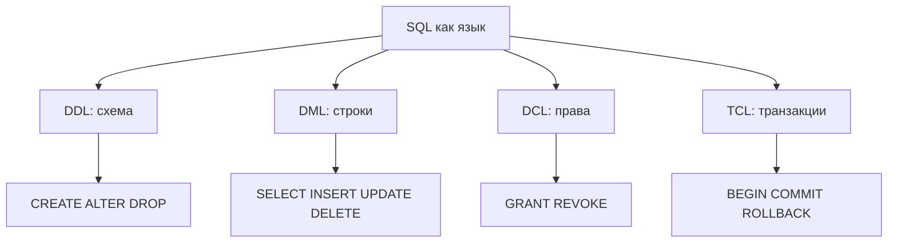

## Введение

Первый выпуск серии SQL для собеседования. Здесь разбираем, как устроен язык SQL по группам команд, чем реляционная СУБД отличается от NoSQL и почему «SQL» и «MySQL» — не одно и то же. Примеры ориентированы на PostgreSQL; различия с MySQL и MS SQL Server отмечены коротко.

**Ключи и constraints.** После семейств команд переходим к каркасу реляционной модели: таблица и поле, ключи и ограничения. На собесе часто сыплют подряд: что такое PK, чем UNIQUE отличается от PK, зачем FK и что такое целостность. Ответы ниже — с примерами под PostgreSQL.

## Раздел: Как отвечать одним блоком

Этот выпуск собрал соседние короткие темы трека: «SQL на собесе», «Ключи и constraints». Раньше каждая занимала отдельную карточку на несколько минут, а на собеседовании их спрашивают одним блоком. Ниже у каждой темы свой раздел, затем общие лабы, один тест и одна колода карточек. В ответе сначала назовите, какую тему спросили, потом определение и один пример. Не проговаривайте все разделы, если спросили один. Лабы можно пройти по порядку исходного трека. Если времени мало, сделайте первую и последнюю: первая ставит язык, последняя проверяет, что соседние темы вы не перепутали.

## Раздел: SQL на собесе: DDL, DML, DCL и TCL

SQL удобно мысленно делить на семейства команд — так отвечают на вопрос «что такое DDL/DML/DCL».

**DDL (Data Definition Language)** — описание структуры: объекты схемы создаём, меняем и удаляем.
- Типичные команды: `CREATE`, `ALTER`, `DROP`, `TRUNCATE` (в части классификаций `TRUNCATE` относят к DDL, потому что это операция над таблицей как объектом, а не построчное изменение данных).
- Пример (PostgreSQL):

```sql
CREATE TABLE accounts (
  id         bigint GENERATED ALWAYS AS IDENTITY PRIMARY KEY,
  email      text NOT NULL,
  created_at timestamptz NOT NULL DEFAULT now()
);

ALTER TABLE accounts ADD COLUMN is_active boolean NOT NULL DEFAULT true;
```

**DML (Data Manipulation Language)** — работа со строками данных.
- Команды: `SELECT`, `INSERT`, `UPDATE`, `DELETE`, иногда отдельно выделяют `MERGE` / `UPSERT` (`INSERT … ON CONFLICT` в PostgreSQL).
- Пример:

```sql
INSERT INTO accounts (email) VALUES ('dev@example.com');
UPDATE accounts SET is_active = false WHERE email = 'dev@example.com';
SELECT id, email FROM accounts WHERE is_active;
```

**DCL (Data Control Language)** — права доступа.
- Команды: `GRANT`, `REVOKE` (в некоторых СУБД ещё `DENY`).
- Пример:

```sql
GRANT SELECT, INSERT ON accounts TO app_writer;
REVOKE INSERT ON accounts FROM app_writer;
```

**TCL (Transaction Control Language)** — границы транзакций (часто спрашивают вместе с тройкой выше).
- Команды: `BEGIN` / `START TRANSACTION`, `COMMIT`, `ROLLBACK`, `SAVEPOINT`.
- В PostgreSQL DML обычно идёт внутри транзакции; DDL тоже может быть транзакционным (в отличие от многих сценариев MySQL с InnoDB, где DDL часто неявно коммитит).

На собесе достаточно чётко разделить: **схема** (DDL), **данные** (DML), **права** (DCL), **атомарность изменений** (TCL).

## Раздел: SQL на собесе: RDBMS и NoSQL

**RDBMS (реляционная СУБД)** хранит данные в таблицах со схемой, связями через ключи и декларативным SQL. Примеры: PostgreSQL, MySQL/MariaDB, SQL Server, SQLite, Oracle.

Сильные стороны для бизнес-систем:
- предсказуемая схема и ограничения целостности;
- мощные JOIN и аналитические запросы;
- транзакции и зрелая модель конкурентного доступа.

**NoSQL** — зонтичный термин для моделей без жёсткой «таблицы + SQL» как единственного интерфейса:
- **документные** (MongoDB) — JSON/BSON-документы;
- **ключ–значение** (Redis) — быстрый доступ по ключу, кэш, сессии;
- **колоночные / широкие таблицы** (Cassandra) — высокие объёмы записи и горизонтальное масштабирование;
- **графовые** (Neo4j) — связи как первоклассные сущности;
- **поисковые** (Elasticsearch) — полнотекст и фасеты.

На практике часто гибрид: PostgreSQL как система записи + Redis/Elasticsearch рядом. Важно сказать интервьюеру: выбор модели зависит от запросов, согласованности и операционной сложности, а не от моды.

## Раздел: SQL на собесе: Язык SQL и продукт MySQL

**SQL** — язык запросов (стандарт ISO/ANSI с диалектными расширениями). Одна и та же идея (`SELECT … FROM … WHERE`) живёт в разных СУБД, но синтаксис и поведение отличаются: типы, функции дат, `LIMIT`/`OFFSET` vs `TOP`/`FETCH`, автоинкремент, изоляции.

**MySQL** — конкретная СУБД (продукт), которая *реализует* диалект SQL. Аналогично PostgreSQL и SQL Server — тоже продукты со своими диалектами.

Короткий ответ на Q9: «SQL — язык; MySQL — СУБД, которая понимает свой диалект SQL». Не путать также MySQL (СУБД) и «mysql» (клиентская утилита/протокол).

## Раздел: SQL на собесе: Частые вопросы с собеседования

**Вопрос.** DDL в транзакции PostgreSQL vs MySQL?

**Ответ.** В PostgreSQL многие DDL транзакционны (rollback откатывает CREATE). В MySQL historically DDL делал implicit commit — на собесе называют диалект, не «всегда так».

**Вопрос.** DCL — что включить в ответ?

**Ответ.** Data Control Language: GRANT/REVOKE прав на объекты. Связать с least privilege: app role без DROP, миграции отдельным пользователем.

**Вопрос.** SQL vs диалект MySQL?

**Ответ.** SQL — стандарт языка; MySQL/PostgreSQL/SQL Server — продукты с extensions (`LIMIT` vs `TOP`, типы, функции). Переносимость: писать стандартное ядро, знать отличия там, где работаете.

**Вопрос.** TCL — зачем `SAVEPOINT`?

**Ответ.** Вложенный откат части транзакции без полного ROLLBACK — длинные бизнес-процессы с компенсирующими шагами. Не замена идempotent design, но инструмент в SQL.

## Раздел: Ключи и constraints: Таблица, поле и ключи

**Таблица** — именованная структура из строк (кортежей) и столбцов (атрибутов). На уровне хранения в PostgreSQL таблица обычно лежит в heap; строки адресуются через `ctid`, но в прикладном SQL вы работаете с логическими ключами.

**Поле (столбец)** — именованный атрибут с типом (`integer`, `text`, `timestamptz`, …), допустимостью NULL и ограничениями.

**PRIMARY KEY (PK)** — ограничение, которое:
1. однозначно идентифицирует строку;
2. запрещает NULL во всех столбцах ключа;
3. подразумевает уникальный индекс (в PostgreSQL создаётся автоматически).

На таблицу — один PRIMARY KEY (может быть составным):

```sql
CREATE TABLE orders (
  id         bigint GENERATED ALWAYS AS IDENTITY PRIMARY KEY,
  user_id    bigint NOT NULL,
  status     text NOT NULL,
  created_at timestamptz NOT NULL DEFAULT now()
);

-- составной PK
CREATE TABLE order_items (
  order_id bigint NOT NULL,
  line_no  int NOT NULL,
  product_id bigint NOT NULL,
  qty      int NOT NULL CHECK (qty > 0),
  PRIMARY KEY (order_id, line_no)
);
```

**UNIQUE KEY / UNIQUE** — уникальность значений (или набора столбцов), но в отличие от PK:
- на таблицу может быть несколько UNIQUE;
- в PostgreSQL в UNIQUE-столбце допускается несколько NULL (NULL не считается равным NULL при проверке уникальности) — это частый подвох на собесе;
- UNIQUE не объявляет «главный» идентификатор строки для FK по умолчанию, хотя на UNIQUE можно ссылаться из FK.

Практически: PK — «кто я»; UNIQUE — «это значение/комбинация не должна повторяться» (email, внешний код заказа).

## Раздел: Ключи и constraints: Ограничения и внешние ключи

**Constraints** — правила, которые СУБД проверяет при записи. Основные виды:

| Ограничение | Смысл |
|-------------|--------|
| `NOT NULL` | значение обязательно |
| `UNIQUE` | уникальность |
| `PRIMARY KEY` | уникальность + NOT NULL + идентификатор |
| `FOREIGN KEY` | ссылка на существующую строку (или NULL, если допускается) |
| `CHECK` | произвольный предикат по строке |
| `EXCLUDE` (PG) | запрет пересечений (диапазоны, геометрия) |

**FOREIGN KEY (FK)** связывает дочернюю таблицу с родительской:

```sql
CREATE TABLE users (
  id    bigint GENERATED ALWAYS AS IDENTITY PRIMARY KEY,
  email text NOT NULL UNIQUE
);

CREATE TABLE orders (
  id      bigint GENERATED ALWAYS AS IDENTITY PRIMARY KEY,
  user_id bigint NOT NULL REFERENCES users (id) ON DELETE RESTRICT,
  status  text NOT NULL CHECK (status IN ('new', 'paid', 'canceled'))
);
```

Поведение при удалении/обновлении родителя задаётся действиями: `RESTRICT` / `NO ACTION`, `CASCADE`, `SET NULL`, `SET DEFAULT`. На собесе полезно привести пример: удаление пользователя с заказами — либо запрет, либо каскад (осознанно).

## Раздел: Ключи и constraints: Целостность данных

**Целостность** — данные соответствуют правилам предметной области и модели.

Классы, которые обычно ждут в ответе:
1. **Доменная** — значения в допустимом домене типа и CHECK (`qty > 0`, статус из списка).
2. **Сущностная** — каждая сущность идентифицируема (PK), нет «безымянных» дубликатов строк с точки зрения ключа.
3. **Ссылочная** — FK не указывает на несуществующего родителя; нет «осиротевших» ссылок после некорректного удаления.
4. **Пользовательская / бизнес** — правила, которые не всегда укладываются в один CHECK (уникальность активного тарифа на пользователя, непересечение интервалов) — триггеры, EXCLUDE, приложение + транзакции.

Целостность обеспечивается ограничениями схемы + транзакциями + (иногда) приложением. Хороший ответ: «сначала декларативные constraints, императив — только если декларативно нельзя».

## Раздел: Ключи и constraints: Частые вопросы с собеседования

**Вопрос.** PRIMARY KEY vs UNIQUE?

**Ответ.** PK — главный идентификатор строки, NOT NULL, один на таблицу, часто clustered в SQL Server. UNIQUE допускает NULL (в PG несколько NULL), их может быть несколько.

**Вопрос.** FOREIGN KEY без индекса на дочерней таблице?

**Ответ.** Проверка FK при INSERT/UPDATE в parent и DELETE/UPDATE parent блокирует/сканирует child — без индекса на FK column дорого. Индекс на `(parent_id)` в child — best practice.

**Вопрос.** Составной PK vs surrogate id?

**Ответ.** Surrogate (bigserial) упрощает FK и ORM; natural/composite PK отражает домен (order_id + line_no). На собесе — trade-off читаемости модели и размера индексов.

**Вопрос.** CHECK constraint vs validation в app?

**Ответ.** CHECK гарантирует инвариант на уровне БД при любом клиенте; app validation для UX. Оба слоя не дублируют друг друга зря — БД последняя линия обороны.

## Лаба

**SQL на собесе.**

**Цель.** В учебной БД PostgreSQL (или SQLite) создать схему, данные, выдать права (если есть роли) и откатить транзакцию — чтобы наглядно разделить DDL/DML/DCL/TCL.

**Шаги.**
1. Создайте таблицу `sql01_items (id, name, qty)` через `CREATE TABLE` (DDL).
2. Вставьте 3 строки, обновите `qty` у одной, сделайте `SELECT` (DML).
3. Откройте транзакцию, удалите одну строку, выполните `ROLLBACK` и убедитесь, что строка на месте (TCL).
4. Если работаете в PostgreSQL с ролями: создайте роль `sql01_reader`, сделайте `GRANT SELECT` и проверьте отказ на `INSERT` (DCL). В SQLite этот шаг замените письменным объяснением, почему DCL там почти отсутствует.
5. Запишите в заметку одну фразу-ответ: чем DDL отличается от DML на примере вашей таблицы.

**В группу:** партнёр называет случайную команду (`ALTER`, `REVOKE`, `COMMIT`, `UPDATE`) — вы относите её к семейству и объясняете зачем.

**Готово, если…**
- [ ] Называете по 2–3 команды для DDL, DML, DCL и TCL без подсказки
- [ ] Объясняете RDBMS vs документное/ключ–значение хранилище одним примером из продукта
- [ ] Чётко отличаете язык SQL от СУБД MySQL

**Ключи и constraints.**

**Цель.** Спроектировать мини-схему users → orders → order_items с PK/UK/FK/CHECK и поймать нарушения целостности.

**Шаги.**
1. Создайте `users(id PK, email UNIQUE NOT NULL)`, `orders(id PK, user_id FK, status CHECK)`, `order_items(order_id, line_no, qty CHECK, PK составной)`.
2. Вставьте пользователя и заказ; попробуйте вставить заказ с несуществующим `user_id` — зафиксируйте текст ошибки FK.
3. Попробуйте два пользователя с одним email — ошибка UNIQUE.
4. Попробуйте `qty = 0` — ошибка CHECK.
5. Сформулируйте вслух: чем UNIQUE(email) отличается от PRIMARY KEY(id).

**В группу:** партнёр предлагает действие `ON DELETE CASCADE` vs `RESTRICT` для users→orders — обсудите риск для продакшена.

**Готово, если…**
- [ ] Объясняете таблицу/поле без круговых определений
- [ ] Отличаете PK от UNIQUE, в том числе поведение NULL в PostgreSQL
- [ ] Называете 3+ вида constraints и 3 вида целостности

## Схема: SQL на собесе: Семейства команд SQL



## Схема: Ключи и constraints: Связи users–orders–items

```mermaid
erDiagram
  USERS ||--o{ ORDERS : places
  ORDERS ||--|{ ORDER_ITEMS : contains
  USERS {
    bigint id PK
    text email UK
  }
  ORDERS {
    bigint id PK
    bigint user_id FK
    text status
  }
  ORDER_ITEMS {
    bigint order_id PK_FK
    int line_no PK
    int qty
  }
```

## Тест

### К какому семейству относится ALTER TABLE ADD COLUMN?

**Ответ:** DDL

**Пояснение:** меняется структура объекта схемы, а не содержимое строк как цель операции.

### Чем PRIMARY KEY отличается от UNIQUE?

**Ответ:** PK один, без NULL

**Пояснение:** UNIQUE может быть несколько; в PostgreSQL несколько NULL в UNIQUE-столбце обычно допустимы.

### Чем RDBMS принципиально отличается от key-value хранилища?

**Ответ:** таблицы, схема, SQL

**Пояснение:** key-value отлично для кэша и простых lookup; сложные связи и отчёты обычно проще в RDBMS.

### Что проверяет FOREIGN KEY?

**Ответ:** ссылочную целостность — значение ссылки существует в родительской таблице (или NULL, если разрешён)

**Пояснение:** FK не заменяет бизнес-проверки, но защищает от «битых» связей.

### SQL и MySQL — это одно и то же?

**Ответ:** нет, язык и продукт

**Пояснение:** тот же язык в разных продуктах (PostgreSQL, SQL Server) реализуется с отличиями.

## Шпаргалка

<ul><li><b>DDL</b> — CREATE / ALTER / DROP (схема)</li><li><b>DML</b> — SELECT / INSERT / UPDATE / DELETE (данные)</li><li><b>DCL</b> — GRANT / REVOKE (права)</li><li><b>TCL</b> — BEGIN / COMMIT / ROLLBACK (транзакции)</li><li>RDBMS: PostgreSQL, MySQL, SQL Server, SQLite</li><li>NoSQL: документ, KV, колонки, граф, поиск</li><li>SQL ≠ MySQL (язык ≠ продукт)</li><li><b>PK</b> — идентификатор, UNIQUE + NOT NULL, один на таблицу</li><li><b>UNIQUE</b> — уникальность кандидата; NULL-семантика зависит от СУБД</li><li><b>FK</b> — ссылка на PK/UNIQUE родителя + действие ON DELETE/UPDATE</li><li>NOT NULL, CHECK, UNIQUE, PK, FK</li><li>Сначала декларативно, потом триггеры/приложение</li></ul>

## Anki

### Front: Что такое DDL?

Back: команды определения схемы — CREATE, ALTER, DROP (и часто TRUNCATE как операция над объектом)

### Front: Можно ли иметь несколько PRIMARY KEY на одной таблице?

Back: Нет, PRIMARY KEY один (столбец или набор столбцов). Несколько UNIQUE — можно.

### Front: Зачем выделяют TCL отдельно от DML?

Back: TCL управляет границами транзакции (COMMIT/ROLLBACK), а DML меняет или читает строки внутри этих границ

### Front: Можно ли в PostgreSQL вставить две строки с NULL в UNIQUE-столбец?

Back: Да, обычно можно: NULL при сравнении уникальности не считается равным другому NULL.

### Front: Чем SQL отличается от MySQL?

Back: SQL — стандартизированный язык запросов; MySQL — конкретная СУБД, реализующая диалект SQL

### Front: Что обеспечивает ссылочную целостность?

Back: FOREIGN KEY и политика ON DELETE/UPDATE относительно родительской строки

## Итоги

- Четыре семейства команд — быстрый каркас ответа на junior-собесе
- RDBMS и NoSQL решают разные классы задач; гибриды нормальны
- «SQL vs MySQL» проверяет, понимаете ли вы слой языка и слой продукта
- Таблица + типизированные поля — базовая единица реляционной модели
- PK/UK/FK и CHECK — главный способ защитить данные без кода приложения
- Целостность — не одно слово, а набор уровней; умейте привести пример на каждый

## Ссылки

- [PostgreSQL: SQL Commands](https://www.postgresql.org/docs/current/sql-commands.html)
- [Select Star SQL](https://selectstarsql.com/)
- [PG Exercises](https://pgexercises.com/)
- [OTUS / Хабр — часть I](https://habr.com/ru/companies/otus/articles/461067/)
- [PostgreSQL: Constraints](https://www.postgresql.org/docs/current/ddl-constraints.html)
- [DELETE, TRUNCATE и DROP](/game/learn/sql-delete-truncate-drop)
