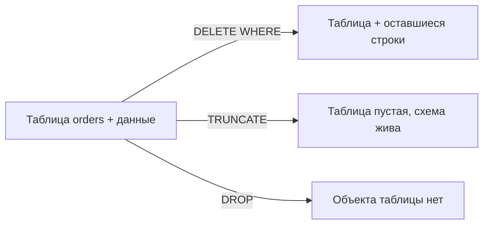
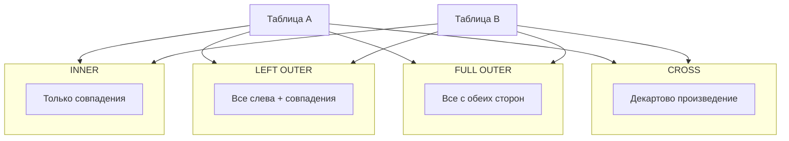

## Введение

Классика собеседования: «чем DELETE отличается от TRUNCATE» и следом «а DROP тогда зачем». Вопрос звучит просто, но ловит на деталях: WHERE, скорость, триггеры, идентичность/sequence, права и особенно **откат**. Ниже — практичный разбор с упором на PostgreSQL и явными оговорками по диалектам.

**JOIN типы.** JOIN — способ связать строки нескольких таблиц по условию. На собесе ждут не только названия типов, но и понимание, какие строки пропадут, где появятся NULL и чем опасен NATURAL JOIN. Примеры ниже для PostgreSQL; идея переносится на MySQL и SQL Server (с оговоркой по FULL OUTER JOIN в MySQL).

## Раздел: Как отвечать одним блоком

Этот выпуск собрал соседние короткие темы трека: «DELETE, TRUNCATE и DROP», «JOIN типы». Раньше каждая занимала отдельную карточку на несколько минут, а на собеседовании их спрашивают одним блоком. Ниже у каждой темы свой раздел, затем общие лабы, один тест и одна колода карточек. В ответе сначала назовите, какую тему спросили, потом определение и один пример. Не проговаривайте все разделы, если спросили один. Лабы можно пройти по порядку исходного трека. Если времени мало, сделайте первую и последнюю: первая ставит язык, последняя проверяет, что соседние темы вы не перепутали.

## Раздел: DELETE, TRUNCATE и DROP: DELETE против TRUNCATE

**DELETE** — DML: удаляет строки, можно с условием.

```sql
DELETE FROM orders WHERE status = 'canceled';
DELETE FROM orders;  -- все строки, но таблица остаётся
```

Свойства DELETE:
- допускается `WHERE`;
- в PostgreSQL срабатывают триггеры `BEFORE/AFTER DELETE` (построчно или statement-level);
- можно вернуть удалённые строки (`RETURNING` в PG);
- в транзакции полностью откатывается через `ROLLBACK`;
- для больших таблиц без условия может быть медленнее TRUNCATE из‑за построчного/WAL-накладного характера и последующего обслуживания мёртвых строк (VACUUM).

**TRUNCATE** — быстрая очистка таблицы (в классификации часто ближе к DDL-операции над объектом).

```sql
TRUNCATE TABLE orders;
TRUNCATE TABLE order_items, orders RESTART IDENTITY CASCADE;  -- PostgreSQL
```

Свойства TRUNCATE (типично):
- нельзя указать `WHERE` — очищается вся таблица (или список таблиц);
- обычно не вызывает построчные DELETE-триггеры (в PG для TRUNCATE есть отдельные trigger events);
- сбрасывает/перезапускает identity/sequence при `RESTART IDENTITY` (PG);
- требует прав, отличных от обычного DELETE (в PG — право `TRUNCATE`);
- быстрее на больших объёмах за счёт освобождения страниц целиком.

**Откат — критичное отличие диалектов:**
- **PostgreSQL:** `TRUNCATE` можно выполнить внутри транзакции и **откатить** `ROLLBACK` (пока транзакция не закоммичена).
- **Microsoft SQL Server:** `TRUNCATE` тоже логируется минимально, но в типичном учебном ответе его часто противопоставляют DELETE; в актуальных версиях truncate table откатывается в явной транзакции — проверяйте версию, не зубрите миф «truncate никогда не откатывается».
- **MySQL (InnoDB):** DDL-подобные операции часто делают неявный commit; `TRUNCATE` обычно **нельзя откатить** как обычный DML — это частый правильный акцент на собесе про MySQL.

Короткий ответ: DELETE — выборочно и как DML; TRUNCATE — полная быстрая очистка таблицы без WHERE; про rollback всегда уточняйте СУБД.

## Раздел: DELETE, TRUNCATE и DROP: DROP против TRUNCATE

**DROP** удаляет сам объект схемы.

```sql
DROP TABLE orders;
DROP TABLE IF EXISTS orders CASCADE;  -- PG: зависимые объекты тоже
```

Сравнение с TRUNCATE:
- **TRUNCATE** — таблица остаётся (имя, столбцы, ограничения, привилегии), данные исчезают;
- **DROP** — исчезает определение таблицы; все данные, индексы, триггеры на ней пропадают вместе с объектом; FK, которые ссылались на таблицу, нужно учесть (`CASCADE` / сначала снять зависимости);
- после DROP нужно заново `CREATE TABLE`, чтобы пользоваться объектом;
- **DROP** vs **DELETE/TRUNCATE** — это «убить сущность схемы» vs «очистить содержимое».

Связанные команды: `DROP INDEX`, `DROP SCHEMA`, `DELETE` из строк — не путать уровни.

Практическое правило:
1. убрать часть строк → `DELETE … WHERE`;
2. очистить таблицу, сохранив схему → `TRUNCATE`;
3. убрать таблицу из модели → `DROP TABLE`.

## Раздел: DELETE, TRUNCATE и DROP: Частые вопросы с собеседования

**Вопрос.** Нужно удалить 10% строк — DELETE или TRUNCATE?

**Ответ.** DELETE с WHERE — единственный выбор; TRUNCATE не фильтрует. TRUNCATE — полная очистка таблицы быстро, без построчного WHERE.

**Вопрос.** TRUNCATE и триггеры?

**Ответ.** В PostgreSQL TRUNCATE не вызывает обычные FOR EACH ROW DELETE triggers; есть отдельные truncate triggers. На собесе уточняют СУБД — поведение различается.

**Вопрос.** DROP vs DELETE для GDPR «забыть пользователя»?

**Ответ.** Обычно DELETE строк или anonymize в рамках модели; DROP TABLE уничтожает объект для всех. FK CASCADE при DELETE vs сохранение таблицы — проектное решение.

**Вопрос.** RESTART IDENTITY после TRUNCATE в PG?

**Ответ.** Сбрасывает serial/identity counters — полезно в тестовых схемах после полного wipe. В prod на живых id осторожно: внешние системы могли запомнить старые id.

## Раздел: JOIN типы: Зачем нужны соединения

Без JOIN пришлось бы вручную сопоставлять ключи во внешнем коде. В SQL соединение — декларативное описание: «возьми заказы и пользователей, где `orders.user_id = users.id`».

Базовый шаблон:

```sql
SELECT o.id, u.email, o.status
FROM orders AS o
INNER JOIN users AS u ON u.id = o.user_id
WHERE o.status = 'paid';
```

Ключевые идеи:
- условие соединения (`ON` / `USING`) задаёт соответствие строк;
- фильтр `WHERE` применяется к уже соединённому результату (с нюансами для внешних JOIN — см. ниже);
- алиасы (`o`, `u`) обязательны в речи на собесе, иначе легко запутаться в одноимённых `id`.

## Раздел: JOIN типы: Типы JOIN подробно

**INNER JOIN** — только пары, где условие истинно. Заказ без пользователя (битый FK) или пользователь без заказов не попадут в результат (для пары «заказ–пользователь» пользователь без заказов отпадёт).

**LEFT (OUTER) JOIN** — все строки левой таблицы + совпадения справа; если совпадения нет, правые столбцы = NULL. Удобно искать «пользователи без заказов»:

```sql
SELECT u.id, u.email
FROM users u
LEFT JOIN orders o ON o.user_id = u.id
WHERE o.id IS NULL;
```

Важно: условие на правую таблицу в `WHERE` может «убить» LEFT и превратить его по сути в INNER. Фильтры на правую сторону часто кладут в `ON`.

**RIGHT (OUTER) JOIN** — зеркало LEFT (все справа). На практике чаще переписывают в LEFT, меняя порядок таблиц — так читаемее.

**FULL (OUTER) JOIN** — строки обеих сторон; NULL там, где нет пары. В PostgreSQL и SQL Server поддерживается; в MySQL historically нет FULL OUTER — эмулируют через UNION LEFT и RIGHT.

**SELF JOIN** — таблица соединяется сама с собой (иерархия сотрудников, граф друзей): алиасы обязательны.

**Антиджойны / семиджойны** (часто обсуждают рядом): «есть ли хотя бы одна связанная строка» (`EXISTS`) vs «нет связанных» (`NOT EXISTS` / `LEFT … IS NULL`).

## Раздел: JOIN типы: CROSS JOIN и NATURAL JOIN

**CROSS JOIN** — декартово произведение: каждая строка A с каждой строкой B. Явный вид:

```sql
SELECT *
FROM sizes
CROSS JOIN colors;
```

Эквивалент старого `FROM a, b` без условия — опасен случайно: на больших таблицах взрывает объём. Осознанное применение — генерация комбинаций, календарные решётки, тестовые наборы.

**NATURAL JOIN** соединяет таблицы по **всем одноимённым столбцам** автоматически:

```sql
-- рискованно: сработает по всем общим именам столбцов
SELECT *
FROM orders
NATURAL JOIN users;
```

Почему на практике избегают:
- скрытое условие — легко сломать при добавлении столбца `created_at` в обе таблицы;
- читатель запроса не видит ключ связи;
- в команде предпочтительны `USING (user_id)` или явный `ON`.

`USING (user_id)` — компромисс: условие явное по имени столбца, в результате столбец не дублируется.

Итог для собеса: CROSS — декартово; NATURAL — неявное соединение по именам; в проде почти всегда пишите явный `ON`.

## Раздел: JOIN типы: Частые вопросы с собеседования

**Вопрос.** `EXISTS` или `INNER JOIN` для проверки «есть связанные строки»?

**Ответ.** Оба могут; `EXISTS` часто останавливается на первом совпадении и не раздувает результат дубликатами join. Если нужны столбцы из обеих таблиц — JOIN; если булев факт связи — EXISTS семантически яснее.

**Вопрос.** Почему фильтр на правую таблицу в `WHERE` ломает LEFT JOIN?

**Ответ.** NULL из несовпавших строк отфильтровывается предикатом на правые столбцы — строки «только слева» исчезают. Условие на правую часть для сохранения OUTER кладут в `ON`.

**Вопрос.** CROSS JOIN случайно — риск?

**Ответ.** Декартово произведение: |A|×|B| строк. Забытое условие в старом синтаксисе `FROM a, b` на больших таблицах убивает память и диск. Явный CROSS — только осознанные комбинаторные задачи.

**Вопрос.** SELF JOIN — типичный кейс?

**Ответ.** Иерархия в одной таблице: сотрудник и manager_id → join employees m ON e.manager_id = m.id. Два алиаса одной таблицы обязательны, иначе неразличимы столбцы.

## Лаба

**DELETE, TRUNCATE и DROP.**

**Цель.** На учебной таблице сравнить DELETE, TRUNCATE и DROP и проверить откат в вашей СУБД.

**Шаги.**
1. Создайте `sql03_demo(id serial/identity, note text)`, вставьте 5 строк.
2. В транзакции удалите 2 строки через `DELETE … WHERE`, сделайте `ROLLBACK` — строки должны вернуться.
3. В новой транзакции выполните `TRUNCATE` (в PG) и `ROLLBACK` — зафиксируйте, восстановились ли данные. Если MySQL — опишите, что truncate, скорее всего, уже зафиксирован.
4. Снова заполните таблицу и выполните `DROP TABLE`; попробуйте `SELECT` — ожидайте ошибку «relation does not exist».
5. Запишите таблицу сравнения из трёх строк: команда / WHERE / объект схемы / rollback в PG.

**В группу:** один говорит «нужно обнулить огромный лог за сегодня ночью, схема важна» — второй выбирает команду и обосновывает.

**Готово, если…**
- [ ] Называете минимум 3 отличия DELETE и TRUNCATE
- [ ] Объясняете, почему DROP опаснее TRUNCATE для приложения
- [ ] Умеете сказать про rollback в PostgreSQL vs типичный MySQL

**JOIN типы.**

**Цель.** На схеме users/orders/order_items получить четыре результата разными JOIN и объяснить кардинальность.

**Шаги.**
1. Подготовьте 3 пользователя, у одного из них 0 заказов; 2 заказа с позициями.
2. Напишите INNER JOIN заказов с пользователями и посчитайте строки.
3. Напишите LEFT JOIN от users к orders и найдите пользователя без заказов через `IS NULL`.
4. Сделайте CROSS JOIN двух маленьких справочников (например, `priorities` × `channels`) — убедитесь, что число строк = произведение.
5. Попробуйте NATURAL JOIN на таблицах с общим лишним столбцом `updated_at` и объясните, почему результат «сломался» или стал пустым.

**В группу:** партнёр рисует круги Венна для INNER/LEFT/FULL — вы подписываете SQL-синонимы.

**Готово, если…**
- [ ] Объясняете INNER vs LEFT на пальцах и на примере с NULL
- [ ] Знаете, когда CROSS уместен и чем опасен случайный декарт
- [ ] Аргументированно отказываетесь от NATURAL JOIN в пользу ON/USING

## Схема: DELETE, TRUNCATE и DROP: Что остаётся после команды



## Схема: JOIN типы: Типы соединений



## Тест

### Можно ли сделать TRUNCATE только для строк status = 'new'?

**Ответ:** нет, у TRUNCATE нет WHERE; нужен DELETE или промежуточная таблица

**Пояснение:** TRUNCATE очищает таблицу целиком (или перечисленные таблицы целиком).

### Какой JOIN вернёт пользователей без заказов вместе с NULL в полях заказа?

**Ответ:** LEFT JOIN

**Пояснение:** INNER отбросит пользователей без совпадений; для «только без заказов» добавьте `WHERE o.id IS NULL`.

### Откатывается ли TRUNCATE в PostgreSQL?

**Ответ:** да, внутри незакоммиченной транзакции ROLLBACK вернёт данные

**Пояснение:** это важное отличие от распространённого поведения MySQL, где truncate обычно не откатывают как DML.

### Чем CROSS JOIN отличается от INNER JOIN?

**Ответ:** CROSS не требует условия и даёт все комбинации; INNER оставляет только строки, где условие истинно

**Пояснение:** INNER концептуально можно представить как CROSS + фильтр, но оптимизатор работает иначе.

### Чем DROP TABLE отличается от TRUNCATE TABLE?

**Ответ:** DROP убирает объект

**Пояснение:** TRUNCATE очищает строки, определение таблицы остаётся; после DROP нужны CREATE и права.

## Шпаргалка

<ul><li><b>DELETE</b> — строки, WHERE, триггеры DELETE, DML, rollback</li><li><b>TRUNCATE</b> — все строки, быстро, без WHERE; rollback зависит от СУБД</li><li><b>DROP</b> — удаляет таблицу как объект</li><li>PostgreSQL: TRUNCATE транзакционен; RESTART IDENTITY, CASCADE</li><li>MySQL: TRUNCATE часто с неявным commit</li><li>SQL Server: уточняйте версию и мифы про «нельзя откатить»</li><li><b>INNER</b> — пересечение по условию</li><li><b>LEFT/RIGHT/FULL</b> — внешние, с NULL на стороне без пары</li><li><b>CROSS</b> — декартово произведение</li><li><b>NATURAL</b> — неявный JOIN по общим именам (избегать)</li><li>Фильтры на правую таблицу во внешнем JOIN — осторожно: лучше в ON</li><li>MySQL: FULL OUTER часто эмулируют UNION</li></ul>

## Anki

### Front: Когда выбрать DELETE, а не TRUNCATE?

Back: Когда нужно условие WHERE, построчные DELETE-триггеры или удаление части строк

### Front: Что делает LEFT JOIN?

Back: Возвращает все строки левой таблицы и подходящие справа; если пары нет — справа NULL

### Front: Что делает DROP TABLE?

Back: Удаляет определение таблицы и всё её содержимое из схемы; объект нужно создавать заново

### Front: Когда уместен CROSS JOIN?

Back: Когда нужны все комбинации небольших наборов; не как случайный JOIN без ON

### Front: TRUNCATE в PostgreSQL и откат?

Back: Можно выполнить в транзакции и откатить ROLLBACK до COMMIT

### Front: Чем заменить NATURAL JOIN?

Back: Явным ON или USING (column) с понятным ключом связи

## Итоги

- DELETE — точечная работа со строками; TRUNCATE — полная очистка; DROP — конец объекта
- Скорость и триггеры — частые критерии выбора
- Про rollback всегда уточняйте СУБД: PostgreSQL дружелюбнее к транзакционному TRUNCATE, чем типичный MySQL
- JOIN связывает наборы строк; тип определяет судьбу несовпавших
- LEFT + IS NULL — рабочий приём для «нет связанной записи»
- CROSS осознанно, NATURAL — почти никогда в прикладном коде

## Ссылки

- [PostgreSQL: TRUNCATE](https://www.postgresql.org/docs/current/sql-truncate.html)
- [PostgreSQL: DELETE](https://www.postgresql.org/docs/current/sql-delete.html)
- [OTUS / Хабр — часть I](https://habr.com/ru/companies/otus/articles/461067/)
- [PostgreSQL: Joins](https://www.postgresql.org/docs/current/tutorial-join.html)
- [Use The Index, Luke! — глава про JOIN](https://use-the-index-luke.com/sql/join)
- [Select Star SQL](https://selectstarsql.com/)
- [Типы CHAR/VARCHAR и NULL](/game/learn/sql-types-null)
