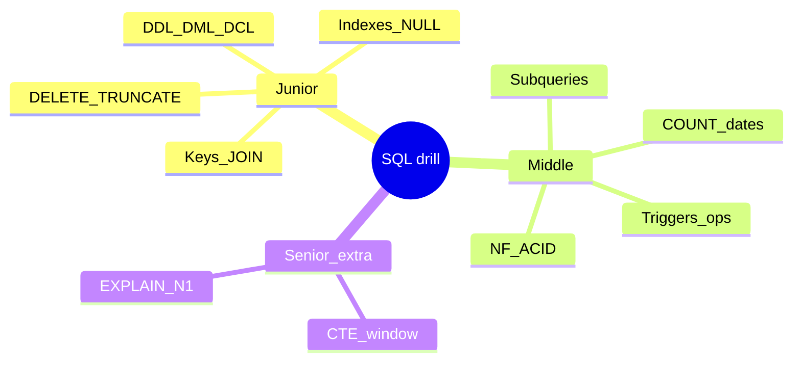
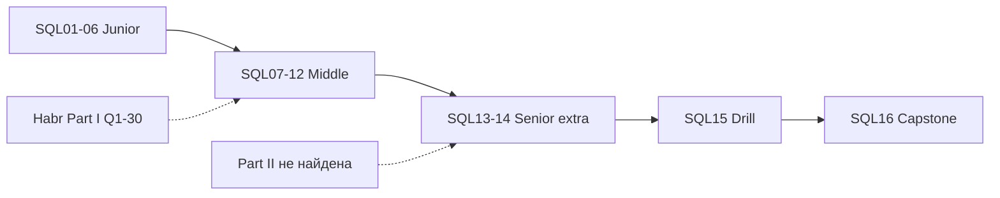

## Введение

Не новая теория, а **темп**. Формулировки вопросов близки к [Части I на Хабре](https://habr.com/ru/companies/otus/articles/461067/); ответы ниже — сжатые оригинальные модели под PostgreSQL. Режим: 45–90 секунд на пункт, определение → пример → ловушка.

**Чеклист SQL.** Финальный выпуск серии SQL Learn: собрать траекторию Junior → Middle → Senior, пройти self-check и быстро найти выпуск по номеру вопроса Qi. Полные формулировки Q1–Q30 — в [Части I на Хабре](https://habr.com/ru/companies/otus/articles/461067/); здесь — **ориентиры компетенций** и навигация. Часть II исходного «топ-65» на Хабре **не найдена**; темы вроде CTE, окон и EXPLAIN закрыты выпусками SQL13–SQL14.

## Раздел: Как отвечать одним блоком

Этот выпуск собрал соседние короткие темы трека: «Drill SQL», «Чеклист SQL». Раньше каждая занимала отдельную карточку на несколько минут, а на собеседовании их спрашивают одним блоком. Ниже у каждой темы свой раздел, затем общие лабы, один тест и одна колода карточек. В ответе сначала назовите, какую тему спросили, потом определение и один пример. Не проговаривайте все разделы, если спросили один. Лабы можно пройти по порядку исходного трека. Если времени мало, сделайте первую и последнюю: первая ставит язык, последняя проверяет, что соседние темы вы не перепутали.

## Раздел: Drill SQL: Ответ вслух

Я начинаю с того, какие строки нужны, потом JOIN, потом фильтр по группе. Если спрашивают NULL, говорю, что сравнение с NULL через равенство не истинно. Индекс обещаю только вместе с условием, которое в него попадает.

## Раздел: Drill SQL: Плохой ответ

«Напишу SELECT звёздочку и посмотрю». Нет набора строк и нет причины JOIN.

## Раздел: Drill SQL: Термины

Соединение — JOIN. Группа — GROUP BY. Пустое значение — NULL. Индекс — index.

## Раздел: Drill SQL: Drill Q1–Q15

**Q1 · DELETE vs TRUNCATE.** DELETE — DML, можно WHERE, row-триггеры; TRUNCATE быстро чистит всю таблицу, без WHERE, иные права/WAL/identity.  
**Q2 · DDL/DML/DCL.** DDL — структура (`CREATE`); DML — данные (`SELECT/INSERT…`); DCL — права (`GRANT`).  
**Q3 · SQL vs MySQL.** SQL — язык; MySQL — СУБД, диалект SQL.  
**Q4 · Таблица и поле.** Таблица — отношение/набор строк одной схемы; поле (столбец) — атрибут с типом.  
**Q5 · JOIN.** Связь строк по условию: INNER / LEFT / RIGHT / FULL; идея CROSS.  
**Q6 · CHAR vs VARCHAR.** CHAR фиксированная длина (паддинг); VARCHAR — переменная; в PG чаще `text`/`varchar` без фанатизма.  
**Q7 · Primary key.** Уникальный идентификатор строки, NOT NULL, один PK на таблицу (вкл. составной).  
**Q8 · View.** Именованный сохранённый SELECT; упрощает доступ; в PG есть updatable view с ограничениями.  
**Q9 · Зачем СУБД.** Надёжное хранение, язык запросов, целостность, конкурентный доступ, восстановление.  
**Q10 · Constraints.** Правила целостности: NOT NULL, UNIQUE, CHECK, FK, PK.  
**Q11 · Unique vs PK.** UNIQUE допускает NULL (в PG — несколько NULL); PK строго NOT NULL и главный идентификатор.  
**Q12 · Целостность.** Данные согласованы со схемой и связями; FK не даёт «сиротам» появиться.  
**Q13 · Индекс.** Структура ускорения поиска/сортировки ценой записи и места; B-tree по умолчанию в PG.  
**Q14 · Текущая дата.** PG: `CURRENT_DATE` / `now()`; MSSQL: `GETDATE()`.  
**Q15 · Виды JOIN.** INNER, OUTER (LEFT/RIGHT/FULL), CROSS; NATURAL — по одноимённым столбцам (осторожно).

## Раздел: Drill SQL: Drill Q16–Q30 и карта повторения

**Q16 · Нормализация.** Устранение аномалий через нормальные формы (1–3НФ как база).  
**Q17 · 1/2/3 НФ.** Атомарность → зависимость от всего ключа → нет транзитивных зависимостей от неключа.  
**Q18 · Clustered index.** В SQL Server определяет физ. порядок; в PG аналог «кластера» другой (`CLUSTER`), таблицы — heap.  
**Q19 · Nonclustered / secondary.** Отдельная структура ключ→указатель на строку; много на таблицу.  
**Q20 · Денормализация.** Сознательное дублирование ради чтения/отчётов; цена — синхронизация.  
**Q21 · DROP.** Удаляет объект схемы (таблицу целиком); не путать с DELETE/TRUNCATE данных.  
**Q22 · Сущность.** Объект предметной области, в модели — обычно таблица с ключом.  
**Q23 · ACID.** Atomicity, Consistency, Isolation, Durability — свойства транзакции.  
**Q24 · Триггер.** Автокод на событие DML; BEFORE/AFTER, NEW/OLD.  
**Q25 · Операторы.** Арифметика, сравнение, логика (AND/OR/NOT); помнить NULL.  
**Q26 · NULL.** Нет значения; сравнения дают UNKNOWN; `IS NULL`.  
**Q27 · CROSS vs NATURAL.** CROSS — декартово; NATURAL — JOIN по всем одинаковым именам столбцов.  
**Q28 · Подзапрос.** SELECT внутри другого оператора.  
**Q29 · Correlated.** Внутренний запрос ссылается на внешнюю строку; noncorrelated — независим.  
**Q30 · COUNT.** `COUNT(*)` строки; `COUNT(col)` без NULL; плюс estimate через статистику.

**Куда вернуться, если ответ плывёт:** SQL01–06 (junior база), SQL07–08 (нормализация/ACID), SQL09–11 (триггеры/подзапросы/COUNT), SQL12 (лаба), SQL13–14 (CTE/окна/EXPLAIN — сверх списка).

## Раздел: Drill SQL: Частые вопросы с собеседования

**Вопрос.** Как пользоваться SQL16 drill, не зубря?

**Ответ.** Отметьте слабые Qi, откройте slug из индекса, объясните вслух 90 секунд, напишите SQL руками. Drill — карта пробелов, не замена пониманию планов и NULL.

**Вопрос.** «SQL не равен MySQL» — когда произнести?

**Ответ.** Когда спрашивают переносимость, TRUNCATE rollback, FULL OUTER, типы. Назовите свой продукт (PostgreSQL) и оговорите отличия MySQL/SQL Server точечно.

**Вопрос.** Три темы middle поверх Q1–Q30?

**Ответ.** CTE/window (SQL13), EXPLAIN/N+1 (SQL14), correlated subqueries (SQL10). Drill junior — база; middle добавляет планы и переписывание запросов.

**Вопрос.** COUNT(*) vs COUNT(col) в устном Q30?

**Ответ.** * — все строки; col — без NULL в col. Связать с отчётом «сколько пользователей указали телефон» vs «сколько строк в таблице».

## Раздел: Чеклист SQL: Ответ вслух

Перед собесом я проверяю три вещи вслух: чем DELETE отличается от TRUNCATE, когда нужен внешний ключ, и что EXPLAIN может показать последовательное чтение даже при живом индексе.

## Раздел: Чеклист SQL: Плохой ответ

Закрыть чеклист галочками, не произнеся ни одного ответа. Галочка не слышна интервьюеру.

## Раздел: Чеклист SQL: Термины

Целостность — integrity. План — execution plan. Внешний ключ — foreign key.

## Раздел: Чеклист SQL: Чеклисты Junior → Middle → Senior

**Как пользоваться серией.**

1. Идите по `order` 601→616 или точечно по индексу Q→slug ниже.
2. Выпуск: теория → лаба → тест → Anki; SQL12 не пропускайте.
3. Держите открытой [Часть I OTUS/Хабр](https://habr.com/ru/companies/otus/articles/461067/) для формулировок; ответы готовьте свои (PostgreSQL-first).
4. После Middle-лабы обязательны SQL13–14, даже если их не было в Q1–Q30.
5. SQL15 — таймер; SQL16 — чеклист перед собесом.

**Чеклист Junior (SQL01–SQL06).**

- [ ] DDL / DML / DCL и «SQL ≠ СУБД»
- [ ] PK / UK / FK, constraints, целостность
- [ ] DELETE vs TRUNCATE vs DROP
- [ ] INNER/LEFT/RIGHT/FULL/CROSS; идея NATURAL
- [ ] CHAR/VARCHAR/text, трёхзначная логика NULL
- [ ] Зачем индекс; clustered vs secondary с оговоркой диалекта

**Чеклист Middle (SQL07–SQL12).**

- [ ] 1–3НФ, сущность, когда денормализуют
- [ ] ACID и границы транзакции
- [ ] Триггеры BEFORE/AFTER, NEW/OLD; операторы и NULL
- [ ] Подзапросы; correlated vs not; NOT EXISTS
- [ ] CURRENT_DATE/now vs GETDATE; COUNT(*) vs COUNT(col) vs estimate
- [ ] Сводная лаба: JOIN, anti-join, агрегаты, удаление на одной схеме

**Чеклист Senior (SQL13–SQL15 + практика).**

- [ ] CTE (WITH), при необходимости рекурсия; отличие от TEMP
- [ ] ROW_NUMBER / RANK / SUM OVER; «последняя строка в группе»
- [ ] EXPLAIN vs EXPLAIN ANALYZE; Seq vs Index Scan
- [ ] Когда индекс помогает/вредит; идея covering; N+1
- [ ] Drill Q1–Q30 за ≤90 с с примером
- [ ] Честно разделяете PostgreSQL / MSSQL / MySQL в ответах

## Раздел: Чеклист SQL: Индекс Q1–Q30 → slug

| Q | Тема (кратко) | slug |
|---|----------------|------|
| Q1 | DELETE vs TRUNCATE | `sql-delete-truncate-drop` |
| Q2 | DDL/DML/DCL | `sql-ddl-dml-dcl` |
| Q3 | SQL vs MySQL | `sql-ddl-dml-dcl` |
| Q4 | Таблица / поле | `sql-ddl-dml-dcl` |
| Q5 | JOIN | `sql-delete-truncate-drop` |
| Q6 | CHAR vs VARCHAR | `sql-types-null` |
| Q7 | Primary key | `sql-ddl-dml-dcl` |
| Q8 | Constraints / связанные | `sql-ddl-dml-dcl` |
| Q9 | Зачем СУБД | `sql-ddl-dml-dcl` |
| Q10 | Constraints | `sql-ddl-dml-dcl` |
| Q11 | Unique vs PK | `sql-ddl-dml-dcl` |
| Q12 | Целостность | `sql-ddl-dml-dcl` |
| Q13 | Индекс | `sql-types-null` |
| Q14 | Текущая дата | `sql-agg-dates-count` |
| Q15 | Виды JOIN | `sql-delete-truncate-drop` |
| Q16 | Нормализация | `sql-normalization` |
| Q17 | 1–3 НФ | `sql-normalization` |
| Q18 | Clustered index | `sql-types-null` |
| Q19 | Nonclustered | `sql-types-null` |
| Q20 | Денормализация | `sql-normalization` |
| Q21 | DROP | `sql-delete-truncate-drop` |
| Q22 | Сущность | `sql-normalization` |
| Q23 | ACID | `sql-normalization` |
| Q24 | Триггер | `sql-triggers-operators` |
| Q25 | Операторы | `sql-triggers-operators` |
| Q26 | NULL | `sql-types-null` |
| Q27 | CROSS vs NATURAL | `sql-delete-truncate-drop` |
| Q28 | Подзапрос | `sql-triggers-operators` |
| Q29 | Correlated | `sql-triggers-operators` |
| Q30 | COUNT | `sql-agg-dates-count` |

**Расширения сверх Части I (вместо отсутствующей Части II).**

| Тема | slug |
|------|------|
| Практика сводная | `sql-agg-dates-count` |
| CTE + window | `sql-cte-window` |
| EXPLAIN, индексы на практике, N+1 | `sql-cte-window` |
| Устный drill | `sql-interview-drill` |
| Capstone / этот индекс | `sql-interview-drill` |

**Обзор серии SQL Learn.**

| Ep | slug | Фокус |
|----|------|--------|
| SQL01 | sql-ddl-dml-dcl | Подмножества, СУБД |
| SQL02 | sql-ddl-dml-dcl | Ключи, constraints |
| SQL03 | sql-delete-truncate-drop | DELETE/TRUNCATE/DROP |
| SQL04 | sql-delete-truncate-drop | JOIN |
| SQL05 | sql-types-null | Типы, NULL |
| SQL06 | sql-types-null | Индексы |
| SQL07 | sql-normalization | НФ |
| SQL08 | sql-normalization | ACID |
| SQL09 | sql-triggers-operators | Триггеры, операторы |
| SQL10 | sql-triggers-operators | Подзапросы |
| SQL11 | sql-agg-dates-count | Дата, COUNT |
| SQL12 | sql-agg-dates-count | Сводная лаба |
| SQL13 | sql-cte-window | CTE, окна |
| SQL14 | sql-cte-window | Планы, perf |
| SQL15 | sql-interview-drill | Drill Q1–30 |
| SQL16 | sql-interview-drill | Capstone |

## Раздел: Чеклист SQL: План на 2 недели до собеса

**Неделя 1.** Закрыть ❌ в Junior+Middle чеклистах; один раз полностью прогнать SQL12 на чистой БД; Anki по слабым Qi.  
**Неделя 2.** SQL13–14 с `EXPLAIN ANALYZE` на своих данных; ежедневный drill SQL15 (по 10 случайных Qi); пробный live-coding: «клиенты без заказов», «последний заказ», «сумма paid за сегодня».

Артефакт «папка доказательств»: скрипт схемы магазина, 10 SQL-решений, 2 скрина/текста планов до/после индекса, список ловушек NULL/диалектов своими словами.

## Раздел: Чеклист SQL: Частые вопросы с собеседования

**Вопрос.** План на 2 недели — приоритет?

**Ответ.** Сначала пробелы ❌ из drill по индексу slug, каждый день 1 тема + 2 SQL руками + один EXPLAIN. Повтор ✅ через неделю устно, без подсказок.

**Вопрос.** Senior SQL без ORM — что показать?

**Ответ.** Транзакции, isolation choice, индексы под реальные запросы, миграции без downtime (expand/contract), observability slow query log. Чеклист SQL16 — self-assessment.

**Вопрос.** Q1–Q30 индекс — как не перепутать с otus-статьёй?

**Ответ.** Индекс — маршрут к вашим выпускам с оригинальными формулировками; не копируйте чужие ответы дословно. На собесе важны примеры из вашего опыта.

**Вопрос.** Когда STOP учить новое SQL перед собесом?

**Ответ.** За 2–3 дня — только повтор слабых и sleep. Новые window-функции в ночь перед — хуже, чем уверенный JOIN/NULL/ACID.

## Лаба

**Drill SQL.**

**Цель.** Пройти устный прогон Q1–Q30 с таймером и отметить слабые номера.

**Шаги.**
1. Закройте статью; партнер/карточки называют номер Qi.
2. Ответьте за ≤90 секунд по каркасу: определение → пример PostgreSQL → ловушка.
3. Отметьте ❌/⚠️/✅; по ❌ откройте выпуск из индекса SQL16.
4. Отдельно прогоните 5 задач «напиши SQL»: JOIN, anti-join, COUNT FILTER, ROW_NUMBER, EXPLAIN одной фразой что ожидаете увидеть.
5. Повторите только ⚠️ на следующий день.

**В группу:** двое ведут «сбивку» уточняющими вопросами («а в MySQL?», «а если NULL?»).

**Готово, если…**
- [ ] ≥24/30 ответов устойчивы без конспекта
- [ ] Есть живой пример на схеме customers/orders
- [ ] Можете связать Q23–Q24 с триггером в транзакции

**Чеклист SQL.**

**Цель.** Заполнить чеклисты и собрать персональный индекс пробелов Qi → действия.

**Шаги.**
1. Пройдите три чеклиста выше маркерами ✅/❌.
2. Для каждого ❌ выпишите slug и одну лабу/Anki на повторение.
3. Сверьте, что Q24–Q25, Q28–Q29, Q14/Q30 реально закрыты SQL09–11 (не только «читал Хабр»).
4. Отметьте отдельно статус SQL13–14 — даже если в Части I их не было.
5. Назначьте дату повторного drill SQL15.

**В группу:** обменяйтесь списками ❌ и проведите взаимный мини-собес на 15 минут.

**Готово, если…**
- [ ] Junior и Middle чеклисты ≥80% ✅
- [ ] SQL13–14 осознанно пройдены или запланированы
- [ ] Есть персональная таблица Qi → slug → статус

## Схема: Drill SQL: Маршрут drill

## Схема: Чеклист SQL: Траектория серии

## Тест

### Какой каркас ответа использовать на любом Qi?

**Ответ:** короткое определение → пример на PostgreSQL → типичная ловушка или отличие диалекта

**Пояснение:** так отличают опыт от заученной чужой статьи.

### Чем DELETE отличается от TRUNCATE по откату?

**Ответ:** DELETE в транзакции откатывается

**Пояснение:** TRUNCATE в PostgreSQL тоже транзакционен, но это DDL-подобная операция с другими блокировками и сбросом identity — на собесе уточняйте диалект.

### Почему Q18 про clustered опасен для кандидата «только Postgres»?

**Ответ:** термин сильнее про SQL Server; в PG нужно честно сказать про heap и CLUSTER/INDEX

**Пояснение:** честное разделение диалектов ценится выше выдуманного «как в учебнике MSSQL».

### Зачем CTE и window на middle/senior SQL?

**Ответ:** читаемые сложные выборки

**Пояснение:** WITH и OVER закрывают ранги, нарастающие итоги и многошаговую логику без временных таблиц.

### Что добавить сверх Q1–Q30 на modern-собесе?

**Ответ:** CTE, окна, EXPLAIN

**Пояснение:** SQL13–14 закрывают пробел; часть II топ-65 на Хабре не найдена.

## Шпаргалка

<ul><li>45–90 с; определение → пример → ловушка</li><li>PostgreSQL first; диалект — одной фразой</li><li>NULL и NOT IN; COUNT(*) vs COUNT(col)</li><li>SQL ≠ MySQL; DELETE ≠ TRUNCATE ≠ DROP</li><li>Clustered — уточнять СУБД</li><li>Junior: DDL/DML, ключи, JOIN, NULL, индекс, DELETE/TRUNCATE</li><li>Middle: НФ, ACID, триггеры, подзапросы, COUNT/даты, сводная лаба</li><li>Senior: CTE, window, EXPLAIN, N+1, темп drill</li><li>Формулировки Q1–30: Хабр OTUS Часть I</li><li>Часть II: не найдена → SQL13–14</li></ul>

## Anki

### Front: Каркас ответа на SQL-собесе?

Back: Определение → пример (лучше PG) → ловушка/диалект

### Front: Где в серии триггеры и операторы?

Back: sql-triggers-operators (SQL09, Q24–Q25)

### Front: Q29 в одном предложении?

Back: Correlated ссылается на внешнюю строку; noncorrelated можно выполнить отдельно

### Front: Что делать с отсутствующей Частью II топ-65?

Back: Опираться на SQL13–14 (CTE/window/EXPLAIN) как на обязательное расширение

### Front: Три темы сверх Q1–Q30?

Back: CTE, window functions, EXPLAIN/N+1

### Front: Минимум перед SQL middle-собесом?

Back: SQL01–12 чеклист + руки на схеме customers/orders + drill слабых Qi

## Мнемоника

### peg: Ответ по SQL

**Задание:** Каркас устного ответа на задачу с запросом.

**Элементы:**
- какие таблицы
- какой ключ
- какой JOIN
- где NULL

**Подсказка:** NULL в JOIN молча убирает строку во INNER.

**Ответ:** 1 таблицы · 2 ключ · 3 JOIN · 4 NULL

## Итоги

- Drill закрепляет скорость, не заменяет лабы
- Оригинальные короткие формулы надежнее чужого текста с Хабра
- Слабые Qi закрывайте точечно по индексу SQL16
- Capstone = чеклисты + индекс Q→slug + честный план повторения
- Хабр Часть I — формулировки; Learn — ваши разборы под PostgreSQL
- Часть II не найдена: senior-темы закрыты SQL13–14, не оставляйте их «на потом»

## Ссылки

- [PostgreSQL: Documentation](https://www.postgresql.org/docs/current/)
- [Use The Index, Luke!](https://use-the-index-luke.com/)
- [OTUS / Хабр — часть I](https://habr.com/ru/companies/otus/articles/461067/)
- [Select Star SQL](https://selectstarsql.com/)
- [DDL DML DCL](/game/learn/sql-ddl-dml-dcl)
