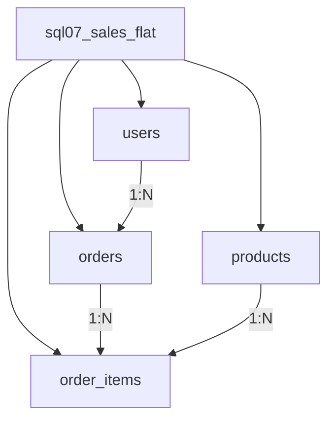
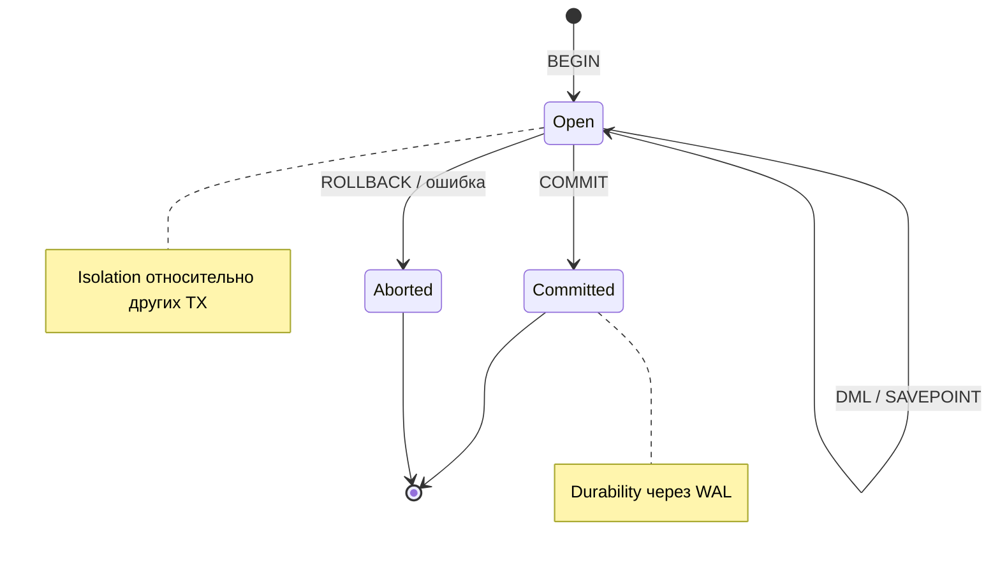

## Введение

Middle-уровень: уже мало назвать PK/FK — нужно проектировать модель. Этот выпуск связывает сущности и отношения, объясняет выгоды нормализации, разбирает 1NF–3NF и честно говорит, зачем иногда денормализуют. Примеры схематические, СУБД — PostgreSQL.

**ACID транзакции.** ACID — каркас ответа про надёжность транзакций в СУБД. На middle-собесе мало расшифровать буквы: нужны примеры, что ломается без каждого свойства, и понимание, что Isolation — спектр уровней, а не магический «всегда полная изоляция». Опора — PostgreSQL; отличия MySQL/SQL Server — точечно.

## Раздел: Как отвечать одним блоком

Этот выпуск собрал соседние короткие темы трека: «Нормализация 1–3НФ», «ACID транзакции». Раньше каждая занимала отдельную карточку на несколько минут, а на собеседовании их спрашивают одним блоком. Ниже у каждой темы свой раздел, затем общие лабы, один тест и одна колода карточек. В ответе сначала назовите, какую тему спросили, потом определение и один пример. Не проговаривайте все разделы, если спросили один. Лабы можно пройти по порядку исходного трека. Если времени мало, сделайте первую и последнюю: первая ставит язык, последняя проверяет, что соседние темы вы не перепутали.

## Раздел: Нормализация 1–3НФ: Сущности, связи и денормализация

**Сущность** — объект предметной области, о котором храним данные: пользователь, заказ, товар, платёж. В модели обычно становится таблицей (или набором таблиц при сложных случаях).

**Атрибут** — свойство сущности (email, статус). **Связь** — ассоциация между сущностями:
- 1:1 — профиль к пользователю;
- 1:N — пользователь и заказы;
- M:N — заказы и товары через таблицу связи `order_items`.

ER-мышление на собесе: сначала существительные и глаголы предметной области, потом таблицы, потом типы связей и ключи.

**Денормализация** — сознательное введение избыточности в уже нормализованную (или почти) схему ради чтения/отчётности/простоты запроса.

Примеры:
- хранить `orders.total_amount` рядом с позициями, хотя сумму можно считать;
- дублировать `user_email` в таблице событий аналитики;
- витрины и materialised views.

Цена денормализации: риск рассинхрона, сложнее UPDATE, нужны чёткие правила обновления (транзакция, триггер, ETL). На собесе важно слово **«осознанно»**: денормализация — не «забыли нормализовать».

## Раздел: Нормализация 1–3НФ: Зачем нормализуют

**Нормализация** уменьшает избыточность и аномалии изменения.

Выгоды, которые ждут в ответе:
1. **Меньше дублирования** — ФИО клиента не копируется в каждый заказ как единственный источник правды.
2. **Меньше аномалий вставки/обновления/удаления** — не теряем данные о товаре, удаляя последний заказ с его «вшитым» описанием.
3. **Проще целостность** — одно место правки + FK/UK.
4. **Гибкость эволюции схемы** — новые атрибуты сущности не размножают столбцы по фактам.

Цена нормализации: больше JOIN при чтении, иногда сложнее ад-hoc отчёты. Отсюда баланс 3NF для OLTP и денормализованные витрины для OLAP.

## Раздел: Нормализация 1–3НФ: 1NF, 2NF, 3NF

Говорите отталкиваясь от ключей и функциональных зависимостей.

**1NF (первая нормальная форма)**  
- атомарные значения атрибутов (не список телефонов в одной ячейке через запятую);
- нет повторяющихся групп (`phone1`, `phone2`, `phone3` как «массив столбцов»);
- есть первичный ключ, строки уникально идентифицируемы.

Плохо: `phones = '111,222'`. Лучше: таблица `user_phones(user_id, phone)`.

**2NF (вторая нормальная форма)**  
- выполняется 1NF;
- каждый неключевой атрибут зависит от **всего** составного ключа, а не от его части.

Классика: в `order_items(order_id, product_id, product_name, qty)` имя товара зависит только от `product_id` → вынести в `products`.

**3NF (третья нормальная форма)**  
- выполняется 2NF;
- нет транзитивных зависимостей неключевых атрибутов: неключевой → другой неключевой.

Пример: `employees(id, dept_id, dept_name)` — `dept_name` зависит от `dept_id`, не напрямую от сотрудника → справочник `departments`.

Выше 3NF (BCNF и далее) на middle-собесе упоминают по желанию; уверенный рассказ 1–3NF + пример денормализации обычно достаточен.

```text
orders(id, user_id, ...)
products(id, name, price)
order_items(order_id, product_id, qty)  -- M:N связь, без product_name
```

## Раздел: Нормализация 1–3НФ: Частые вопросы с собеседования

**Вопрос.** 3NF достаточно для всех систем?

**Ответ.** Для OLTP часто да; отчёты и аналитика — star schema / denormalized marts осознанно. Нормализация снижает аномалии записи; чтение может требовать JOIN — баланс.

**Вопрос.** Денормализация `orders.total` — риски?

**Ответ.** Рассинхрон с sum(line items) при баге или partial update. Нужен single writer: транзакция пересчёта, trigger, или materialized refresh. Собес любит слово «инвариант».

**Вопрос.** 1NF — «атомарность» пример?

**Ответ.** Не хранить `tags='py,sql,go'` в одной ячейке для фильтрации по тегу — таблица `user_tags(user_id, tag)`. JSONB в PG — компромисс с индексами GIN, не отмена моделирования.

**Вопрос.** M:N без промежуточной таблицы?

**Ответ.** Нельзя без потери 1NF/целостности: нужна ассоциативная таблица `order_items(order_id, product_id, qty)` с собственным PK или составным ключом.

## Раздел: ACID транзакции: Atomicity и Consistency

**Транзакция** — логическая единица работы: набор операций, который фиксируется целиком (`COMMIT`) или отменяется целиком (`ROLLBACK`).

**Atomicity (атомарность)** — «всё или ничего». Пример перевода денег:

```sql
BEGIN;
UPDATE accounts SET balance = balance - 100 WHERE id = 1; -- списание
UPDATE accounts SET balance = balance + 100 WHERE id = 2; -- зачисление
-- если второй UPDATE упал или приложение решило отменить:
ROLLBACK;  -- оба изменения откатываются
-- либо
COMMIT;    -- оба изменения видны другим как совершённые вместе
```

Без атомарности возможна потеря денег на одном счёте без появления на другом.

В PostgreSQL DDL тоже часто участвует в транзакции: можно создать таблицу и откатиться (в отличие от типичного MySQL, где DDL часто неявно коммитит текущую транзакцию — важная оговорка).

**Consistency (согласованность)** — транзакция переводит БД из одного **валидного** состояния в другое относительно ограничений: PK/FK/CHECK, уникальности, триггеров, инвариантов, которые СУБД умеет enforced.

Пример: нельзя закоммитить заказ с `user_id`, которого нет — FK остановит. Бизнес-инвариант «баланс не отрицательный» можно выразить `CHECK (balance >= 0)` или проверкой в приложении + правильном уровне изоляции.

Важно: Consistency в ACID — про правила БД; это не CAP-consistency распределённых систем. На собесе иногда путают — разведите явно.

## Раздел: ACID транзакции: Isolation и Durability

**Isolation (изоляция)** — параллельные транзакции не должны «ломать» друг друга неконтролируемым образом. Полная сериализация дорога, поэтому стандарты дают уровни:

| Уровень | Типичные феномены, которые ещё возможны |
|---------|------------------------------------------|
| Read Uncommitted | «грязное» чтение (в PG фактически не ослабляет ниже Read Committed) |
| Read Committed | неиповторяемое чтение, фантомы (дефолт PostgreSQL) |
| Repeatable Read | в PG защищает от фантомов сильнее классического определения; детали реализации MVCC |
| Serializable | максимальная изоляция, возможны ошибки сериализации и ретраи |

Примеры феноменов простым языком:
- **dirty read** — увидели чужой незакоммиченный UPDATE;
- **non-repeatable read** — тот же SELECT дважды, строка изменилась чужим COMMIT;
- **phantom** — появилась новая строка, попадающая под тот же предикат.

```sql
BEGIN ISOLATION LEVEL REPEATABLE READ;
SELECT balance FROM accounts WHERE id = 1;
-- ... другая транзакция меняет и коммитит ...
SELECT balance FROM accounts WHERE id = 1;  -- в RR снимок тот же в PG
COMMIT;
```

Для перевода денег часто комбинируют транзакцию + блокировки/`SELECT … FOR UPDATE`, чтобы не уйти в минус при гонке.

**Durability (долговечность)** — после успешного COMMIT данные переживают сбой процесса/питания (в рамках заявленных гарантий fsync/WAL). В PostgreSQL механизм — WAL (write-ahead log): сначала журнал, потом страницы данных; `commit` считается устойчивым после сброса журнала (настройки синхронизации влияют на компромисс скорость/надёжность).

Кратко по диалектам:
- **SQL Server** — уровни изоляции + опционально snapshot isolation; `GETDATE()` vs `CURRENT_DATE`/`now()` — про функции, не про ACID, но часто рядом в блоке «диалекты».
- **MySQL InnoDB** — транзакции и уровни есть; MyISAM исторически без полноценных транзакций — полезно упомянуть, если спросят «всегда ли MySQL = ACID».

## Раздел: ACID транзакции: Транзакции на практике заказа

Сценарий: создать заказ, списать позицию со склада, записать платёж.

```sql
BEGIN;
INSERT INTO orders (user_id, status) VALUES (42, 'new') RETURNING id;
-- id = 1001
UPDATE inventory SET qty = qty - 1 WHERE product_id = 7 AND qty >= 1;
-- если rowcount = 0 → ROLLBACK
INSERT INTO payments (order_id, amount) VALUES (1001, 499.00);
UPDATE orders SET status = 'paid' WHERE id = 1001;
COMMIT;
```

Что проверить голосом на собесе:
1. Atomicity — не останется paid-заказа без платежа при ошибке посередине.
2. Consistency — `qty >= 0`, FK на user/product.
3. Isolation — два заказа на последний товар не уйдут в −1 без блокировок/ограничений.
4. Durability — после COMMIT рестарт СУБД не «забывает» оплату.

`SAVEPOINT` — частичный откат внутри большой транзакции; `SET CONSTRAINTS DEFERRED` в PG — отложенная проверка FK до конца транзакции (осторожный инструмент).

## Раздел: ACID транзакции: Частые вопросы с собеседования

**Вопрос.** Lost update — как связать с isolation?

**Ответ.** Два TX читают одно значение, оба пишут — последний перетирает без учёта первого. Лечится optimistic locking (version column), `SELECT FOR UPDATE`, или уровень Serializable/Repeatable Read с пониманием аномалий.

**Вопрос.** Read Committed в PostgreSQL — что гарантирует?

**Ответ.** Видите только закоммиченные данные; каждый statement видит snapshot на начало statement (в PG RC — statement-level). Non-repeatable read между двумя SELECT в одной TX возможен.

**Вопрос.** Durability — это только fsync?

**Ответ.** COMMIT переживает сбой процесса при корректной настройке WAL/replication; полная потеря дата-центра — про реплики и backup, не магию одного диска. Ответ зависит от RPO/RTO продукта.

**Вопрос.** ACID Consistency vs CAP consistency?

**Ответ.** ACID — инварианты одной БД после commit (FK, CHECK). CAP — согласованность реплик в распределённой системе. На собесе разводят явно, чтобы не смешивать термины.

## Лаба

**Нормализация 1–3НФ.**

**Цель.** Взять «плохую» широкую таблицу продаж и привести её к 3NF, затем осознанно денормализовать одно поле.

**Шаги.**
1. Создайте денормализованную `sql07_sales_flat` с полями: order_id, order_date, user_id, user_email, product_id, product_name, qty, line_total, order_total.
2. Разнесите на `users`, `products`, `orders`, `order_items` до 3NF; перенесите данные `INSERT … SELECT`.
3. Найдите, какие аномалии исчезли (смена email, смена названия товара).
4. Добавьте в `orders` поле `total_amount` и заполните из суммы позиций — зафиксируйте правило обновления (триггер или только приложение).
5. Подготовьте устный ответ на 90 секунд: «что такое 2NF» с вашим примером.

**В группу:** партнёр предлагает хранить JSON со всеми позициями в `orders` — обсудите, когда это 1NF-нарушение, а когда осознанный документный подход (и что тогда с FK).

**Готово, если…**
- [ ] Рисуете сущности и 1:N / M:N без подсказки
- [ ] Даёте определения 1NF/2NF/3NF и по одному нарушению
- [ ] Отличаете денормализацию от «плохо спроектировали»

**ACID транзакции.**

**Цель.** Воспроизвести гонку двух транзакций на балансе/остатке и сравнить поведение с `FOR UPDATE` и без.

**Шаги.**
1. Создайте `sql08_accounts(id int PRIMARY KEY, balance int CHECK (balance >= 0))` с двумя счетами.
2. В двух сессиях откройте транзакции Read Committed и одновременно спишите 70 с баланса 100 без блокировок — поймайте аномалию или конфликт CHECK.
3. Повторите со `SELECT … FOR UPDATE` перед списанием — зафиксируйте разницу.
4. Сделайте перевод с `ROLLBACK` после первого UPDATE и убедитесь в атомарности.
5. Кратко опишите каждый столбец ACID одним предложением и одним примером из этой лабы.

**В группу:** один ломает изоляцию (два клиента), второй предлагает уровень изоляции и блокировки.

**Готово, если…**
- [ ] Расшифровываете ACID с примерами, а не только словами
- [ ] Называете дефолт изоляции PostgreSQL (Read Committed) и зачем RR/Serializable
- [ ] Отличаете Consistency ACID от «consistency» в CAP

## Схема: Нормализация 1–3НФ: От плоской таблицы к 3NF



## Схема: ACID транзакции: Жизненный цикл транзакции



## Тест

### Что нарушает 1NF?

**Ответ:** многозначные или неатомарные атрибуты и повторяющиеся группы в одной строке

**Пояснение:** нормальная форма требует атомарности и отсутствия «массивов в ячейке» как основного способа модели.

### Что гарантирует Atomicity?

**Ответ:** либо применяются все изменения транзакции, либо ни одного (COMMIT vs ROLLBACK)

**Пояснение:** частичный успех внутри транзакции наружу не «протекает» после отката.

### Чем 2NF отличается от 1NF?

**Ответ:** при составном ключе неключевые атрибуты не должны зависеть от части ключа

**Пояснение:** типичный фикс — вынести атрибуты сущности товара/заказа в свои таблицы.

### Какой уровень изоляции по умолчанию в PostgreSQL?

**Ответ:** Read Committed

**Пояснение:** каждый оператор видит только закоммиченные на его начало данные; повторы SELECT могут видеть новые committed-изменения.

### Денормализация — это всегда ошибка?

**Ответ:** нет, осознанный компромисс

**Пояснение:** избыточность ради скорости чтения; нужен план согласованности копий.

## Шпаргалка

<ul><li><b>1NF</b> — атомарность, нет повторяющихся групп</li><li><b>2NF</b> — нет зависимости от части составного ключа</li><li><b>3NF</b> — нет транзитивных зависимостей между неключевыми</li><li>Сущности → таблицы; M:N → таблица связи</li><li>Нормализация для OLTP; витрины/поля-кэши — денормализация</li><li>Update: меняем имя в 100 строках</li><li>Insert: нельзя завести товар без заказа</li><li>Delete: удалили заказ — потеряли единственную копию атрибута</li><li><b>A</b> — всё или ничего</li><li><b>C</b> — ограничения схемы/инварианты соблюдены после COMMIT</li><li><b>I</b> — контроль аномалий параллелизма (уровни изоляции)</li><li><b>D</b> — COMMIT пережил сбой (WAL/fsync)</li></ul>

## Anki

### Front: Что такое 3NF своими словами?

Back: Таблица в 2NF и ни один неключевой атрибут не зависит транзитивно от ключа через другой неключевой

### Front: Расшифруйте ACID одной строкой каждое свойство

Back: Atomicity — всё/ничего; Consistency — валидные ограничения; Isolation — изоляция параллельных TX; Durability — COMMIT устойчив к сбою

### Front: Как моделируют связь many-to-many?

Back: Отдельной таблицей связи с FK на обе стороны и обычно составным/суррогатным PK

### Front: Зачем SELECT FOR UPDATE при списании остатка?

Back: Заблокировать строку до конца транзакции, чтобы параллельная TX не изменила остаток между проверкой и записью

### Front: Пример оправданной денормализации?

Back: Кэш суммы заказа в orders или email в таблице аналитических событий при чётком правиле обновления

### Front: Что такое dirty read?

Back: Чтение незакоммиченных изменений чужой транзакции; при её ROLLBACK вы опирались на «призрак»

## Мнемоника

### link: Зачем нормальная форма

**Задание:** Цепочка, которую просят на доске.

**Элементы:**
- повтор
- аномалия обновления
- ключ
- отдельная таблица

**Подсказка:** Пока поле зависит не от всего ключа, его выносят.

**Ответ:** повтор → аномалия → ключ → новая таблица

## Итоги

- Сначала сущности и связи, потом нормальные формы
- 1–3NF убирают главные аномалии OLTP-моделей
- Денормализация — инструмент производительности, а не оправдание хаоса
- ACID объясняется примерами денег/заказа/склада, не только акронимом
- Isolation — настраиваемый компромисс; знайте дефолт PostgreSQL и феномены
- Практические инструменты: транзакции, CHECK/FK, FOR UPDATE, ретраи при serialization failure

## Ссылки

- [PostgreSQL: Table Basics](https://www.postgresql.org/docs/current/ddl-basics.html)
- [PG Exercises](https://pgexercises.com/)
- [OTUS / Хабр — часть I](https://habr.com/ru/companies/otus/articles/461067/)
- [PostgreSQL: Transaction Isolation](https://www.postgresql.org/docs/current/transaction-iso.html)
- [PostgreSQL: BEGIN / COMMIT](https://www.postgresql.org/docs/current/sql-begin.html)
- [Триггеры и операторы](/game/learn/sql-triggers-operators)
