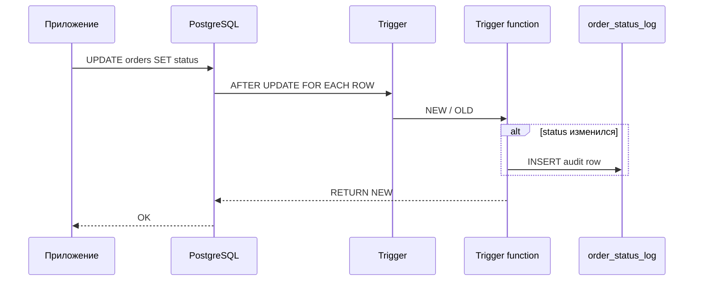
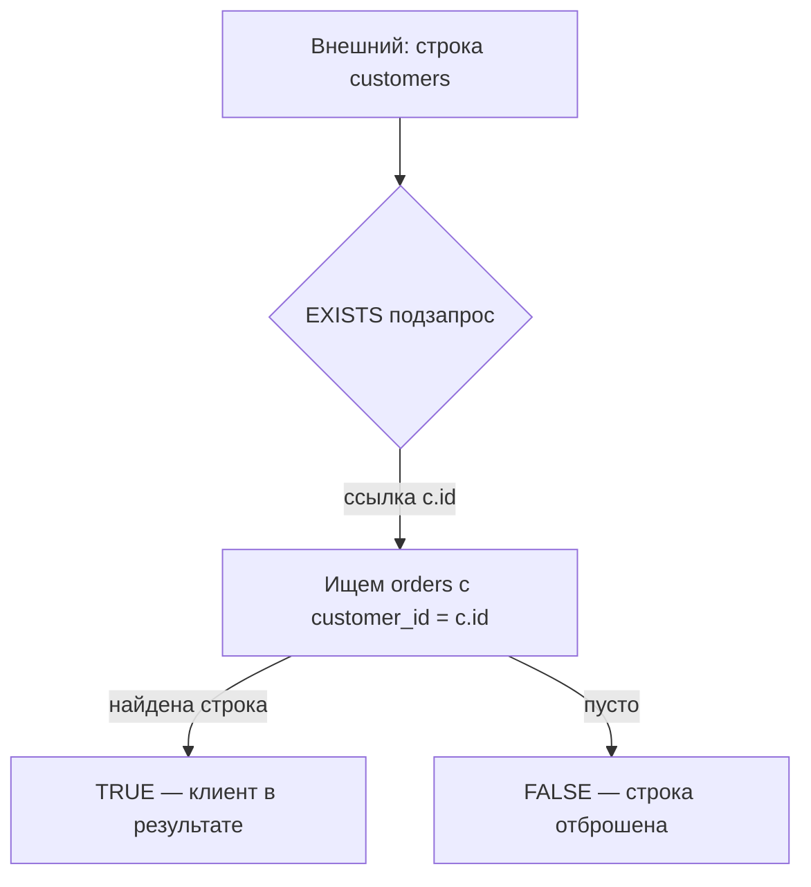

## Введение

После ACID на собесе часто спрашивают: «что такое триггер?» и «какие операторы знаете в SQL?». Это Q24 и Q25 из топ-списка. Ниже — рабочие определения, типичные сценарии в PostgreSQL и ловушки (особенно NULL и приоритет), без зубрёжки чужих формулировок.

**Подзапросы.** Подзапрос — частый способ «запроса внутри запроса» на middle-собесе. Q28 просит определение и виды; Q29 — разницу коррелированного и некоррелированного. Ниже — определения своими словами и живые примеры на схеме заказов в PostgreSQL.

## Раздел: Как отвечать одним блоком

Этот выпуск собрал соседние короткие темы трека: «Триггеры и операторы SQL», «Подзапросы». Раньше каждая занимала отдельную карточку на несколько минут, а на собеседовании их спрашивают одним блоком. Ниже у каждой темы свой раздел, затем общие лабы, один тест и одна колода карточек. В ответе сначала назовите, какую тему спросили, потом определение и один пример. Не проговаривайте все разделы, если спросили один. Лабы можно пройти по порядку исходного трека. Если времени мало, сделайте первую и последнюю: первая ставит язык, последняя проверяет, что соседние темы вы не перепутали.

## Раздел: Триггеры и операторы SQL: Триггеры (Q24)

**Триггер** — именованный обработчик, который СУБД вызывает автоматически при событии на таблице (или представлении): `INSERT`, `UPDATE`, `DELETE`, иногда `TRUNCATE`. Логика лежит в функции (в PostgreSQL — обычно `LANGUAGE plpgsql`), а `CREATE TRIGGER` только связывает событие, момент и функцию.

Ключевые оси ответа на собесе:

| Ось | Что сказать |
|-----|-------------|
| Момент | `BEFORE` / `AFTER` (и `INSTEAD OF` для view) |
| Уровень | `FOR EACH ROW` vs `FOR EACH STATEMENT` |
| Данные | в row-триггере доступны `NEW` и/или `OLD` |
| Условие | `WHEN (...)` — фильтр срабатывания |

Пример каркаса в PostgreSQL:

```sql
CREATE OR REPLACE FUNCTION audit_order_status()
RETURNS trigger AS $$
BEGIN
  IF NEW.status IS DISTINCT FROM OLD.status THEN
    INSERT INTO order_status_log(order_id, old_status, new_status, changed_at)
    VALUES (OLD.id, OLD.status, NEW.status, now());
  END IF;
  RETURN NEW;
END;
$$ LANGUAGE plpgsql;

CREATE TRIGGER trg_orders_status_audit
AFTER UPDATE OF status ON orders
FOR EACH ROW
WHEN (OLD.status IS DISTINCT FROM NEW.status)
EXECUTE FUNCTION audit_order_status();
```

**Когда уместны:** аудит, денормализованные счётчики, запрет «опасных» переходов статуса, синхронизация служебных полей. **Когда вредны:** сложная бизнес-логика «спрятана» от приложения, неочевидные каскады, тяжёлые внешние вызовы внутри триггера — на собесе это признак зрелости: «триггер — последний рубеж целостности, не замена сервиса».

Кратко по диалектам: в MSSQL триггеры опираются на таблицы `inserted`/`deleted`; в MySQL синтаксис ближе к «тело в `CREATE TRIGGER`»; в PostgreSQL почти всегда отдельная функция + `EXECUTE FUNCTION` / `EXECUTE PROCEDURE` (зависит от версии).

## Раздел: Триггеры и операторы SQL: Операторы SQL (Q25)

Группы, которые ждут на middle:

**Сравнение:** `=`, `<>` / `!=`, `<`, `>`, `<=`, `>=`, `BETWEEN`, `IN`, `LIKE` / `ILIKE` (PG), `IS NULL` / `IS NOT NULL`, `IS DISTINCT FROM` (удобно для NULL-safe сравнения в PostgreSQL).

**Логические:** `AND`, `OR`, `NOT`. Приоритет: `NOT` выше `AND`, `AND` выше `OR` — скобки спасают от сюрпризов.

**Арифметика:** `+`, `-`, `*`, `/`, `%` (остаток; в PG также `mod()`). Деление целых в PostgreSQL даёт целое (`5/2 = 2`) — для дроби приводят тип: `5::numeric / 2`.

**Прочее часто всплывает рядом:** конкатенация `||`, операторы множества `UNION` / `INTERSECT` / `EXCEPT`, JSON/array-операторы в PG (`->`, `@>`, `&&`) — упомянуть как «диалектное расширение», если уровень позволяет.

Ловушка NULL: `WHERE col = NULL` никогда не отберёт строки; нужно `IS NULL`. Выражение `NULL OR true` → `true`, `NULL AND true` → `NULL` (в фильтре WHERE это «ложь»). На собесе коротко: «трёхзначная логика».

## Раздел: Триггеры и операторы SQL: Частые вопросы с собеседования

**Вопрос.** Trigger vs application logic?

**Ответ.** Trigger — инвариант и audit на уровне БД, независимо от клиента; сложнее тестировать и версионировать. Бизнес-flow часто в app; audit/compliance — trigger или event outbox.

**Вопрос.** `BEFORE` vs `AFTER` trigger?

**Ответ.** BEFORE может изменить NEW row или отменить операцию; AFTER — side effects после факта (лог, каскад в другую таблицу). ON CONFLICT и FK timing — знать порядок.

**Вопрос.** OR с NULL в WHERE?

**Ответ.** `FALSE OR UNKNOWN` → UNKNOWN — строка отсеивается. Явно обрабатывайте NULL в OR-ветках или используйте `IS DISTINCT FROM` в PostgreSQL для сравнений с NULL.

**Вопрос.** Оператор `||` в SQL?

**Ответ.** В PostgreSQL — конкатенация строк; в стандарте также OR в некоторых контекстах — знать диалект. На собесе MySQL vs PG: CONCAT vs ||.

## Раздел: Подзапросы: Что такое подзапрос (Q28)

**Подзапрос** — SELECT, вложенный в другой SQL-оператор (в `SELECT`, `FROM`, `WHERE`, `HAVING`, иногда в `INSERT`/`UPDATE`). Результат подзапроса используется внешним запросом как значение, набор строк или таблица.

По форме результата:

| Вид | Ожидание | Пример места |
|-----|----------|--------------|
| Скалярный | одна строка, один столбец | `WHERE total > (SELECT avg(total) …)` |
| Список значений | один столбец, N строк | `WHERE id IN (SELECT …)` |
| Таблица (derived) | набор столбцов | `FROM (SELECT …) AS t` |
| Проверка существования | true/false по наличию | `WHERE EXISTS (SELECT 1 …)` |

Правила, которые любят проверять:

- скалярный подзапрос **не должен** вернуть больше одной строки — иначе ошибка;
- `IN` с NULL внутри списка коварен; часто безопаснее `EXISTS`;
- в PostgreSQL подзапрос в `FROM` обязан иметь алиас.

Пример некоррелированного скаляра:

```sql
SELECT id, total
FROM orders
WHERE total > (SELECT avg(total) FROM orders WHERE status = 'paid');
```

Внутренний запрос можно вычислить один раз — он не ссылается на внешнюю строку.

## Раздел: Подзапросы: Correlated vs noncorrelated (Q29)

**Некоррелированный (noncorrelated):** внутренний SELECT независим от текущей строки внешнего запроса. Оптимизатор часто выполняет его один раз (или материализует).

**Коррелированный (correlated):** внутренний запрос ссылается на столбцы внешней таблицы — логически «для каждой внешней строки». Классика — поиск клиентов без заказов или «заказ с максимальной суммой в своей группе».

Пример корреляции через `EXISTS` (предпочтительно для anti-join «есть ли хотя бы одна»):

```sql
-- клиенты, у которых есть хотя бы один paid-заказ
SELECT c.id, c.email
FROM customers c
WHERE EXISTS (
  SELECT 1
  FROM orders o
  WHERE o.customer_id = c.id
    AND o.status = 'paid'
);
```

Пример коррелированного скаляра (на каждый заказ — среднее по тому же клиенту):

```sql
SELECT o.id,
       o.customer_id,
       o.total,
       (SELECT avg(o2.total)
        FROM orders o2
        WHERE o2.customer_id = o.customer_id) AS avg_for_customer
FROM orders o;
```

Anti-join через `NOT EXISTS` (часто читаемее, чем `NOT IN`):

```sql
SELECT c.id
FROM customers c
WHERE NOT EXISTS (
  SELECT 1 FROM orders o WHERE o.customer_id = c.id
);
```

На собесе добавьте: корреляция ≠ всегда медленно — при хорошем индексе по `orders(customer_id)` `EXISTS` отлично работает; зато «подзапрос в SELECT на миллион строк» без нужды лучше заменить JOIN + агрегатом или оконкой (см. SQL13).

Кратко по диалектам: идея одна; синтаксис lateral в PostgreSQL (`JOIN LATERAL`) — явная форма корреляции в `FROM`, удобна, когда подзапрос возвращает несколько столбцов на строку.

## Раздел: Подзапросы: Частые вопросы с собеседования

**Вопрос.** Коррелированный подзапрос всегда медленный?

**Ответ.** Не обязательно: индекс на связке (customer_id) и `EXISTS` могут дать nested loop с одним lookup на строку. Плохо — скаляр в SELECT на миллион строк без нужды; переписать в JOIN или window.

**Вопрос.** Scalar subquery в SELECT — риск?

**Ответ.** Выполняется логически per row; без индекса и уникальности — N оценок. Если subquery не гарантирует одну строку — runtime error; лучше JOIN + aggregation или window.

**Вопрос.** `IN` vs `EXISTS` для больших множеств?

**Ответ.** Semantics близки для положительных проверок; оптимизатор часто переписывает. EXISTS не требует материализовать весь список IN; с NULL в IN предпочтите EXISTS.

**Вопрос.** Подзапрос в FROM (derived table) — зачем?

**Ответ.** Именованный промежуточный результат для второго прохода агрегации/фильтра. В PostgreSQL CTE (SQL13) часто читаемее; derived table — базовый SQL без WITH.

## Лаба

**Триггеры и операторы SQL.**

**Цель.** Создать AFTER UPDATE триггер аудита и набор запросов с операторами сравнения/логики/арифметики.

**Шаги.**
1. В PostgreSQL создайте `orders(id, status text, total numeric)` и `order_status_log(...)`.
2. Реализуйте функцию и триггер, пишущий лог только при смене `status`.
3. Обновите заказ дважды: с той же и с новой статусной меткой — убедитесь, что лог растёт только во втором случае.
4. Напишите `SELECT` с `AND`/`OR`, `BETWEEN`, `IN`, `IS DISTINCT FROM` и арифметикой скидки (`total * 0.9`).
5. Покажите запрос, где без скобок `OR` даёт неожиданный набор, а со скобками — ожидаемый.

**В группу:** партнёр добавляет BEFORE INSERT триггер, который отклоняет `total < 0` через `RAISE EXCEPTION` — вы объясняете, чем BEFORE отличается от AFTER.

**Готово, если…**
- [ ] Объясняете NEW/OLD и BEFORE vs AFTER без шпаргалки
- [ ] Называете минимум три группы операторов с примером
- [ ] Помните про NULL и приоритет AND/OR

**Подзапросы.**

**Цель.** Написать четыре подзапроса: скаляр, IN, EXISTS (correlated), anti-join NOT EXISTS.

**Шаги.**
1. Создайте `customers` и `orders` с 3+ клиентами и заказами в разных статусах (один клиент без заказов).
2. Выберите заказы дороже среднего `total` по всей таблице (noncorrelated).
3. Выберите клиентов, чьи `id` входят в `IN (SELECT customer_id FROM orders WHERE status = 'paid')`.
4. Перепишите пункт 3 через `EXISTS` и сравните планы (`EXPLAIN`).
5. Найдите клиентов без заказов через `NOT EXISTS` и отдельно через `LEFT JOIN … WHERE o.id IS NULL`.

**В группу:** партнёр нарочно делает скалярный подзапрос, возвращающий 2 строки — вы объясняете ошибку и как ограничить (`LIMIT 1` — костыль; лучше агрегат или иная форма).

**Готово, если…**
- [ ] Даёте определение подзапроса и 3 места встраивания
- [ ] На пальцах отличаете correlated от noncorrelated
- [ ] Для «нет дочерних строк» выбираете NOT EXISTS / anti-join, а не слепой NOT IN

## Схема: Триггеры и операторы SQL: Срабатывание row-триггера



## Схема: Подзапросы: Корреляция EXISTS



## Тест

### Чем триггер отличается от обычной хранимой процедуры?

**Ответ:** процедура вызывается явно; триггер — автоматически при DML-событии

**Пояснение:** на собесе важно добавить момент (BEFORE/AFTER) и уровень (ROW/STATEMENT), иначе ответ звучит слишком плоско.

### Что такое подзапрос в одном предложении?

**Ответ:** вложенный SELECT, чей результат использует внешний SQL-оператор

**Пояснение:** уточните вид (скаляр / список / таблица / EXISTS) — так ответ звучит middle, а не junior.

### Почему `WHERE email = NULL` не находит строки?

**Ответ:** сравнение с NULL даёт UNKNOWN, а WHERE пропускает только TRUE

**Пояснение:** корректно писать `email IS NULL`; в PostgreSQL для сравнения «равно с учётом NULL» удобен `IS NOT DISTINCT FROM`.

### Чем коррелированный подзапрос отличается от некоррелированного?

**Ответ:** коррелированный ссылается на столбцы внешней строки и логически зависит от неё

**Пояснение:** некоррелированный можно понять и часто выполнить отдельно; коррелированный — «в контексте» внешней таблицы.

### Что вернёт `5 / 2` в PostgreSQL для типа integer?

**Ответ:** 2

**Пояснение:** целочисленное деление; для дроби приводят к numeric/float.

## Шпаргалка

<ul><li>Событие → момент (BEFORE/AFTER) → уровень (ROW/STATEMENT) → функция</li><li>NEW / OLD; WHEN; аудит и инварианты, не «весь бизнес»</li><li>Сравнение: = &lt;&gt; &lt; &gt; BETWEEN IN LIKE IS NULL</li><li>Логика: NOT &gt; AND &gt; OR; скобки обязательны при сомнении</li><li>Арифметика: + - * / %; смотри типы при делении</li><li>Скаляр / IN-список / derived table / EXISTS</li><li>Noncorrelated — автономен; correlated — ссылка на внешнюю строку</li><li>Алиас обязателен для подзапроса в FROM (PostgreSQL)</li><li>Скаляр ≠ много строк</li></ul>

## Anki

### Front: Что такое SQL-триггер?

Back: Автоматический обработчик DML/DDL-события на объекте БД; в PostgreSQL обычно функция + CREATE TRIGGER

### Front: Q28 — что такое subquery?

Back: SELECT внутри другого оператора; результат — значение, набор или таблица

### Front: Какие три группы операторов ждут в Q25?

Back: Арифметические, логические (AND/OR/NOT), сравнения (=, &lt;&gt;, BETWEEN, IN, LIKE, IS NULL…)

### Front: Q29 — correlated subquery?

Back: Внутренний запрос ссылается на столбцы внешнего; логически per outer row

### Front: Как безопасно сравнить два значения с возможным NULL в PostgreSQL?

Back: IS DISTINCT FROM / IS NOT DISTINCT FROM вместо = / &lt;&gt;

### Front: Клиенты без заказов — какой шаблон?

Back: NOT EXISTS (SELECT 1 FROM orders o WHERE o.customer_id = c.id) или anti-join

## Мнемоника

### acronym: Операторы отбора

**Задание:** Чем сужают строку, кроме равенства.

**Элементы:**
- AND OR NOT
- IN
- BETWEEN
- LIKE

**Подсказка:** LIKE с ведущим % не использует обычный btree так, как равенство.

**Ответ:** AND/OR/NOT, IN, BETWEEN, LIKE

## Итоги

- Триггер — реакция СУБД на событие; называйте момент, уровень и NEW/OLD
- Операторы делятся на арифметику, логику и сравнения; NULL ломает интуицию
- PostgreSQL: функция триггера отдельно; целые делятся нацело; приоритет AND/OR — со скобками
- Подзапрос — вложенный SELECT; важно уметь назвать форму результата
- Noncorrelated независим; correlated завязан на внешнюю строку
- EXISTS / NOT EXISTS — рабочие лошадки; осторожнее с NOT IN и скалярами «на миллион строк»

## Ссылки

- [PostgreSQL: CREATE TRIGGER](https://www.postgresql.org/docs/current/sql-createtrigger.html)
- [PostgreSQL: Operators](https://www.postgresql.org/docs/current/functions-comparison.html)
- [OTUS / Хабр — часть I](https://habr.com/ru/companies/otus/articles/461067/)
- [PostgreSQL: Subquery Expressions](https://www.postgresql.org/docs/current/functions-subquery.html)
- [Select Star SQL](https://selectstarsql.com/)
- [COUNT и даты](/game/learn/sql-agg-dates-count)
