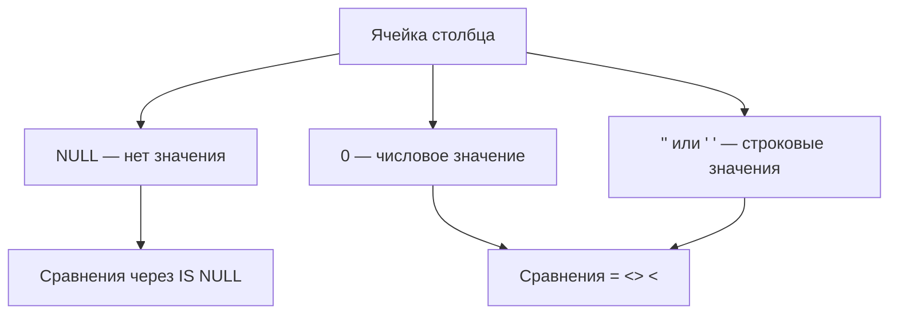

## Введение

Два частых «простых» вопроса: чем `CHAR` отличается от `VARCHAR` и чем `NULL` отличается от нуля и пробела. Ошибки здесь дорогие — неправильные сравнения в `WHERE`, ложные уникальности и раздутые строки фиксированной длины. Разбираем на PostgreSQL с короткими заметками про другие диалекты.

**Индексы basics.** Индекс ускоряет поиск ценой дополнительных структур на запись и места на диске. На junior-собесе ждут определение, разницу clustered/nonclustered и перечень типов. Важно не переносить термины SQL Server на PostgreSQL один в один — модели хранения отличаются.

## Раздел: Как отвечать одним блоком

Этот выпуск собрал соседние короткие темы трека: «CHAR vs VARCHAR и семантика», «Индексы basics». Раньше каждая занимала отдельную карточку на несколько минут, а на собеседовании их спрашивают одним блоком. Ниже у каждой темы свой раздел, затем общие лабы, один тест и одна колода карточек. В ответе сначала назовите, какую тему спросили, потом определение и один пример. Не проговаривайте все разделы, если спросили один. Лабы можно пройти по порядку исходного трека. Если времени мало, сделайте первую и последнюю: первая ставит язык, последняя проверяет, что соседние темы вы не перепутали.

## Раздел: CHAR vs VARCHAR и семантика: CHAR и VARCHAR

Оба типа хранят текстовые строки, но контракт разный.

**CHAR(n)** — строка фиксированной длины n. При записи значение дополняется пробелами справа до n (поведение padding зависит от стандарта и СУБД; в сравнениях пробелы часто игнорируются по правилам SQL).

**VARCHAR(n)** / **CHARACTER VARYING(n)** — строка переменной длины до n символов (в PostgreSQL лимит — в символах, не в байтах для этих типов).

В **PostgreSQL** на практике:
- чаще используют `text` без лимита или `varchar(n)` если нужен явный максимум;
- `char(n)` редко нужен: хранение с padding неудобно, выигрыш минимален;
- пустая строка `''` — это валидное значение типа character, **не** NULL.

В **MySQL** исторически различия CHAR/VARCHAR сильнее связаны с хранением в строках таблиц разных engine; всё равно смысл «фиксированная vs переменная длина» сохраняется.

В **SQL Server** есть `char`/`varchar` и отдельно `nchar`/`nvarchar` (Unicode); плюс `varchar(max)`.

Когда уместен CHAR: коды фиксированной ширины (`country_code char(2)`), если команда осознанно хочет padding. Для имён, email, описаний — `text`/`varchar`.

```sql
CREATE TABLE sql05_codes (
  iso2 char(2) PRIMARY KEY,          -- 'RU'
  label varchar(100) NOT NULL,       -- переменная длина
  comment text                       -- без жёсткого лимита (PG)
);
```

## Раздел: CHAR vs VARCHAR и семантика: NULL, ноль и пробел

**NULL** означает «значение отсутствует / неизвестно». Это не данные, а маркер отсутствия.

Сравнения:
- `0` — число ноль, осмысленное значение;
- `' '` или `''` — строки из пробела / пустая строка, тоже значения;
- `NULL` — нет значения.

Трёхзначная логика SQL: предикаты дают `TRUE`, `FALSE` или `UNKNOWN`. Сравнение с NULL даёт UNKNOWN:

```sql
SELECT 1 = NULL;          -- NULL/unknown
SELECT NULL = NULL;       -- NULL/unknown, не TRUE
SELECT NULL IS NULL;      -- TRUE
SELECT NULL IS NOT NULL;  -- FALSE
```

В `WHERE` строка проходит только при TRUE; UNKNOWN отфильтровывается. Поэтому `WHERE col = NULL` почти никогда не находит «пустые» — нужен `col IS NULL`.

Агрегаты: `COUNT(*)` считает строки; `COUNT(col)` игнорирует NULL в col; `SUM`/`AVG` тоже пропускают NULL.

Пустая строка vs NULL в бизнес-модели: «пользователь не указал отчество» можно моделировать NULL или `''` — важно выбрать одно правило и не смешивать. В PostgreSQL `'' IS NULL` → false.

```sql
-- найти «не задано»
SELECT * FROM users WHERE middle_name IS NULL;

-- пустая строка — другое множество
SELECT * FROM users WHERE middle_name = '';
```

На собесе полезно добавить: в уникальном индексе PostgreSQL несколько NULL допустимы; пустая строка — одна.

## Раздел: CHAR vs VARCHAR и семантика: Частые вопросы с собеседования

**Вопрос.** Почему `NOT IN (subquery)` опасен с NULL?

**Ответ.** Если подзапрос вернул NULL среди значений, результат NOT IN может стать UNKNOWN для всех строк — фильтр «ничего не прошло». Безопаснее `NOT EXISTS` или явная фильтрация NULL в подзапросе.

**Вопрос.** `COUNT(*)` vs `COUNT(column)` на собесе?

**Ответ.** `COUNT(*)` считает строки; `COUNT(col)` игнорирует NULL в col. Для «сколько заполненных email» — COUNT(email); для «сколько строк в таблице» — COUNT(*).

**Вопрос.** NULL в UNIQUE constraint PostgreSQL?

**Ответ.** Несколько строк с NULL в UNIQUE-столбце допустимы — NULL не равен NULL. Пустая строка — одно значение, дубликаты `''` нарушат UNIQUE.

**Вопрос.** `WHERE col = NULL` — почему молчит?

**Ответ.** Сравнение с NULL даёт UNKNOWN, не TRUE; строки не проходят WHERE. Нужен `IS NULL`. Трёхзначная логика — базовый ответ junior SQL.

## Раздел: Индексы basics: Что такое индекс

**Индекс** — вспомогательная структура (чаще всего сбалансированное дерево), которая хранит упорядоченные ключи и указатели на строки таблицы (или включает нужные поля целиком).

Зачем:
- быстро находить строки по равенству и диапазону (`WHERE id =`, `WHERE created_at BETWEEN`);
- поддерживать уникальность (`UNIQUE INDEX` / ограничения PK/UK);
- иногда отдавать результат без обращения к heap (covering / index-only scan в PG при видимости по visibility map).

Цена:
- замедление `INSERT`/`UPDATE`/`DELETE` — нужно обновлять индекс;
- место на диске;
- риск «лишних» индексов, которые не используются планировщиком.

```sql
CREATE INDEX idx_orders_user_id ON orders (user_id);
CREATE UNIQUE INDEX idx_users_email ON users (email);
-- частичный индекс (PostgreSQL)
CREATE INDEX idx_orders_open ON orders (created_at) WHERE status = 'new';
```

Планировщик решает, читать индекс или seq scan: при малой таблице полный скан часто дешевле.

## Раздел: Индексы basics: Clustered и nonclustered

Термины классически из **SQL Server / ряд учебных курсов**:

**Clustered index** задаёт физический порядок строк в структуре таблицы: данные «лежат в индексе». На таблицу обычно один clustered (часто на PK). Поиск по ключу кластера быстро находит страницу данных.

**Nonclustered index** — отдельная структура: ключ индекса + указатель на строку (RID или ключ кластера). Таких индексов много. Чтобы получить остальные столбцы, движок делает lookup в основную структуру.

**Как это выглядит в PostgreSQL:**
- таблицы по умолчанию — **heap** (неупорядоченное хранилище строк);
- вторичные индексы (по умолчанию **B-tree**) хранят ключ + `tid` (указатель на версию строки в heap);
- отдельного «clustered index» как обязательной организации таблицы, как в SQL Server, **нет**;
- команда `CLUSTER` один раз переписывает heap в порядке индекса, но порядок **не поддерживается** автоматически при дальнейших записях;
- `INDEX … INCLUDE` и index-only scan частично закрывают сценарии covering.

На собесе хороший ответ: «В SQL Server кластерный индекс часто определяет физический layout; в PostgreSQL индекс — отдельная структура над heap, а CLUSTER — разовое упорядочивание».

## Раздел: Индексы basics: Типы индексов

Обзор с привязкой к PostgreSQL:

| Тип | Когда полезен |
|-----|----------------|
| **B-tree** | Равенство и диапазоны, сортировка, PK/UK — основной тип по умолчанию |
| **Hash** | В PG ограниченные сценарии равенства; реже нужен вручную |
| **GiST / SP-GiST** | Геометрия, диапазоны, полнотекстные/нестандартные ключи |
| **GIN** | Массивы, jsonb, полнотекст — много значений на строку |
| **BRIN** | Очень большие таблицы с физически коррелированными значениями (время) |

В **SQL Server** в разговоре про типы часто звучат clustered/nonclustered, unique/nonunique, filtered, columnstore — другая таксономия поверх storage engine.

Практические правила junior-уровня:
1. индекс под реальные `WHERE`/`JOIN`/`ORDER BY`, не «на все столбцы»;
2. селективность важна: индекс по `boolean is_active` часто бесполезен без условия/частичности;
3. составной индекс: порядок столбцов = порядок отбора (`(user_id, created_at)` ≠ `(created_at, user_id)` для разных запросов);
4. смотреть план (`EXPLAIN` / `EXPLAIN ANALYZE`) — тема следующих выпусков серии.

## Раздел: Индексы basics: Частые вопросы с собеседования

**Вопрос.** Когда индекс не поможет?

**Ответ.** Малая таблица (seq scan дешевле), низкая селективность (`WHERE is_active` без условия), функция на столбце без expression index (`WHERE lower(email)`), несовпадение порядка составного индекса с запросом, OR по разным столбцам без union trick.

**Вопрос.** Зачем partial index в PostgreSQL?

**Ответ.** Индекс только на подмножестве строк (`WHERE status = 'open'`) — меньше размер и быстрее обслуживание для частых запросов к «открытым» заказам. На собесе показывает знание PG beyond generic B-tree.

**Вопрос.** Составной индекс `(a, b)` — запрос только по `b`?

**Ответ.** Обычно индекс не используется для фильтра только по второму столбцу — нужен leading column `a` или отдельный индекс на `b`. Исключения — index-only scan и специфика плана.

**Вопрос.** Цена индекса на INSERT?

**Ответ.** Каждая вставка/обновление ключей поддерживает B-tree (и другие структуры) — дополнительный I/O и WAL. Лишние индексы замедляют write-heavy OLTP.

## Лаба

**CHAR vs VARCHAR и семантика.**

**Цель.** Наглядно увидеть padding/длину CHAR/VARCHAR и поведение NULL в фильтрах и агрегатах.

**Шаги.**
1. Создайте таблицу `sql05_demo(a char(5), b varchar(5), c int)`.
2. Вставьте строки: `('x','x',0)`, `('x','x',NULL)`, `('', '', NULL)` — если СУБД позволит по длине.
3. Выполните `WHERE c = NULL`, `WHERE c IS NULL`, `WHERE c = 0` — сравните результаты.
4. Посчитайте `COUNT(*)`, `COUNT(c)`, `SUM(c)` по таблице.
5. В PostgreSQL сравните `length(a)` и `length(b)` / `trim` для CHAR — обсудите padding.

**В группу:** партнёр загадывает «нет значения», «ноль», «пробел» — вы пишете предикат.

**Готово, если…**
- [ ] Объясняете CHAR vs VARCHAR без путаницы с NULL
- [ ] Никогда не пишете `= NULL` для поиска пустых
- [ ] Отличаете 0, '', ' ' и NULL на примере

**Индексы basics.**

**Цель.** Создать индекс под JOIN/фильтр и сравнить план до/после на учебной таблице.

**Шаги.**
1. Создайте `sql06_events(id bigserial, user_id bigint, created_at timestamptz, payload text)` и вставьте заметный объём (тысячи строк скриптом).
2. Выполните `EXPLAIN ANALYZE SELECT * FROM sql06_events WHERE user_id = 42;` без индекса — зафиксируйте Seq Scan.
3. Создайте `CREATE INDEX ON sql06_events (user_id);` и повторите план — ожидайте Index Scan / Bitmap Index Scan.
4. Добавьте составной `(user_id, created_at)` и запрос с диапазоном дат для одного user_id.
5. Кратко запишите 3 пункта: выгода, цена на INSERT, отличие PG heap от clustered в SQL Server.

**В группу:** один предлагает «давайте clustered index на email как в SQL Server» — второй объясняет, как сказать это корректно для PostgreSQL.

**Готово, если…**
- [ ] Определяете индекс и его trade-off за 30 секунд
- [ ] Не путаете clustered SQL Server с индексами PostgreSQL
- [ ] Называете B-tree как основной тип и по одному примеру GiST/GIN

## Схема: CHAR vs VARCHAR и семантика: Значение vs отсутствие



## Схема: Индексы basics: Поиск через индекс


## Тест

### Чем VARCHAR(10) отличается от CHAR(10)?

**Ответ:** переменная vs фиксированная длина

**Пояснение:** CHAR дополняет пробелами; в PostgreSQL для текста чаще text/varchar.

### Зачем нужен индекс, если можно Seq Scan?

**Ответ:** селективный поиск быстрее

**Пояснение:** на маленьких таблицах Seq Scan может быть дешевле; решает планировщик по статистике.

### Почему WHERE age = NULL не находит строки без возраста?

**Ответ:** сравнение с NULL даёт UNKNOWN, а WHERE пропускает только TRUE; нужен IS NULL

**Пояснение:** NULL — не обычное значение, а маркер отсутствия.

### Есть ли в PostgreSQL clustered index как в SQL Server?

**Ответ:** нет прямой аналогии; по умолчанию heap + вторичные индексы, CLUSTER лишь разово упорядочивает

**Пояснение:** путать термины диалектов — частая ошибка на собесе.

### NULL и 0 — одно и то же?

**Ответ:** нет, разная семантика

**Пояснение:** SUM и бизнес-логика трактуют их по-разному; путать нельзя.

## Шпаргалка

<ul><li><b>CHAR(n)</b> — фиксированная длина</li><li><b>VARCHAR(n)</b> — переменная до n</li><li>В PG часто <b>text</b> без лимита</li><li>NULL ≠ 0 ≠ '' ≠ ' '</li><li>Проверка: <code>IS NULL</code> / <code>IS NOT NULL</code></li><li><code>COUNT(col)</code> пропускает NULL</li><li>Индекс ускоряет чтение, замедляет запись, занимает место</li><li>PG: heap + B-tree (и другие access methods)</li><li>SQL Server: clustered часто = организация данных таблицы</li><li>B-tree · Hash · GiST · SP-GiST · GIN · BRIN</li></ul>

## Anki

### Front: Когда уместен CHAR(n)?

Back: Для кодов фиксированной ширины; для обычного текста обычно varchar/text

### Front: Что такое индекс в СУБД?

Back: Вспомогательная структура для ускорения поиска по ключу ценой накладных расходов на изменение данных

### Front: Как найти строки с неизвестным значением столбца?

Back: Предикатом IS NULL, не через = NULL

### Front: Clustered vs nonclustered в классическом смысле?

Back: Clustered определяет порядок/организацию данных таблицы (обычно один); nonclustered — отдельная структура с указателями на строки

### Front: Чем пустая строка отличается от NULL?

Back: '' — значение нулевой длины; NULL — отсутствие значения; сравнения и уникальность ведут себя иначе

### Front: Чем PostgreSQL отличается в теме «кластерный индекс»?

Back: Таблица — heap; индексы вторичные; CLUSTER не поддерживает порядок автоматически как clustered index в SQL Server

## Мнемоника

### keyword: NULL

**Задание:** NULL — не ноль и не пустая строка.

**Элементы:**
- NULL
- неизвестно

**Подсказка:** Сравнение с NULL через = даёт не истину, а unknown. Берут IS NULL.

**Ответ:** NULL = неизвестно, не ноль

## Итоги

- CHAR фиксирует ширину, VARCHAR — переменная длина; в PostgreSQL text — рабочая лошадка
- NULL — отдельная семантика, не «ноль» и не «пробел»
- Трёхзначная логика объясняет половину багов в WHERE и JOIN
- Индекс — инструмент под конкретные запросы, не серебряная пуля
- B-tree закрывает большинство junior-сценариев в PostgreSQL
- Clustered/nonclustered рассказывайте с пометкой диалекта — иначе ответ засчитывают как путаницу

## Ссылки

- [PostgreSQL: Character Types](https://www.postgresql.org/docs/current/datatype-character.html)
- [PostgreSQL: NULL](https://www.postgresql.org/docs/current/functions-comparison.html)
- [OTUS / Хабр — часть I](https://habr.com/ru/companies/otus/articles/461067/)
- [PostgreSQL: Indexes](https://www.postgresql.org/docs/current/indexes.html)
- [Use The Index, Luke!](https://use-the-index-luke.com/)
- [Нормализация и денормализация](/game/learn/sql-normalization)
