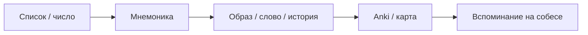

## Введение

На собеседовании часто просят воспроизвести список (ACID, OSI, уровни тестов) или число (порт, RFC). Anki и карта знаний у нас уже есть — они отвечают за **повторение**. Этот выпуск про **кодирование**: как превратить сухой список в образ, слово или историю, чтобы его вообще было что повторять. Дальше открывайте плашку «Мнемотехники» или раздел ниже.

## Раздел: Как отвечать одним блоком

Этот выпуск собрал соседние короткие темы трека: «Мнемотехники». Раньше каждая занимала отдельную карточку на несколько минут, а на собеседовании их спрашивают одним блоком. Ниже у каждой темы свой раздел, затем общие лабы, один тест и одна колода карточек. В ответе сначала назовите, какую тему спросили, потом определение и один пример. Не проговаривайте все разделы, если спросили один. Лабы можно пройти по порядку исходного трека. Если времени мало, сделайте первую и последнюю: первая ставит язык, последняя проверяет, что соседние темы вы не перепутали.

## Раздел: Мнемотехники: Пять техник первой волны

1. **Акроним** — первые буквы складываются в слово (ACID, SOLID).
2. **Акростих** — буквы дают фразу (Please Do Not Throw Sausage Pizza Away).
3. **Чанкинг** — длинную строку режем на группы (54-32, IP-октеты).
4. **Цепочка / link** — элементы связываем историей в нужном порядке.
5. **Крючки / peg** — номер 1…N уже имеет образ; на него «вешаем» элемент списка.

Дополнительно (без отдельного движка в v1): дворец памяти, major system для цифр, keyword для чужих терминов. Spaced repetition не дублируем — это Anki.

## Раздел: Мнемотехники: Как пользоваться на 9to18

- В статье Learn добавьте раздел `## Мнемоника` с дриллами.
- Плашка `/game/mnemonics` собирает дриллы из всех опубликованных выпусков.
- На карте знаний лист с `{learn:slug}` показывает дриллы связанной статьи.

## Раздел: Как кодировать список до карточки

Мнемотехника нужна до карточки, а не вместо неё. Карточка Anki спрашивает то, что уже один раз было закодировано. Если список ACID впервые видите на карточке, мозг держит четыре буквы как шум. Если сначала сложили слово или короткую сцену, карточка только возвращает эту сцену.

Акроним берите, когда буквы сами складываются в произносимое слово. ACID, SOLID, CRUD — готовые примеры. Не выдумывайте акроним из десяти согласных: его труднее вспомнить, чем исходный список. Если слово не получается, переходите к акростиху: каждая буква начинает слово фразы. Фраза должна быть чуть нелепой. Гладкая канцелярская фраза забывается так же, как определение из учебника.

Чанкинг режет то, что нельзя свернуть в слово: порт, маску, номер RFC, длинный идентификатор ошибки. Группы по две-четыре цифры совпадают с тем, как человек и так читает телефон. На собеседовании полезно проговорить группы вслух один раз, прежде чем писать на доске. Цепочка нужна, когда важен порядок, а не набор. Уровни OSI или стадии транзакции связывайте историей, где каждый следующий кадр физически вытекает из предыдущего: провод, кадр, пакет, сегмент. Если история переставится, вы заметите это по сюжету, а не по номеру пункта.

Крючки закрывают списки фиксированной длины. Номер один навсегда связан с одним образом, номер два — с другим. На крючок вешаете элемент сегодняшнего списка. Завтра другой список вешается на те же крючки, старый при этом не обязан остаться: крючок — это полка, не архив. Дворец памяти — та же идея, только полки расставлены по знакомой комнате. Для собеседования хватает пяти крючков. Дворец на двадцать мест имеет смысл, только если список и правда длинный и его спросят целиком.

Как выбрать технику за минуту до ответа. Если в списке три-пять известных букв — акроним. Если порядок жесткий и элементов больше пяти — цепочка или дворец из нескольких точек. Если спрашивают число — чанк, не история. Если термин чужого языка — keyword: созвучное русское слово и картинка, а потом уже точный термин. Не кодируйте то, что и так понимаете на примере. Кодируйте то, что иначе вываливается из памяти под стрессом: классификацию, порядок, порт, расшифровку.

Проверка, что код работает. Закройте конспект и произнесите список вслух. Потом объясните каждый пункт своими словами, не буквами. Если буквы есть, а смысла нет, акроним сыграл против вас: на собеседовании раскроют каждую букву. Добавьте к букве одно конкретное предложение. Для ACID это не «буква I — isolation», а «параллельные транзакции не видят чужой незафиксированный результат». Карточка Anki должна спрашивать это предложение, а не только букву.

На этой площадке дриллы из раздела «Мнемоника» собираются на отдельный тренажёр, а карточки Anki остаются в выпуске. Сначала код, потом карточка, потом повтор через день. Пять техник не нужно применять все к одному списку. Одна техника на один список, и сразу проверка вслух.

## Раздел: Формулировки из исходных выпусков

Мнемотехники. Вопрос «Чем мнемоника отличается от Anki?»: мнемоника кодирует материал в образ; Anki планирует повторения. без кодирования карточка — просто текст; без SRS образ забывается.

Мнемотехники. Вопрос «Какая техника лучше для нумерованного списка из 7 пунктов?»: система крючков (peg) или дворец памяти. у каждого номера уже есть «гвоздь», на который вешается элемент.

Мнемотехники. Вопрос «Что такое чанкинг?»: разбиение длинной строки на короткие группы. рабочая память держит ~4±1 чанка, не произвольную длину.

Мнемотехники. Карточка «Мнемоника vs SRS?» — мнемоника = кодирование в образ; SRS/Anki = расписание повторений.

Мнемотехники. Карточка «Peg system одним предложением» — у каждого числа есть заранее выученный образ-крючок; элемент списка «вешается» на крючок.

Мнемотехники. Карточка «Пример акростиха для OSI» — Please Do Not Throw Sausage Pizza Away (Physical…Application).

## Раздел: Границы соседних тем

Блок «Как отвечать одним блоком» отвечает на отдельный вопрос билета. Сначала назовите границу: когда приём уместен и какой соседний приём берут вместо него. Потом дайте один пример из лабы этого выпуска, без пересказа всего раздела. Если пример не вспоминается, вернитесь к шпаргалке и закройте только этот блок, не весь трек.

Блок «Мнемотехники: Пять техник первой волны» отвечает на отдельный вопрос билета. Сначала назовите границу: когда приём уместен и какой соседний приём берут вместо него. Потом дайте один пример из лабы этого выпуска, без пересказа всего раздела. Если пример не вспоминается, вернитесь к шпаргалке и закройте только этот блок, не весь трек.

Блок «Мнемотехники: Как пользоваться на 9to18» отвечает на отдельный вопрос билета. Сначала назовите границу: когда приём уместен и какой соседний приём берут вместо него. Потом дайте один пример из лабы этого выпуска, без пересказа всего раздела. Если пример не вспоминается, вернитесь к шпаргалке и закройте только этот блок, не весь трек.

Блок «Как кодировать список до карточки» отвечает на отдельный вопрос билета. Сначала назовите границу: когда приём уместен и какой соседний приём берут вместо него. Потом дайте один пример из лабы этого выпуска, без пересказа всего раздела. Если пример не вспоминается, вернитесь к шпаргалке и закройте только этот блок, не весь трек.

Блок «Формулировки из исходных выпусков» отвечает на отдельный вопрос билета. Сначала назовите границу: когда приём уместен и какой соседний приём берут вместо него. Потом дайте один пример из лабы этого выпуска, без пересказа всего раздела. Если пример не вспоминается, вернитесь к шпаргалке и закройте только этот блок, не весь трек.

## Лаба

**Мнемотехники.**

**Цель.** Закодировать один список из своей будущей собес-темы.

**Шаги.**
1. Выберите список из 4–7 элементов (свой или ACID/OSI из дриллов ниже).
2. Примените одну технику: акроним *или* цепочку *или* крючки.
3. Через 10 минут без подглядывания восстановите список вслух.
4. Занесите пару «вопрос → ответ» в Anki статьи (если ещё нет).

**В группу:** ваша фраза/акроним и список.

**Готово, если…**
- [ ] Список восстановлен без шпаргалки
- [ ] Понятно, какая техника сработала и почему

## Схема: Мнемотехники: Кодирование → повторение

## Тест

### Чем мнемоника отличается от Anki?

**Ответ:** мнемоника кодирует материал в образ; Anki планирует повторения

**Пояснение:** без кодирования карточка — просто текст; без SRS образ забывается.

### Какая техника лучше для нумерованного списка из 7 пунктов?

**Ответ:** система крючков (peg) или дворец памяти

**Пояснение:** у каждого номера уже есть «гвоздь», на который вешается элемент.

### Что такое чанкинг?

**Ответ:** разбиение длинной строки на короткие группы

**Пояснение:** рабочая память держит ~4±1 чанка, не произвольную длину.

### Когда акроним хуже исходного списка?

**Ответ:** когда слово не произносится

**Пояснение:** Набор согласных запоминается хуже, чем сам перечень. Тогда берут акростих или цепочку.

### Что спрашивать у карточки Anki после акронима?

**Ответ:** смысл каждой буквы

**Пояснение:** Буква без предложения не считается ответом на собеседовании.

## Шпаргалка

<ul><li><b>Акроним</b> — фиксированный короткий список с удобными буквами</li><li><b>Акростих</b> — буквы не складываются в слово</li><li><b>Чанкинг</b> — порты, UUID, команды, номера</li><li><b>Цепочка</b> — порядок шагов / pipeline</li><li><b>Крючки</b> — нумерованные списки 5–12 пунктов</li></ul>

## Anki

### Front: Мнемоника vs SRS?

Back: мнемоника = кодирование в образ; SRS/Anki = расписание повторений

### Front: Peg system одним предложением

Back: у каждого числа есть заранее выученный образ-крючок; элемент списка «вешается» на крючок

### Front: Пример акростиха для OSI

Back: Please Do Not Throw Sausage Pizza Away (Physical…Application)

### Front: Акроним или цепочка для порядка стадий?

Back: Цепочка: сюжет ломается, если порядок перепутан.

### Front: Чанкинг для чего?

Back: Для чисел и длинных кодов, которые не сворачиваются в слово.

### Front: Сколько техник на один список?

Back: Одну. Вторую добавляют, только если первая не вспоминается вслух.

## Мнемоника

### acronym: Выбор приёма

**Задание:** Какой приём под какой список. Один список — один приём.

**Элементы:**
- Акроним для букв
- Цепочка для порядка
- Чанк для числа
- Крючок для короткого перечня

**Подсказка:** Буква без предложения не считается ответом.

**Ответ:** acronym, link, chunk, peg

## Итоги

- Кодирование и повторение — разные навыки; на 9to18 для них разные инструменты
- Пять техник покрывают списки, числа и порядок шагов на большинстве собесов
- Дриллы живут в статьях Learn и поднимаются на плашку и карту

## Ссылки

- [Тренажёр](/game/mnemonics)
- [Карта обучения](/game/learning-map)
- [Learn](/game/learn)
